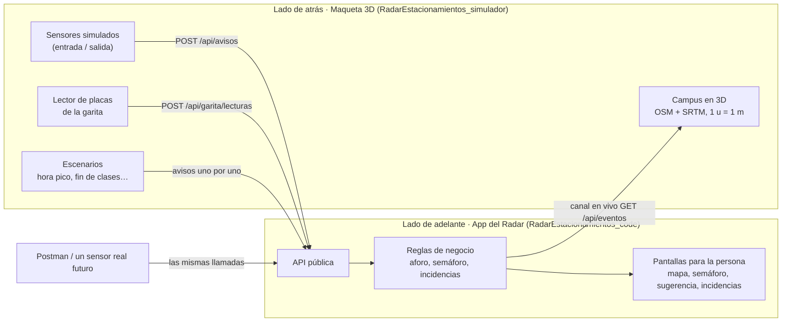

# Arquitectura dual: la app del Radar y la maqueta 3D del campus

**Estado:** 🟢 Vigente — especificación del 27/oct/26. La decisión está en
[D-006](decisiones/D-006-arquitectura-dual-app-y-maqueta-3d.md).

## En una frase

El proyecto tiene **dos sistemas**. Uno es **la app** (el Radar de Estacionamientos), que es el
producto para la comunidad UCAB. El otro es **la maqueta 3D del Campus Montalbán**, que hace de
"mundo real" simulado y le manda a la app las mismas señales que le mandarían los sensores y
la garita.

## Por qué son dos

- La UCAB no dio acceso a sensores ni al lector de placas (restricción del Brief y
  [D-002](decisiones/D-002-deteccion-simulada.md)). Sin señales no hay radar que mostrar.
- Si la simulación viviera dentro de la app, la app quedaría "hecha para la demo". Separada,
  la app **no sabe que la maqueta existe**: recibe las señales por la misma puerta por la que
  entrarían las reales. El día que haya sensores de verdad, se apaga la maqueta y la app no
  cambia.
- Sirve para la defensa: en la maqueta se ve un carro entrar por la garita y en la app baja el
  número de puestos libres al mismo tiempo.

## Sistema 1 · La app del Radar (lado de adelante)

**Qué es:** la aplicación web (solo navegador, restricción del Brief) que usan estudiantes,
profesores, vigilancia y administración.

**Para quién y qué hace:** las historias del Brief. Ver/consultar los estacionamientos en el
mapa, semáforo de ocupación, sugerencia del más cercano, notificaciones, incidencias (CRUD) y
administración de estacionamientos.

**Lo que tiene que cumplir para la persona.** Muy interactiva y con buen diseño de uso; las
reglas obligatorias están en ⭐ D-007 (`DESIGN.md`) y ⭐ D-008 (PWA). Cada punto apunta a los rangos de calidad del Brief:

| Lo que se busca | Cómo se nota | Rango de calidad del Brief → ISO 25010 |
|---|---|---|
| Se entiende de un vistazo | Colores del semáforo, números grandes, lenguaje del campus («la Playa», «Sambilito») | Capacidad de interacción → auto-descriptividad |
| Responde al instante | El mapa cambia solo cuando entra o sale un carro, sin recargar | Eficiencia de desempeño → comportamiento temporal |
| Se usa con una mano en el carro | Pensada primero para el celular: botones grandes, pocos toques para reportar | Capacidad de interacción → operabilidad |
| Evita errores | Formularios con listas cerradas (tipo de incidencia, estacionamiento); desde el mapa, el estacionamiento llega ya elegido | Capacidad de interacción → protección contra errores de usuario |
| No se cae si falla un sensor | Ese estacionamiento sale «sin datos» y el resto sigue | Fiabilidad → tolerancia a fallos |
| Cada quien ve lo suyo | Las placas solo las ven su dueño y el personal autorizado | Seguridad → confidencialidad |

> La redacción de los 4 RNF medibles va en el ERS (Segunda Entrega). Esta tabla no los
> reemplaza: solo dice a qué rango de calidad apunta cada rasgo del diseño.

**Dónde está:** `RadarEstacionamientos_code/` (Next.js). Su API pública está en el README de esa
carpeta.

## Sistema 2 · La maqueta 3D del campus (lado de atrás)

**Qué es:** un mundo virtual en 3D del Campus Montalbán con medidas reales: contorno, edificios
y vías de OpenStreetMap, y relieve SRTM de la NASA. Mide ~930 m × 610 m, la garita está en la
Av. Teherán y el terreno va de ~920 a ~975 m s. n. m.

**Qué hace:** produce las señales del mundo real y se las manda a la app.

| Señal | En la vida real la daría… | Llamada a la app | HU que la recibe |
|---|---|---|---|
| Un carro entra o sale de un estacionamiento | El sensor del acceso | `POST /api/avisos` | 3.1 y 4.1 |
| Se lee una placa al pasar la talanquera | El lector de placas de la garita | `POST /api/garita/lecturas` | 3.2 |
| Un conductor reporta un problema | Una persona en la app | `POST /api/incidencias` | 9.1 |
| El administrador cambia capacidad o cierra un estacionamiento | Planta Física en la app | `PATCH /api/estacionamientos/:id` | 5.4 |
| Hora pico (10:00 a.m.), fin de clases (2:00 p.m.), llenar, vaciar | Muchos sensores a la vez | Avisos uno por uno | 3.3 (R2) |

Además **dibuja lo que pasa en la app**: escucha el canal en vivo (`GET /api/eventos`) y pinta
cada estacionamiento con su semáforo, las incidencias donde ocurren y los estacionamientos
cerrados con conos.

**Dónde está:** `RadarEstacionamientos_simulador/` (Next.js + Three.js, puerto 3001), con
capturas, pruebas (`npm test`) y una colección de Postman.

### La maqueta también le da su imagen a la app

La pantalla de inicio de la app es una **maqueta del campus vista desde arriba** (D-007). Esa
imagen la produce el simulador en su página `/maqueta`: fotografía la escena 3D con estilo de
maqueta física y exporta `campus.jpg` y la proyección (`maqueta.json`), que se copian a
`RadarEstacionamientos_code/front/public/maqueta/` y `back/datos_del_campus/`. Es un **archivo**, no código: la app no
importa nada del simulador ni lo necesita corriendo.

## El contrato entre los dos

1. **Una sola puerta.** La maqueta solo usa la API pública de la app, como lo haría Postman,
   un sensor o una persona. No importa código de la app ni toca sus datos.
2. **La app no sabe que la maqueta existe.** No hay rutas ni código "para el simulador". Si la
   maqueta necesita algo, tiene que ser una API que también le serviría a un sensor real.
3. **Nada se fija a mano.** Un escenario manda los avisos uno por uno, y es la app la que aplica
   sus reglas (aforo, semáforo).
4. **La clave de sensores no llega al navegador.** La maqueta la agrega en su servidor
   (`app/api/base/[...ruta]`).
5. **Sin datos reales.** Las placas de la maqueta son al azar. Nada de placas ni correos reales
   en el repositorio.

## Cómo encaja con lo que pide la profesora

- **Brief:** la restricción «los sensores de los accesos y el lector de placas de la garita se
  simulan por software» es exactamente la maqueta. No hace falta cambiar el Brief.
- **Backlog:** la maqueta es la HU 3.2 «Simular sensores y placas» (épica Registro de entradas y
  salidas) y, en R2, la 3.3 de escenarios. No es una épica nueva.
- **ERS (Segunda Entrega):** la maqueta no es una historia de usuario de la persona. En el ERS
  se especifican las HU de la app. Si el equipo quiere un RNF sobre la integración, el apartado
  es **Compatibilidad → interoperabilidad** (la app recibe avisos de sensores por su API).
  Pero los 4 RNF que se califican salen de los **rangos de calidad del Brief**.
- **Arquitectura (Unidades 12 a 16, Cuarta Entrega):** el lado de atrás y el de adelante son un
  ejemplo directo de componentes separados que se comunican por una interfaz pública.

## Qué falta

- [ ] Fusionar la rama `hu-3.2-mapa-3d-campus` a `main` (hoy la maqueta solo está en esa rama).
- [ ] Que Aaron, responsable de las HU 3.1, 3.2, 4.1 y 4.2, la revise y la tome como suya
      o la comparta.
- [ ] Confirmar en la visita al campus los pisos estimados de los edificios y dibujar el
      Rectorado y el Centro de Estudiantes, que no están en OSM.
- [ ] Decidir si la maqueta se muestra en la defensa del Sprint 1 (Tercera Entrega, 10–12/nov).
