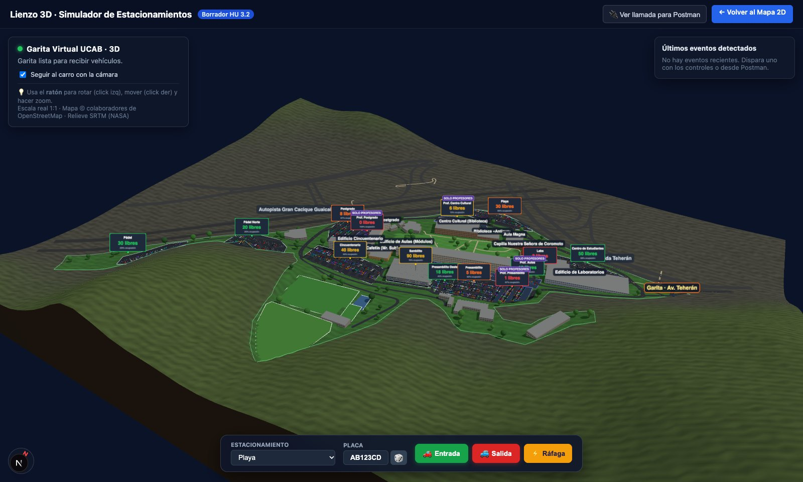
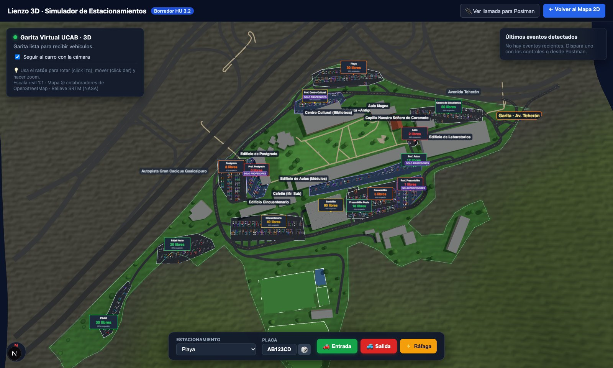
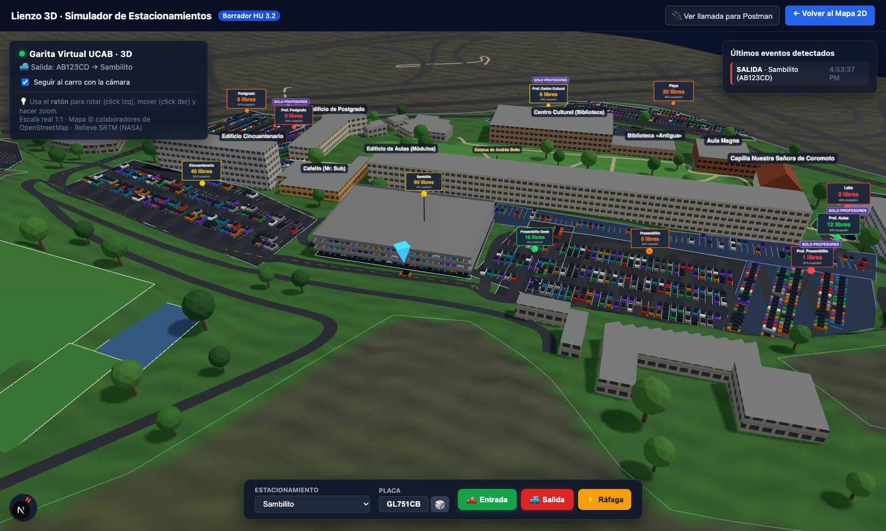
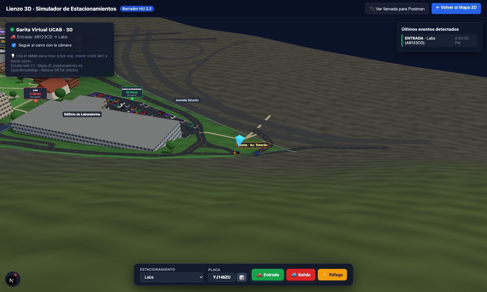
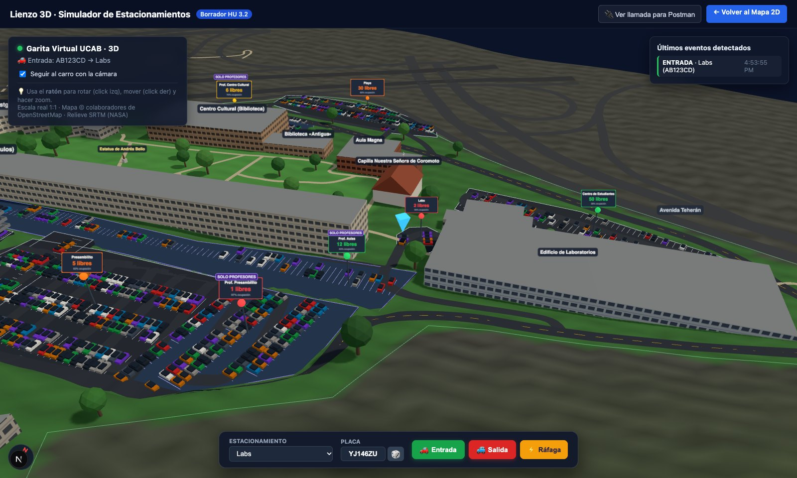

# Maqueta 3D del Campus Montalbán (HU 3.2)

Maqueta del campus de la UCAB Montalbán con **dimensiones reales** (1 unidad = 1 metro).
Muestra los 14 estacionamientos con su semáforo de ocupación y anima cada entrada y salida
que llega a la garita, simulada o desde Postman.

## Cómo abrirla

```bash
cd RadarEstacionamientos_code
npm install
npm run dev
```

Abre <http://localhost:3000/simulacion> o el botón **🎮 Lienzo 3D (Simulador)** del mapa 2D.

- **Ratón:** clic izquierdo para rotar, clic derecho para mover y la rueda para el zoom.
- **Controles de abajo:** eligen el estacionamiento y disparan **Entrada**, **Salida** o
  **Ráfaga** (hora pico). La misma llamada funciona desde Postman: `POST /api/simulacion/evento`.

## Cómo se ve

**Vista general** (desde el sureste). El terreno sube hacia las canchas del sur; la garita
está en la esquina noreste, sobre la Av. Teherán.



**Vista cenital con el norte arriba.** Se puede comparar con el mapa 2D: Playa al norte,
Postgrado al oeste, Pádel al suroeste.



**Sambilito:** edificio de 3 pisos con columnas. El carro con el marcador azul está saliendo.



**Garita de la Av. Teherán.** El carro llega por la avenida, espera a que suba la talanquera
y entra.



**Llegada a Labs.** El cartel baja de puestos libres cuando el carro se estaciona.



## De dónde salen los datos

| Qué | Archivo | Fuente |
|---|---|---|
| 14 estacionamientos | `data/estacionamientos.js` | Satelital, OpenStreetMap y lo que marcó German |
| Contorno, edificios, vías, canchas, garita | `data/campus.js` | OpenStreetMap (relación 3644537) |
| Relieve | `data/campus.js` (`RELIEVE`) | SRTM 30 m (NASA) |

Medidas reales del campus: **~930 m de este a oeste × 610 m de norte a sur (~20 ha)**. Va de
~920 m s. n. m. (Playa, junto a la autopista) a ~975 m (canchas del sur).

**Qué es estimado** (por confirmar en la visita al campus):

- Los pisos de los edificios que OSM no trae (campo `fuentePisos: "estimado"`).
- El Edificio de Aulas: OSM dice 12 pisos y se dibujan 5.
- Los árboles: son decorativos.
- El Rectorado y el Centro de Estudiantes: no aparecen en OSM, así que todavía no se dibujan.

## Código

- `components/Mapa3D.js`: la escena (Three.js).
- `lib/mapa3d/geo.js`: conversión GPS → metros, relieve, polígonos y puestos.
- `lib/mapa3d/rutas.js`: rutas del carro por las vías reales, respetando los sentidos únicos.
- `tests/mapa3d.test.js`: distancias, orientación y rutas (`npm test`).

Mapa © colaboradores de OpenStreetMap (ODbL). Relieve: SRTM, NASA.
