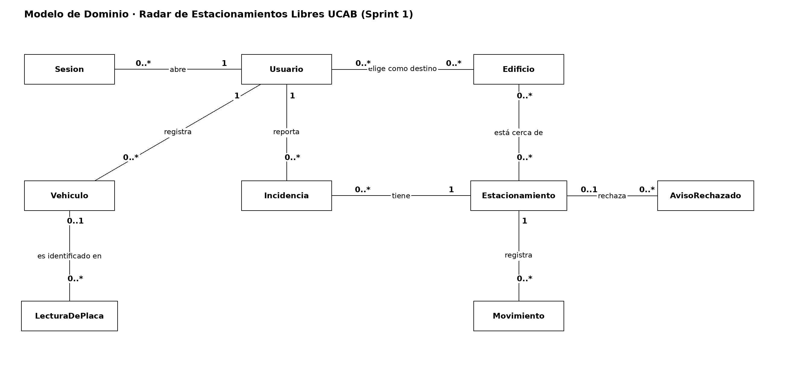
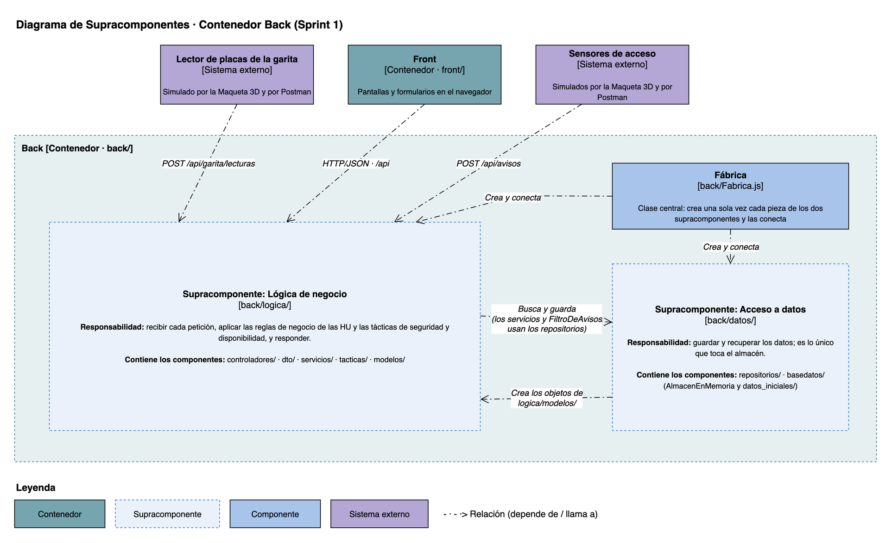
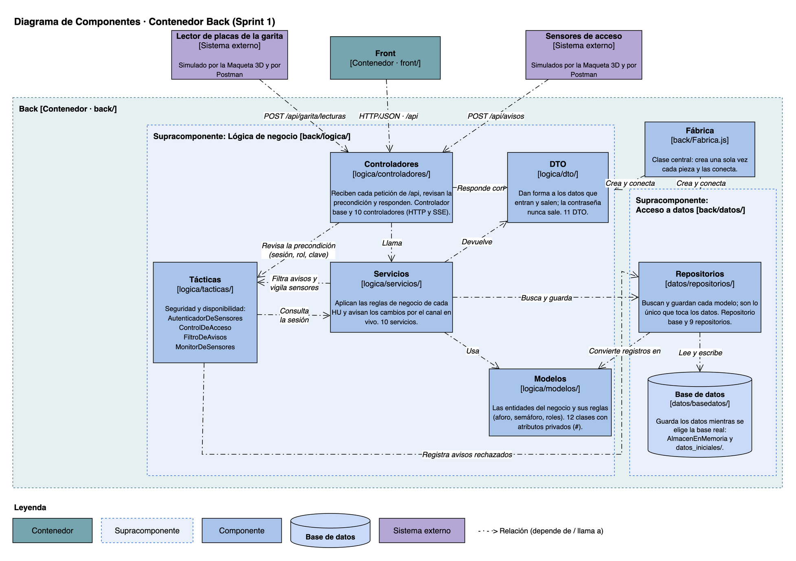
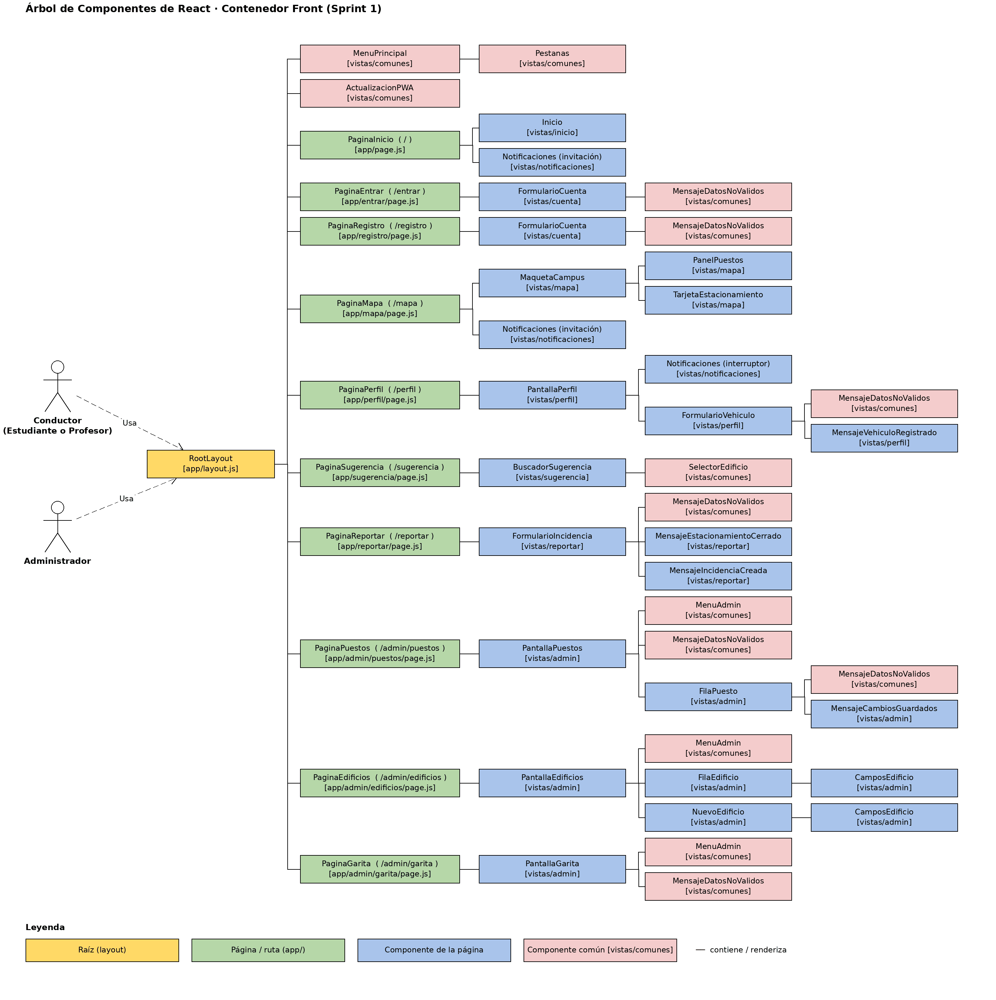
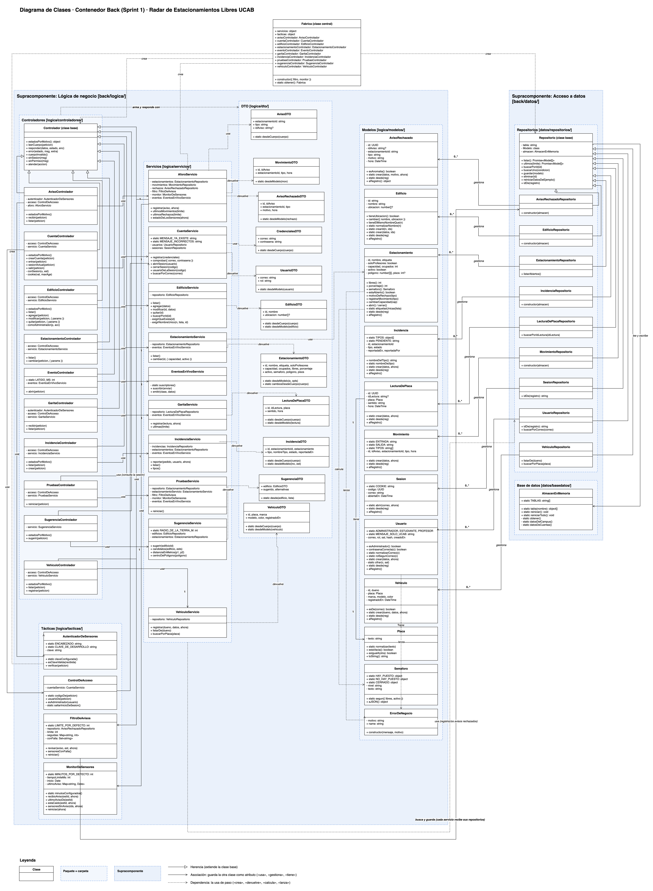

# Guía de la Cuarta Entrega · Documentación de la Arquitectura del Primer Sprint

> **Guía interna del equipo. No es para entregar.** Para cada punto de la entrega: qué pide la profesora, dónde va en el Trello, el diagrama listo (draw.io + PNG), cómo explicarlo y su trazabilidad con el código.

**Fuente:** rama `sprint-1-completo`, commit `9438990` (16/nov/26). Preparada por Samuel con Claude el 24/nov/26. Los diagramas están en esta misma carpeta: el `.drawio` se abre en app.diagrams.net (Archivo → Abrir desde → Dispositivo) y el `.png` es la imagen para el Trello.

> **Versión final de los diagramas · 26/nov/26** (rama `doc-diagramas-cuarta-entrega`). Se juntaron los diagramas de este PR (Samuel, 24/nov) con la versión que el equipo hizo con Antigravity y circuló por WhatsApp el 26/nov, y se corrigieron contra la instrucción oficial de la profesora y la lámina U10:
> - **Del repo se mantuvo:** un archivo por tarjeta del Trello, `Usuario` en el modelo de dominio, los sensores simulados por la Maqueta 3D, los supracomponentes rotulados como marcos, la Fábrica en el diagrama de componentes y las rutas reales (`POST /api/avisos`, `POST /api/garita/lecturas`).
> - **De la versión de WhatsApp se tomó:** la descripción de cada caja, las cantidades de cada componente y el detalle del diagrama de clases (tipos de los atributos y las relaciones «crea», «devuelve», «lanza», «tiene» y «calcula»).
> - **Correcciones nuevas:** el diagrama de **supracomponentes** (5b), que pide la instrucción; la **responsabilidad** de cada componente (U10: «Por cada componente: su nombre, responsabilidades y detalles de implementación»); en clases, los **paquetes** por carpeta (U10: «Contiene: clases, métodos, atributos, paquetes»), la leyenda, los tipos con su nombre real (antes `EstRepo`, `MovRepo`…), la relación servicios → repositorios, `ControlDeAcceso → CuentaServicio`, `FiltroDeAvisos → AvisoRechazadoRepositorio`, la flecha «calcula» que apuntaba a `ErrorDeNegocio` en vez de a `Semaforo`, las flechas sueltas y el bloque de métodos duplicado de `VehiculoControlador`.
> - **Todo en un solo archivo:** [`00_cuarta_entrega_completa.drawio`](00_cuarta_entrega_completa.drawio) trae los 7 diagramas, uno por página.

## Para quien revise (Sebastián y su Claude)

Este PR **solo agrega documentación** en `RadarEstacionamientos_logica/producto/cuarta_entrega/`. No cambia código ni el Trello.

Qué se pide revisar:

1. **Que cada diagrama coincida con el código** de `sprint-1-completo`. Cada punto trae una tabla de trazabilidad (elemento → HU → archivo y línea). Si algo no coincide, comentar en el PR.
2. **Que cumpla lo que pidió la profesora.** Las fuentes son sus instrucciones de la Cuarta Entrega, su documento «Diseño 4» y las notas de clase (resumidas en «Qué pidió la profesora en clase», abajo).
3. **La reorganización del back en 2 supracomponentes** quedó fusionada en `main` mediante el PR #62. Usar `back/logica/` y `back/datos/` como referencia para los puntos 6, 8 y 10.
4. **Los pendientes** de la lista de abajo, que debe decidir el equipo.

Si eres un asistente de IA revisando este PR: lee esta guía completa, compara cada tabla de trazabilidad con los archivos que cita en la rama `sprint-1-completo`, y reporta en el PR las diferencias (archivo, línea y qué no coincide). No modifiques el código, el Trello ni los diagramas sin que el equipo lo confirme.

## Pendientes del equipo antes de subir todo al Trello

- [x] Reorganización del back aplicada en `39d254f` e integrada en `main` mediante el PR #62.
- [ ] Confirmar qué IA se usaron: en el repositorio solo hay evidencia de Claude (commits con `Co-Authored-By`).
- [x] RNF 3: Trello y el valor por defecto de `MonitorDeSensores` coinciden en 30 minutos.
- [x] Característica 3: usar **Robustez** para la característica de U13. **Disponibilidad** identifica la familia de tácticas del código.
- [ ] `front/vistas/comunes/MensajeHecho.js`: ningún componente lo renderiza. Usarlo o borrarlo.
- [ ] Correo de la profesora: las instrucciones dicen `mperezpu@ucab.edu.com` y nuestros documentos `mperezpu@ucab.edu.ve`. Confirmar antes de darle permiso de edición al tablero.
- [ ] Probar los enlaces de draw.io en una ventana privada antes de pegarlos en el Trello.
- [x] El diagrama 5b figura como apartado propio y tiene imagen y enlace de draw.io en la [tarjeta de Ejecución](https://trello.com/c/BxW5eEYt).
- [ ] Si alguien ya pegó en el Trello la versión de WhatsApp, cambiarla por esta.
- [ ] Código: `logica/tacticas/ControlDeAcceso.js` importa directo `datos/basedatos/datos_iniciales/usuarios_de_prueba.js` (línea 6) y se salta los repositorios. Moverlo a `UsuarioRepositorio` o explicarlo en la defensa.

## Qué pide la instrucción oficial

[Instrucciones de la Cuarta Entrega en Módulo 7](https://modulo7.ucab.edu.ve/courses/3675/modules/items/224290) · [Asignación de tácticas arquitectónicas](https://modulo7.ucab.edu.ve/courses/3675/modules/items/225743). La tabla de asignación confirma **Revocar Acceso (ID 6)** para el equipo **87 3**.

Revisada en Módulo 7 el 26/nov/26. Título: «Cuarta Entrega: Documentación de la Arquitectura del Primer Sprint». Se hace en el **Trello**, con permiso de edición para la profesora.

- **Tarjeta de Planificación:** Modelo de Dominio · Herramientas de Software utilizadas para el Desarrollo, incluyendo las IAs (Restricciones de la Arquitectura) · Diagrama de Contexto · Características de la Arquitectura.
- **Tarjeta de Ejecución:** Registro de Decisiones Arquitectónicas · Diagrama de Contenedores · **Diagramas de Supracomponentes (si aplica)** · Diagramas de Componentes · Diagrama de Clases · Lista de Archivos.
- **Nota:** «Los que hayan desarrollado usando ReactJS deben elaborar un árbol de componentes, en sustitución a todos los Diagramas del FRONT».

Lo que dice la lámina **U10 · Diseño III** (Genially del curso) sobre cada diagrama:
- **Leyenda:** «Evite la ambigüedad en sus diagramas incluyendo una cantidad suficiente de texto, así como una clave o leyenda para la notación utilizada».
- **Contexto (nivel 1):** el sistema y cómo encaja con las personas que lo usan y los otros sistemas; «aquí el detalle no es importante». Contiene: usuarios y sistemas, todos conectados.
- **Contenedores (nivel 2):** los contenedores (aplicaciones, almacenes de datos…); «las decisiones tecnológicas son también una parte fundamental». Contiene: contenedores, relaciones entre ellos y usuarios.
- **Componentes (nivel 3):** «Por cada componente: su nombre, responsabilidades, detalles de implementación». Contiene: componentes, contenedores necesarios, usuarios y relaciones (solo los necesarios).
- **Clases:** «Solo mostrar métodos y atributos relevantes. Contiene: clases, métodos, atributos, paquetes».
- «Puede darse el caso (y esto es muy común) que deba proponer carpetas que agrupen carpetas».

## Presentación de la táctica arquitectónica · 1/dic · 3 puntos

**Equipo 87 3 · Revocar Acceso (ID 6).** La fila 6 asigna la táctica al equipo 3 de la sección 87. [Asignación oficial en Módulo 7, pág. 1](https://modulo7.ucab.edu.ve/courses/3675/modules/items/225743)

La actividad pide una presentación de tres láminas, en PPT o video, para enviar al correo institucional indicado en sus instrucciones.

1. **Nombre y descripción.** Revocar acceso es retirar un permiso o invalidar una autorización que antes permitía usar un recurso.
2. **Usos frecuentes.** Cierre de sesión, retiro de permisos cuando cambia el rol y revocación de credenciales tras un incidente.
3. **Ideas para especificarla.** Indicar qué autorización se revoca, quién puede hacerlo, cuándo surte efecto y qué respuesta recibe una solicitud posterior. Ejemplo del Radar: después de `DELETE /api/sesion`, una nueva solicitud a `GET /api/sesion` con la misma cookie recibe 401. `CuentaServicio.cerrarSesion` elimina la sesión en el servidor y `CuentaControlador.salir` indica al navegador que borre la cookie. Si se demuestra en desarrollo, dejar desactivado `SALTAR_INICIO_DE_SESION`.

El ejemplo cubre la sesión actual. La revocación administrativa de otras sesiones y la retirada de roles son casos posibles para la exposición. El RNF 3 de tolerancia a fallos se conserva en la documentación del Sprint 1.

## Qué pidió la profesora en clase (notas de Samuel)

- Representar la arquitectura del Sprint 1. Todo el código agrupado en carpetas; la jerarquía y los nombres de las carpetas son parte del diseño. **Componente = envoltorio de más bajo nivel** (una carpeta).
- En web hay 2 capas (Front y Back) con **un solo hilo de comunicación** entre ellas.
- Todos los diagramas llevan **leyenda**.
- **Contexto:** solo usuario, nuestro sistema y los sistemas que interactúan con él; los sistemas **no** se relacionan con las personas.
- **Contenedores:** leyenda con colores; la base de datos no es un sistema.
- **Componentes (Simon Brown / C4):** un diagrama por contenedor. En el front aparecen personas; en el back no. **2 supracomponentes en el back.** Carpetas al mismo nivel: componente con componente, supra con supra.
- **Clases:** un solo diagrama, aunque sea abrumador, con una **clase central que una a todas**. Como React no es OO, las clases del front no van: se hace aparte el **árbol de componentes de React**, que sustituye todos los diagramas del front.
- **Decisiones arquitectónicas:** ejemplos «el cliente» y «orientado a objetos».
- **Características de la arquitectura:** Rango de calidad → RNF → característica, sin copiar el texto del Brief.
- En la lista «Ejecución» van además la historia especificada en la Segunda Entrega y la especificación de los RNF.

# Lista «Planificación»

## 1 · Modelo de Dominio

**Qué pide la profesora:** Clases solo con sus nombres, relaciones entre ellas (con nombre si hace falta) y la cardinalidad. En clase dijo que va con la planificación, junto a las herramientas y el contexto.

**Dónde va en el Trello:** Lista «Planificación» → tarjeta «Modelo de Dominio»: adjuntar el PNG y pegar el enlace de draw.io.



**Archivos:** [`01_modelo_de_dominio.drawio`](01_modelo_de_dominio.drawio) · [`01_modelo_de_dominio.png`](01_modelo_de_dominio.png) · [abrir en diagrams.net](https://viewer.diagrams.net/?tags=%7B%7D&lightbox=1&highlight=0000ff&edit=_blank&layers=1&nav=1&title=Modelo%20de%20Dominio#R7Vtbb5w4FP41SNuVOuKSuT3OTNLdlbJS1VF3nx04M1gFPDKeS/LrewAT7JikRGpCcZmHBM7xBX/f8Sf7YJxgk152NAHHd2OWCye4dnyfHA6TiJI9J2k+yUCgyQlunGAjjViYRlXRyCucvpuRFCrLvyyChKEpKhq9ZinNKHtsIb38xckhLgsVZS5VJc933aqh6L6yLGrDntd9eY1hSx9kd15d7EgjyLWCgrFE0INuDFmWQSg0G+GcnfViO5bovR7IHgzDNiSJaf2fRiKWVm+2bBx/A93HsuuFP68cKakLy5HkMYnYWTGVwHHGRA3hBpJE4aCq9+kZ7+ODcchElwqiqnAiyfFlSl1n4ztrHIb7hUSE1/6bXJCQMowIij2yHE239I5DcfF1s1rjvz+2B07xaXzX+yAHLe5rJAVc8DnXsUgTNHh4SRK6z/A6gV3hOQEXFJFfSXNKo6iovN6xTMjI8Gb1vWy4aEcODKvD5VlwPDVWgaUg+D0WkRWuJEn3evSdG8rndeDGCtuBtBEZZfvHhhsi8EJy0c5LDjmiapCzVcwKipwdswiKqi6O/BxTAdsDCQvvGWegDjAqQLJhCeNl3eBT+UN7Ljj7BorHLX8t0KrQB28C9dKE2pu2QD39CVAf8yPhlWppWH9V7ZaB3R/aENEdDVvgvtEcVuE9X0x7w/sEMQ2PiYn3f5rDZjEJ3HfEm2Yhrk3wDzEQ/+eJy2pNeVfQoViFmIqir02sFJYOoM/eCPQEV9ZHbob5bWW/hs8JCW0M9UBX8+l7gp6yU8uK/UQtDvEOaL+VrnAIYwPu1Ynm7At6yAPu3SyE3HOXPcoKeAbiBDeUBs6QRatiK493GctAx1UnQcXIf4JhcZ+QO0jWJPy2L+u1EVJ1D5GRF3gCKj4iO/IQWrYWgvA9iKfbO5MFDgkR9KR31IZoA+dj7Y4Ip66BsWcCjIO9LZBp35+HOHDgL+3QMQtAH8hd2V5Bw4FhGqAcx3TtTK9/QIz3GmJa4l3mfmT/TcZFpQxenggf3clcqs/rSEkvn1mV8rhofcv59BEHqzXAdru8yrxps+TVtJpTx51M/hyZNZgdFrG+QSsgI1BCkVapulzQjNmlkWqmoA+V9FtU8redTr5NQumPQtmV2WERGxi0cthTXEwTu6RRTer1IY3BuIBUI84WXQxGXezK7LCIvWrRxQPjwjJZ1HPvfQjj1SiMasjZIoxXozB2ZXZYxE4NWgUm0oeZbFRegv1aojgdRVENN1tEcTqKYldmh0XszEw34mHRTeCsvAIO4MVb3fL43xBVUjtmpOUba/3sQyNnY7KxmUwzm2RyNspkV2aHRey8RSZLPw630JjycIAL2SBlUj82qMqkcuynD6Gctwvl77menNsklPNRKLsyOyxiF3a9lXlmny1P5vWhiYtxg62Gmi2CuBgFsSuzwyJ22SKI5XFSm/SwPjvbhyAux0ViM3OWNmnictTErsz+ysTibfONc1W8+VK8NtYfoDeFyo/Xg5vv)

### Trazabilidad

Revisado contra el repositorio `sebastianmoreno1793/Proyecto-Estacionamientos-UCAB`, rama `sprint-1-completo`, commit `9438990` (16/nov/26). Las rutas son dentro de `RadarEstacionamientos_code/`. Las HU son las 12 de la Tabla 3 del Brief (Iteración 1).

### Clases del diagrama → HU → código

| Clase del diagrama | HU del Sprint 1 | Archivo del código | Evidencia |
|---|---|---|---|
| Usuario | 1.1 | `back/logica/modelos/Usuario.js` | `export class Usuario` (correo, rol, contraseña cifrada) |
| Sesion | 1.1 | `back/logica/modelos/Sesion.js` | `export class Sesion`, `#correo` (línea 9) |
| Vehiculo | 2.1 | `back/logica/modelos/Vehiculo.js` | `export class Vehiculo`, `#dueno` (línea 11), `#placa` (línea 12) |
| Movimiento | 3.1 | `back/logica/modelos/Movimiento.js` | `export class Movimiento`, `#estacionamientoId` (línea 12) |
| LecturaDePlaca | 3.2 | `back/logica/modelos/LecturaDePlaca.js` | `export class LecturaDePlaca`, `#placa` (línea 12) |
| AvisoRechazado | 4.1 | `back/logica/modelos/AvisoRechazado.js` | `export class AvisoRechazado`, `#estacionamientoId` (línea 9) |
| Estacionamiento | 4.1, 4.2, 5.1, 5.4 | `back/logica/modelos/Estacionamiento.js` | `export class Estacionamiento` (capacidad, ocupados, activo, polígono) |
| Edificio | 6.1 | `back/logica/modelos/Edificio.js` | `export class Edificio`, `#ubicacion` (línea 9) |
| Incidencia | 9.1 | `back/logica/modelos/Incidencia.js` | `export class Incidencia`, `#estacionamientoId` (línea 17), `#reportadaPor` (línea 21) |

### Relaciones del diagrama → código

| Relación | Cardinalidad | HU | Evidencia en el código |
|---|---|---|---|
| Usuario **abre** Sesion | 1 — 0..* | 1.1 | `Sesion.#correo` (`Sesion.js`, línea 9); `CuentaServicio.abrirSesion(usuario)` (`back/logica/servicios/CuentaServicio.js`, línea 39) |
| Usuario **registra** Vehiculo | 1 — 0..* | 2.1 | `Vehiculo.#dueno` (`Vehiculo.js`, línea 11); `VehiculoServicio.registrar(dueno, …)` y `listarDe(dueno)` (`back/logica/servicios/VehiculoServicio.js`, líneas 17 y 26) |
| Usuario **reporta** Incidencia | 1 — 0..* | 9.1 | `Incidencia.#reportadaPor` (`Incidencia.js`, línea 21); `IncidenciaServicio` crea la incidencia con `reportadaPor: usuario?.correo` (`back/logica/servicios/IncidenciaServicio.js`, línea 24) |
| Estacionamiento **tiene** Incidencia | 1 — 0..* | 9.1 | `Incidencia.#estacionamientoId` (`Incidencia.js`, línea 17) |
| Estacionamiento **registra** Movimiento | 1 — 0..* | 3.1, 4.1 | `Movimiento.#estacionamientoId` (`Movimiento.js`, línea 12) |
| Estacionamiento **rechaza** AvisoRechazado | 0..1 — 0..* | 4.1 | `AvisoRechazado.#estacionamientoId` (`AvisoRechazado.js`, línea 9). Es 0..1 porque un aviso de un estacionamiento que no existe se guarda con motivo `no_existe` (`back/logica/tacticas/FiltroDeAvisos.js`, línea 31) |
| Vehiculo **es identificado en** LecturaDePlaca | 0..1 — 0..* | 2.1, 3.2 | Las dos clases usan la misma clase `Placa` (`Vehiculo.js`, línea 21; `LecturaDePlaca.js`, línea 19). El comentario de `Vehiculo.js` (línea 3) dice que «el lector de la garita identifica al vehículo por ella». Es 0..1 porque la garita puede leer una placa que nadie registró |
| Usuario **elige como destino** Edificio | 0..* — 0..* | 7.2 | `SugerenciaServicio.sugerir(edificioId)` (`back/logica/servicios/SugerenciaServicio.js`, línea 21): el usuario elige el edificio al que va |
| Edificio **está cerca de** Estacionamiento | 0..* — 0..* | 7.2 | `SugerenciaServicio.candidatos(edificio, estacionamientos)` (línea 30): calcula la distancia del edificio a cada estacionamiento |

### Clases del código que no van en el modelo de dominio

| Clase | Archivo | Por qué no va |
|---|---|---|
| Placa | `back/logica/modelos/Placa.js` | Es un dato (valor) de Vehiculo y de LecturaDePlaca, no un concepto propio del negocio |
| Semaforo | `back/logica/modelos/Semaforo.js` | Se calcula a partir del Estacionamiento (libres y estado); no se guarda |
| ErrorDeNegocio | `back/logica/modelos/ErrorDeNegocio.js` | Es un mecanismo técnico para avisar que una regla no se cumplió |
| Notificacion (HU 8.1) | `front/modelos/Notificacion.js` | Es del front; por la nota de React, el front va en el árbol de componentes |

### Cobertura de las 12 HU del Sprint 1

| HU | Clase(s) del diagrama |
|---|---|
| 1.1 | Usuario, Sesion |
| 2.1 | Vehiculo |
| 3.1 | Movimiento |
| 3.2 | LecturaDePlaca |
| 4.1 | Estacionamiento, Movimiento, AvisoRechazado |
| 4.2 | Estacionamiento |
| 5.1 | Estacionamiento |
| 5.4 | Estacionamiento |
| 6.1 | Edificio |
| 7.2 | Relaciones Usuario–Edificio y Edificio–Estacionamiento |
| 8.1 | No tiene clase en el back (es solo del front) |
| 9.1 | Incidencia |

---

## 2 · Herramientas de Software utilizadas (incluidas las IA)

**Qué pide la profesora:** Las herramientas de software usadas para el desarrollo, incluidas las IA. Cuentan como restricciones de la arquitectura.

**Dónde va en el Trello:** Lista «Planificación» → tarjeta «Herramientas de Software»: pegar la tabla (o una lista con herramienta y para qué se usó).

Revisado contra el repositorio `sebastianmoreno1793/Proyecto-Estacionamientos-UCAB`, rama `sprint-1-completo`, commit `9438990` (16/nov/26). Solo se listan herramientas con evidencia en el repositorio. Las marcadas «por confirmar» las debe validar el equipo.

### Lenguaje, frameworks y librerías

| Herramienta | Para qué se usa | Evidencia en el repositorio |
|---|---|---|
| JavaScript | Lenguaje de toda la app (front y back) y del simulador | Todos los archivos son `.js` / `.mjs` |
| Node.js (18.18 o superior) | Ejecuta la app, el simulador y las pruebas | `RadarEstacionamientos_code/iniciar.mjs`; `npm test` en `RadarEstacionamientos_code/package.json` |
| Next.js 15 | Framework web: pantallas del front y rutas `/api` que conectan con el back | `RadarEstacionamientos_code/front/package.json` (`"next": "^15.5.0"`) |
| React 19 | Componentes de la interfaz (front) | `front/package.json` (`"react": "^19.1.0"`, `"react-dom"`) |
| Three.js | Maqueta 3D del campus en el simulador | `RadarEstacionamientos_simulador/package.json` (`"three": "^0.186.1"`) |
| node:test | Pruebas automáticas de unidad, integración y aceptación | `"test": "node --test"`; carpetas `back/pruebas/unidad`, `integracion`, `aceptacion` |
| node:crypto (scrypt) | Cifrado de la contraseña con sal | `back/logica/modelos/Usuario.js` (`scryptSync`, `randomBytes`) |
| Service Worker / PWA | Notificaciones del navegador (HU 8.1) y app instalable | `front/public/sw.js`; decisión D-008 |

### Datos

| Herramienta | Para qué se usa | Evidencia |
|---|---|---|
| OpenStreetMap y SRTM | Forma y relieve del campus en la maqueta 3D | `docs/stack_y_arquitectura.md` (sección «Dos sistemas (D-006)»); `RadarEstacionamientos_simulador/mapa_3d/Relieve.js` |
| Almacén en memoria | Guarda los datos mientras se elige la base de datos | `back/basedatos/AlmacenEnMemoria.js`; «Por decidir: Base de datos» en `docs/stack_y_arquitectura.md` |

### Desarrollo, pruebas y colaboración

| Herramienta | Para qué se usa | Evidencia |
|---|---|---|
| Visual Studio Code | Editor del equipo | `docs/stack_y_arquitectura.md`; carpeta `.vscode/` |
| Extensión propia «Radar · Historias de usuario» | Encuentra los archivos de cada HU (`@HU-x.y`) | `herramientas/radar-hu/` |
| Extensiones recomendadas de VS Code: Todo Tree, GitLens, Bookmarks | Navegar etiquetas, historial y marcadores | `.vscode/extensions.json` |
| Git y GitHub | Control de versiones, Issues por HU y Pull Requests | Repositorio; `.github/ISSUE_TEMPLATE/`, `.github/pull_request_template.md` |
| GitHub Actions | Sincroniza el estado de las HU con Trello | `.github/workflows/trello.yml` |
| Trello | Planificación del sprint y entregas | Enlace en `README.md` |
| Figma (FigJam) | Mapa de historias de usuario (Backlog) | Enlace en `README.md` |
| draw.io (diagrams.net) | Diagramas de actividades y de arquitectura | `RadarEstacionamientos_logica/producto/segunda_entrega/diagrama_actividades_HU9.1.drawio` |
| Postman | Probar la API como si fuera un sensor | `RadarEstacionamientos_simulador/coleccion_postman/` |
| Vercel (por confirmar) | Despliegue previsto | Solo mencionado en `docs/stack_y_arquitectura.md`; no hay configuración de despliegue en el repositorio |

### Inteligencia Artificial

| Herramienta | Para qué se usó | Evidencia |
|---|---|---|
| Claude (Anthropic) | Asistente de programación y documentación | Commits del repositorio con `Co-Authored-By: Claude Opus 5.5` (por ejemplo `0406843`, «App por capas (MVC)…») |
| Otras IA (por confirmar) | — | Si el equipo usó otras (ChatGPT, Gemini, Copilot…), agregarlas aquí; no hay evidencia en el repositorio |

### Restricciones que imponen a la arquitectura

| Restricción | Origen |
|---|---|
| Solo acceso por navegador web, sin aplicación móvil | Brief (Restricciones); D-003 |
| Solo herramientas sin costo adicional | D-005 |
| Sensores y lector de placas simulados por software | Brief (Restricciones); D-002 |
| Datos en memoria hasta decidir la base de datos | `docs/stack_y_arquitectura.md` |

---

## 3 · Diagrama de Contexto

**Qué pide la profesora:** Personas, sistemas y nuestra app, con leyenda. Los sistemas externos no se relacionan con las personas (ese era el error del ejemplo de la lámina).

**Dónde va en el Trello:** Lista «Planificación» → tarjeta «Diagrama de Contexto»: adjuntar el PNG y el enlace.


**Archivos:** [`03_diagrama_de_contexto.drawio`](03_diagrama_de_contexto.drawio) · [`03_diagrama_de_contexto.png`](03_diagrama_de_contexto.png) · [abrir en diagrams.net](https://viewer.diagrams.net/?tags=%7B%7D&lightbox=1&highlight=0000ff&edit=_blank&layers=1&nav=1&title=Diagrama%20de%20Contexto#R7VlNb9s4EP01ArKHBpJoO87RlpP24BTBGkXPtMTIRClRJanY3l+/MxQlS5bSpFjHWSTNoSWHw6H43nyQtEeibPfABfNCfyO18cjCC0NaFJcJp6mimb7MmQGRR248EjkhKPOkUk0CHAz9nGaskiwqHQrCBM1GMjdsZ2RjJNt9VrTY3MmECVTaVfOC0PcrW8m+kkxrQarq5YKDYMX/cSsGtVrJE6Y7ikZKYXjRFcYyz1lsOjKqlNx21R6k6K5a0JT1BKuYir70O0/MxkmDyfVh4Avj6cYtPQ2vqoGM1spuJ3pDE7ltiSxwSkpTQxgxIVo0uHleePuEQvNtiuXmhXNMpfBIRfkst74Xhd4c9uP/TROqaoUbbWjMJXgHh3WlBtGSrxXDxrdoNof/LlaF4vBNoR/85XZv9jWkaN0j843JBAgCaFLB0xzagj3gyCNThgMFMyfOeJLg5PkDfJpzkWBS951htOP2BtPZ7kmIgrbTMpkxo/ag4iaMHIL7rhtuD9xfTZxs06KdOBl17pY2hjt0QMMxMswOeHHSIwgIScrYSCBg4oUEPonML4CEEiIXqAJl5OpeyQemperjDY5XYLPMxMyaOSC8pGsm7qXmBvgElbU0RmYDFBhZdCmTpRE8Z1ETdv4AH22+yGn4ue7yc93nZ4ie6WnooUnG8x4/M5RybRTEt/pQ6JPRWeFXVRY6gh+iQmDWWEMjxcZvJqtqNqzdGGgsqkYynq+AYWaz5JatvfFiQOlJiS5o3vGKyc8S076l6JO2HM2CoNgdRmoTs0KAJ8Tci4g3J7lbHjDJYWOCrm2Vv7j/PoO493+W2MtKhs4ILYb6hrOswAyhGEU0hQWhQCXbEjUcFq9qlPVRqwp7RLOixO4dfDkVa/ysWQDLRLi/MuVMoZXEfa412RhT1nOgpoME+9YbN9bEIi7dynZvMRR9+IfqyxY/FYo1skdhpmQJqyUuFLYbbtiqoDGObuFk0g0fOByJSAoMRphLbm8X1xOsJwCb/MFaI779O4ot/3Vii0zH3dJT91vBNRhdwfg04aVZrp+PrhVoyZbD0DiGsvOc+/x2kMEZgalcnjHQHrm2k2NIHzZ2MKFT57IajigJBW/0v8i983aelQJSvo0mTPy+QO07ClFosIXr28nVKCR6k9H8LB49H82uFm/u0dOwWy6m/WrRHJw6Du2fxqEF1sZnHXrJqrNV5cCFoDE9ZEPkMaWKI6H/fx9esuaj7T7qbTiXjvFC1JQJ6+Du8KiprSNVjo9tjh/09T+u/kJXJ+Tcvt739CXbsxyJf5X7FznL/Wvs93EMwgEcw9FpYCx6MN4zpe1h5T0f7MdHsA+4L5n0UR9NT4N6/9zx1R5ibW6q8+m7O/EFV0eoD1ynmsNdB/ZT1cce7P3i9f5yNRm9Mez9O+yn9mNbu1MXTB8f4ZjoXAQvSk3duljNH6uLFH2tB7dwgJ1TZJ7wmI3py649J8r4LOix8U33sw1U0hk+J0NPFnCvJnOQ3HI0a5GAXg2U38W6GzC/QhT7AkvHnMY/Ujuvk7PwD1QSqjfWXuA699RgrIIEoPMBFj+0/9f8sKT3xn3EDmxVlipmx6+QhqqUmaPXlz6VCjzT8MfuIv+Vl/APL0e8tJ4f35IY0iPmpkk+aB4u0rK5QQ1doz80iYdXlrfkcPRrDoW9Ajd3YQDQDiVUf2juDg8K5+MOuoffCO1Y65fWWlj/hntQsr//kpt/AQ==)

### Trazabilidad

Revisado contra la rama `sprint-1-completo`, commit `9438990` (16/nov/26). Rutas dentro de `RadarEstacionamientos_code/` salvo que se indique otra carpeta.

| Elemento del diagrama | Tipo | Origen (Brief / HU) | Evidencia en el código |
|---|---|---|---|
| Conductor (Estudiante o Profesor) | Persona | Brief, Mapa de Impacto: «Estudiantes y profesores»; HU 1.1, 2.1, 4.2, 5.1, 7.2, 8.1, 9.1 | Roles `estudiante` y `profesor` en `back/logica/modelos/Usuario.js` (`rolSegunCorreo`) |
| Administrador | Persona | Brief, Mapa de Impacto: «Administración»; HU 3.1/3.2/4.1 (vista de garita), 5.4, 6.1 | Rol `administrador` en `Usuario.js`; pantallas `front/app/admin/puestos`, `admin/edificios`, `admin/garita` |
| Radar de Estacionamientos Libres UCAB [Sistema web] | Nuestro sistema | Brief, Restricciones: «únicamente mediante navegador web» | Carpeta `RadarEstacionamientos_code/` (Next.js) |
| Sensores de acceso (simulados) | Sistema externo | Brief, Restricciones: sensores simulados; HU 3.1 y 4.1; D-002 | Entrada `POST /api/avisos` (`front/app/api/avisos/route.js`); `back/controladores/AvisoControlador.js`; clave del sensor en `back/logica/tacticas/AutenticadorDeSensores.js` |
| Lector de placas de la garita (simulado) | Sistema externo | Brief, Restricciones: lector de placas simulado; HU 3.2; D-002 | Entrada `POST /api/garita/lecturas` (`front/app/api/garita/lecturas/route.js`); `back/controladores/GaritaControlador.js` |
| Conductor → Radar «Usa» | Relación | HU de la persona | Pantallas `front/app/` (registro, entrar, mapa, perfil, sugerencia, reportar) |
| Administrador → Radar «Usa» | Relación | HU 5.4, 6.1 y vista de garita | Pantallas `front/app/admin/` |
| Sensores → Radar «Envía avisos de entrada y salida» | Relación | HU 3.1 y 4.1 | `POST /api/avisos` |
| Lector de placas → Radar «Envía las placas leídas» | Relación | HU 3.2 | `POST /api/garita/lecturas` |

### Qué no aparece y por qué

| Elemento | Por qué no va en el contexto |
|---|---|
| Simulador / Maqueta 3D (`RadarEstacionamientos_simulador/`) | Es lo que hoy reemplaza a los sensores y al lector de placas (D-002, D-006). En el contexto se muestran los sistemas reales que representa; el simulador aparece en el diagrama de contenedores |
| Vigilancia | El Brief la menciona, pero en el Sprint 1 solo existe el rol `administrador` (no hay rol de vigilancia en `Usuario.js`) |
| Correo institucional / servicio de correo | El correo UCAB solo se usa como identificador; la app no envía correos |
| Notificaciones del navegador (HU 8.1) | Las maneja el propio navegador del conductor (`front/public/sw.js`); no es un sistema externo al que la app se conecte |

---

## 4 · Características de la Arquitectura

**Qué pide la profesora:** Las características de calidad de la arquitectura, derivadas de los RNF: Rango de calidad → RNF → característica. Sin copiar el texto del Brief.

**Dónde va en el Trello:** Lista «Planificación» → tarjeta «Características de la Arquitectura»: la característica y de qué RNF sale.

Cadena de trazabilidad que pidió la profesora: **Rango de Calidad (Brief) → RNF (Segunda Entrega) → Característica de la arquitectura**. Los nombres de las características son los de su lámina U13 (Gandhi, Richards y Ford: operacionales, estructurales y transversales). Evidencia revisada en la rama `sprint-1-completo`, commit `9438990` (16/nov/26).

Según la lámina 9 de U13, las características «tienen que ser las menos posible», por eso son solo las cuatro que salen de los RNF.

| # | Característica de la arquitectura | Tipo (U13) | Sale del RNF | Sale del Rango de Calidad del Brief | Dónde la atiende la arquitectura (código) |
|---|---|---|---|---|---|
| 1 | **Usabilidad** | Transversal | RNF 1 · Facilidad de interacción → Auto-descriptividad | Rango 2: la información se entiende de un vistazo, con los colores del semáforo y lenguaje claro | `back/logica/modelos/Semaforo.js` (dos estados con texto: «Hay puesto», «No hay puesto», «Cerrado», D-009); `front/vistas/comunes/ColoresSemaforo.js` |
| 2 | **Rendimiento** | Operacional | RNF 2 · Eficiencia de desempeño → Comportamiento temporal | Rango 1: el mapa carga y se actualiza en pocos segundos | Canal en vivo `back/logica/servicios/EventosEnVivoServicio.js` (`GET /api/eventos`, Server-Sent Events): el mapa cambia sin recargar |
| 3 | **Robustez** | Operacional | RNF 3 · Fiabilidad → Tolerancia a fallos | Rango 3: si un sensor falla, se oculta solo ese estacionamiento y el sistema sigue con los demás | Tácticas `back/logica/tacticas/MonitorDeSensores.js` (detecta el sensor que dejó de avisar) y `back/logica/tacticas/FiltroDeAvisos.js` (ignora avisos defectuosos sin detener el sistema) |
| 4 | **Autorización** | Transversal | RNF 4 · Seguridad → Confidencialidad | Rango 4: cada usuario solo accede a lo permitido para su rol; placas y vehículos solo los ve su dueño y el personal autorizado | Táctica `back/logica/tacticas/ControlDeAcceso.js` (sesión y rol, 401/403); `VehiculoRepositorio.listarDe(dueno)`; las placas leídas solo en `admin/garita` y nunca en el canal en vivo |

Nota sobre el orden de los rangos: es el orden de la sección 4 del Brief (1 · carga en pocos segundos, 2 · se entiende de un vistazo, 3 · si un sensor falla, 4 · seguro con los datos).

### Puntos para que el equipo revise

- **Robustez** es la característica de arquitectura según U13. Las tácticas de disponibilidad implementan la detección de fallos y permiten que el resto del sistema siga funcionando.
- **Tiempo del sensor caído.** El [RNF 3 vigente en Trello](https://trello.com/c/d70el54Y) establece 30 minutos. Coincide con el valor por defecto de `TIEMPO_LIMITE_SENSOR_MIN`. Los demás estacionamientos deben seguir actualizándose en 5 segundos o menos.
- **Autenticación.** También existe (`AutenticadorDeSensores.js`, sesión con correo UCAB), pero viene de una restricción del Brief (solo la comunidad UCAB), no de un Rango de Calidad. Por eso no la puse como característica: va en las decisiones arquitectónicas.
- **Texto en el Trello.** Según tus notas, en la tarjeta no se copia el texto del Brief: basta con el nombre de la característica y de qué RNF sale.

---

# Lista «Ejecución»

## 5 · Diagrama de Contenedores

**Qué pide la profesora:** Personas, bases de datos, contenedores y sistemas, con sus relaciones y leyenda con colores. La base de datos es su propio elemento, no un sistema. Un solo hilo de comunicación entre Front y Back.

**Dónde va en el Trello:** Lista «Ejecución» → tarjeta «Diagrama de Contenedores»: adjuntar el PNG y el enlace.


**Archivos:** [`05_diagrama_de_contenedores.drawio`](05_diagrama_de_contenedores.drawio) · [`05_diagrama_de_contenedores.png`](05_diagrama_de_contenedores.png) · [abrir en diagrams.net](https://viewer.diagrams.net/?tags=%7B%7D&lightbox=1&highlight=0000ff&edit=_blank&layers=1&nav=1&title=Diagrama%20de%20Contenedores#R7Vpbc9o4FP41zHQfmvEFDDwaCNvt0JYp6ezjjrCF0Va2XFkmob9+jyTL2Mhp2BbItGmmTayjY8k+33cuktzzp+nDhlDc85wtK0TPn/U8D+X5TUxQwlFa3GRYgKjn3/b8aSUEZRJr1diVnZ6ToRRryUzrIBDGctgpywTOcMw4LuqB0oc/Ocq371iMqVR80Pe6nuPo8eK9loyMIOFmSvcgWJGv1ayuUStJDPM0FQVjVJC8LYxYluFItGSIc3bfVtsw2p41Rwm2BKsIUVv6N4nFtpK6wfjQ8QaTZFtNPfKGuiNFRrl6k2KLYnbfECnDccaEMeEUU9qAorqv580fUaifjeNMnHiP0Ao7RMuT8HV6U683gXdyPqIYcaN0WwgUEQYsITA3k4oLstZ3fJqGE/jzapVzAs/lOe4flQXE3phV4Ad44slWpBQELlwiSpIMrineyJ4d5oIADGElTkkcy5snG3i8iiZuYNrVwHKc6v3gdvzwqJncJnExS7Hge1CpbuhXVty3qXh/wL9m8bYBvV/JUEW5pB64BQlcVKh0I5RYCP1fy8t/g4m661j7nwg8tDeYWYBwVmYxlo/ggBHvt0TgVY4i2XsPnt3GKkbFVunKBkQbOmWUcTWQP5/PvekU5IXg7DNu9AzngeM4HdgKltsEKGB2kiUL1ZqNDpI7qT3rd0DfpIZ/Hip4gzYXApsLwaiDC/3xecgAYS22+AAeGpeRALt6AdjVlTZ9BUiXEM7Bd0GZwf8lZxtcMG47H0SiXF6WKQ3VMAdIFmiN6ZIVRABpQGXNhGDpo5g1OMFKQUkGeJs47FwHoXEboHEHQB34jM4DD4pTkln4hFJKgP8Q8PmLsr7fv6r5N5xldkIDr6AygqzhIpEXc62mpTBm3VFr8loymBzyX88PYeT3kKpu/pXh1R2oh5Mh9iNGkUpt42aKrJ5nrgKsNfSjEghsWYsjwZdSVgUKsNeFQix03fzh0GOGWILDI0rBjt5UFR1fSixkKofMizk8I9npxC7NFqE0LyvNDeNpSREnKoPstQVJjEzaV7lGKiEhgwmWD6gGydAOJ1LtpmFR/QbmrX4ktRxlk2EQDsJ5VzZx1M8Ry50LZYHRUUUwsGle115NnrtnqgnWKPr8NM8nSus7af4W7dAq4iQXTUbria9I6HD5lyYo7U393sRPIOwZOmY4YVDM6H4h+0M3knGxJmyBk5JLFlecjkmRs4ysCdXCaSWPUIaoofWO7JiqV1e3f7wgUgfj5yZ1fAqlC2zAjZEqd0/kd0hTFCmOjDODdIpTxgmqCITTnHFFg2O6VzPN1zC7ub6eC3wqyiouTxWlCygGcNXa4a16p1lUUqOBrRWBSgVsR1oCtCOFCvYcR1v0FUJ41ZFTpF0InlSNHZt0QrIIVt/wC5kkgWOyITBZAY7ivEGFyjWY4oTIBQpFyoYWZDClsjN4mu7KgPh1Wso5i6BQrdsyjJ3sh6aaivZQ/8SY+09741q77mJdC2DCRDn0B11GVfKicjjPduHpeBbOR9/twt6ZXHh4XH4NbBcedLnw8DwuXOCseNqJV6DVLCtQpPE+0ZNXUEpjtT8BlRjmGbueK66ILJKUpzg5qyn+ri6z5HDKMXQv1O4iVWy9eBKZ9MPhLHjuJOI67pPrr3oDpcnAM62PqVztPEnABdarZU2/Ot6plgI0gYAr8fx5GPmbkCcS0g+uzEibjwu8x1mMLrQJ6l9lE3Qwcm5sQ7pd9aHXP48hc8uQS8wLqHN+7S2V4x1Ht8vwftCx5zg6j92jrg1Hs1b89dZBbnBkcK+T6X7XLu+ZQsbasnjHuuenLHzdyxS+vnvsJN6pmA2CMxUeFmZ2VfDrpdf+ac7Sv6Cz2OdjC71sTYnA9SKyMGA84znXJTZtvJPsP7ig/bll/9fNLZRmw1SZjtoxh7Kb6E297EKlkNfhBGcw+nB8bPRRh9E953K1EHYto38qkD7nrTfku451oe4M5VcQ0GI5BsNNQDInciJlHWgZ4zlt+7cd5VtWlm0qy6xJnU7afgI/x84kG0skZJhUp7ueA4ZyPPXXYIZj69OMI8TgVVnJI3x8VioQT7A4OiOy4eVASSG3pFofjfwgUt5vpJ5EqnFs+pxQ+fYCg6iKS+10ZjudVlBj69mctgOYb+7uljDD29WH983wByKUk5cOcONgtgmwOca6Er79jpV4DW8RcbLGLxqlw6liC6T4ihANLIhum35nziyajrf8sLo7OBr81jov3OMOO/HP6HDBt9HsPmj6FrZmX3Yu93lLjl48zIf97qvBDM3DR6qqr/GprxGaD4kPSuojZP/2Pw==)

### Trazabilidad

Revisado contra la rama `sprint-1-completo`, commit `9438990` (16/nov/26). Rutas dentro de `RadarEstacionamientos_code/` salvo que se indique otra carpeta.

| Elemento del diagrama | Tipo | Evidencia en el código |
|---|---|---|
| Conductor (Estudiante o Profesor) | Persona | Roles `estudiante` y `profesor` en `back/logica/modelos/Usuario.js` |
| Administrador | Persona | Rol `administrador` en `Usuario.js`; pantallas `front/app/admin/` |
| Límite «Radar de Estacionamientos Libres UCAB» | Límite del sistema | Carpeta `RadarEstacionamientos_code/` |
| Front [Next.js + React] | Contenedor | Carpeta `front/` (`front/package.json`: next 15, react 19) |
| Back [JavaScript] | Contenedor | Carpeta `back/` (clases sin dependencia de Next; `back/Fabrica.js` las conecta) |
| Base de datos (almacén en memoria, temporal) | Base de datos | `back/basedatos/AlmacenEnMemoria.js`; «Por decidir: Base de datos» en `docs/stack_y_arquitectura.md` |
| Sensores de acceso (simulados) | Sistema externo | Simulados por `RadarEstacionamientos_simulador/` (D-002, D-006) |
| Lector de placas de la garita (simulado) | Sistema externo | Simulado por `RadarEstacionamientos_simulador/` (D-002, D-006) |

| Relación | Evidencia |
|---|---|
| Conductor / Administrador → Front «Usa [navegador]» | Pantallas en `front/app/` (Brief: solo navegador web, D-003) |
| Front → Back «Pide y envía datos [HTTP/JSON · /api]» | **Único hilo de comunicación:** `front/servicios/ClienteHttp.js` («hablan con el back SOLO por fetch, a las mismas URL /api/...»); canal en vivo `front/servicios/EventosEnVivoServicio.js` (`GET /api/eventos`). Las rutas `front/app/api/**/route.js` son la única parte del front que importa el back (`@back/Fabrica.js`) |
| Back → Base de datos «Lee y escribe» | Los repositorios (`back/repositorios/*Repositorio.js`) leen y escriben en `AlmacenEnMemoria` |
| Sensores → Back «Envía avisos [POST /api/avisos]» | `front/app/api/avisos/route.js` → `back/controladores/AvisoControlador.js`; clave en `back/logica/tacticas/AutenticadorDeSensores.js` |
| Lector de placas → Back «Envía placas leídas [POST /api/garita/lecturas]» | `front/app/api/garita/lecturas/route.js` → `back/controladores/GaritaControlador.js` |

### Para explicar en la defensa

- **Por qué la entrada `/api` está en `front/app/api/`.** Es una exigencia de Next.js: las URL se declaran en la carpeta `app/`. Esos archivos solo conectan la URL con el controlador del back (`Fabrica`); no tienen lógica. Por eso el hilo sigue siendo uno solo: todo pasa por `/api`.
- **Por qué la base de datos aparece aparte.** Como indicó la profesora, la base de datos no es un sistema: es su propio elemento. Hoy es un almacén en memoria mientras el equipo elige la base de datos definitiva.
- **El simulador.** No es un contenedor del Radar: es otro proyecto (`RadarEstacionamientos_simulador/`) que hace de sensores y de lector de placas y llama a la misma API que llamarían los reales.

---

## 5b · Diagrama de Supracomponentes del Back

**Qué pide la profesora:** La instrucción oficial lo pide aparte en la tarjeta de Ejecución: «Diagramas de Supracomponentes (si aplica)». Aplica porque el back tiene dos carpetas que agrupan carpetas (U10: «proponer carpetas que agrupen carpetas»).

**Dónde va en el Trello:** Lista «Ejecución» → tarjeta «Diagramas de Supracomponentes»: adjuntar el PNG y el enlace.



**Archivos:** [`05b_diagrama_de_supracomponentes_back.drawio`](05b_diagrama_de_supracomponentes_back.drawio) · [`05b_diagrama_de_supracomponentes_back.png`](05b_diagrama_de_supracomponentes_back.png) · [abrir en diagrams.net](https://viewer.diagrams.net/?tags=%7B%7D&lightbox=1&highlight=0000ff&edit=_blank&layers=1&nav=1&title=Diagrama%20de%20Supracomponentes%20Back#R7VptU9s4EP41maEfYPwSJ+FjEsh1buiVabi566cbxRaOWtlyJQVIf/2tXuzIL9C0dUhLy1BqrVeWtM+j1e7ag3CePdwSigeBt2ZCDsKLQRCgojhLCEo5ysRZjiWIBuHlIJxbISiTxKiKTcFRzLKC5TiXWJyuUPxR6QdejjJslJYNJbg5mAeD2RguZlZfPz97+IOjYv2GJZjCveTB9PeHnmeemWyN5LwUpLycib8TLMlnO7Jfqm1IAuO6ipIxKklRF8Ysz3EsazLEObuvq90yWh+1QCluCZYxom3pPySRaysNA2934zUm6doOPR7bGxkqla1ArFHC7h2RNhxnTJYmnGNKHYRsv0GweEShmhsHcPbsI43CHaIbu8ILQw2kQFJsegrzOQNJjhPGKwJ4J8uCExg/8PxXdqVyW5pP4geY2WwtMwoCHy4RJWkO1xTfqjt3mEsC5p5acUaSRHWe3cJQlg7+qGzbB6vn2HVAd/zwqDl8l6CYZVjyLajYDkNrrW3Ndvc7mMclWdcOwqGVIcustHpuzfJwYY3fDQRVbG1iMQhGVFllBRepurgCLW1sDU1BUYxE2aIKshRxIlHZDwatulbP4pUkmi2JkFhjDcBgnrNBdNGh+KhEFCivITz6tFEE1vCcCo3X1PeLh92d8hFLkm0obAG1Dr0kPf836NMGqwV46mnetrp7DU4tU4NVKzNjl/NpEI2zTZ5gZVsPbt+vicTLAsXq7j14pjoHwW/SOaMwjuobzobT8YXimJCcfcTOHU//NNjnNdgZ9sPGIKrTcRi1+Fhx1OXjJOqFj7ec5XsQcmHU9qRbzV9UXsQOtXg+7l2jXCJK9d7Z6mOAKzJywpQEq8fqcytHdzhFerqHp914NI2mi2PTLgqOSjuBc/Fl1i1Bi3FcuT4Ux1iwn8nrid9ur5t/4/Oj8m8X9Tr8s5GN+n3Mh5l+xoV9DyYJEmut2wHQ5XjhLfwugIbRxJ9cdoRPkhXtGAsYFJM8vdKti8lOcqO0L4Yd0dUBgG5EW/64DbRfKblID8c9RVwsBVPt4WzqATBsbehwNZiHg1lonmCcUI5TFpP9vZClTDmNZzz+Wkt8hwWsTqAVoSRBiV5i1yo8jmOyIor5MUrUygsMfCPGGDCduYKloLAg49qE7pPSXZRaWakMWtWd139bp2eaUj1v6seKylVHgdMN17MzqglRcybllPXQWz2ckieYn32NNatFqu1NYH+ryWgv7aY+j9oF0k3Yk8qx61Np4bqGRLKGRGB+B1ZjTU2JyiXXxJnKoq3yAY6BJ13OdOEvZl0uJ5yPJ9p3fOlMsL5FNYf9eI7GCRF67UxtFHRmav04jgRJJr7Rb0xtpOJpt2Ee9HX+wnb6KdxFukE80a7A7Mx4U2BuXIPeW2YtWlUHc5Rp3oMzmeYkVg0Ii3SJR7tZHZMjmqFYO4jz/Dm3OMcFEwSy7/a+XSGBK1gC72Sqpojzy/wNzkAflR5LqfxHYGUEUe0mXv3e0LUiYLmjR+0dHXaFAlV88L3JLlrtkeqaU2nF9XH9dZt2gXS3sw/i+bbtHA5TxXFgouSIGv8Tc6zouMnVX8F08nGHPzsHOsGfq5DG7lL9V7TrgLsTG84/HNfqTgdLU6bn8+Hl7NhpSpOygR/tR9nzfvIU7LcI+/rm5hq6/bl8+5frnECECtKCAOfJVNXDocUKDNnBDCQLogbUNoNWaTKvjkcdPNe2QcP2qk3RClOVQKW6nwPXQv80/ZVqXCOp0nKdnATeEP4F+n+Y1QOR/6qRzyLbem/7KZJv7a2obL+3kzSrx0mrtt+AW22JDY9xqwQmEU+xbOYNbXZwTJEkd/VhvhfqoAX19dvljQPtoqz6LlQVecOR+JXgDvtBe1eAPyrY4RfBRndEsJeHcPg4wpN+EN7VFo+K8LBdX9qIuAwSTcjcDghOzFnspI5aHQCGY/ACTy0pmt02QscPprMbwr56YQTyHfp4Z8OoxqAaf87C6NudhFMzcklUpYTPxKGoxaG5CewM0Gz1AUtWlk6anKgqTm5h4WV5kxoZJi4X/DoXJt/OBacMcFR/MnqMC1s3MH/B+EaN06Kv8K9MCntHV3cF86Oto1AwkkvXh1wz8xlF+WJkFNYzjlHQZop56I431ez2o9L4F6TSk5nEAZn0zEcGbb/Mv8JbwAYd6COd4bN8pDMaex2vjTpLRf2YsZ13uy8Ef5zPAYKDmHvcUWv3w66XdD29o2vnvs2y+o9aKu0JAL98sf0UAtEBEQg7CN+P8fst7PVk7zA6MuPb6WH7c5Uf6LOPvvzM+R40Hx7Q7O2M6tStorqNEcqUScsXQ/D7Dg5s5y24d5JgiIR0CV3/Me+FKDWf1aJDfRfbU217FDWxmLRr22FvZyw0d189m6h19+14KSw/WN8p6Y/dw8v/AQ==)

### Trazabilidad

Revisado contra `main` (commit `1169712`, 24/nov/26, con la reorganización D-018 ya fusionada). Rutas dentro de `RadarEstacionamientos_code/back/`.

| Elemento | Carpeta | Evidencia |
|---|---|---|
| Supracomponente Lógica de negocio | `logica/` | `controladores/`, `dto/`, `servicios/`, `tacticas/`, `modelos/` |
| Supracomponente Acceso a datos | `datos/` | `repositorios/`, `basedatos/` (`AlmacenEnMemoria.js` y `datos_iniciales/`) |
| Fábrica (fuera de los dos) | `Fabrica.js` | Está en `back/`, al lado de `logica/` y `datos/`; crea y conecta todo (constructor, líneas 46–98) |
| Lógica → Datos «Busca y guarda» | — | Los servicios y `FiltroDeAvisos` reciben repositorios (`Fabrica.js`, líneas 62 y 69–77) |
| Datos → Lógica «Crea los objetos de logica/modelos/» | — | Cada repositorio importa su modelo de `../../logica/modelos/` |

### Para explicar en la defensa

- **¿Hay un ciclo entre Lógica y Datos?** No en el código. `datos/` sí importa los modelos de `logica/modelos/` (los repositorios crean esos objetos), pero `logica/` no importa `datos/`: los servicios y `FiltroDeAvisos` **reciben** los repositorios por el constructor y quien los conecta es la Fábrica (inyección de dependencias). La flecha «Busca y guarda» es una llamada en tiempo de ejecución, no un `import`. Los modelos funcionan como el núcleo del dominio que comparten los dos.
- **La única excepción** es `logica/tacticas/ControlDeAcceso.js`, que importa los usuarios de prueba de `datos/basedatos/datos_iniciales/` (línea 6), solo para el modo de desarrollo sin inicio de sesión. Está en los pendientes.
- **¿Por qué la Fábrica no está en ningún supracomponente?** Porque en el código vive en `back/Fabrica.js`, al lado de `logica/` y `datos/`. Es lo que arma la aplicación, no parte de la lógica ni de los datos.

---

## 6 · Diagrama de Componentes del Back (con sus 2 supracomponentes)

**Qué pide la profesora:** Un diagrama de componentes por cada contenedor o supracomponente. En el back no hay personas. Dos supracomponentes en el back, con las carpetas al mismo nivel según su jerarquía.

**Dónde va en el Trello:** Lista «Ejecución» → tarjeta «Diagramas de Componentes»: adjuntar el PNG y el enlace. El de supracomponentes va en su propia tarjeta (punto 5b).



**Archivos:** [`06_diagrama_de_componentes_back.drawio`](06_diagrama_de_componentes_back.drawio) · [`06_diagrama_de_componentes_back.png`](06_diagrama_de_componentes_back.png) · [abrir en diagrams.net](https://viewer.diagrams.net/?tags=%7B%7D&lightbox=1&highlight=0000ff&edit=_blank&layers=1&nav=1&title=Diagrama%20de%20Componentes%20Back#R7VzZcts4Fv0aVTkP7eIiSvKjFqtTU87EFblrep6mIBKmMIEINkjKVr5+LjbubskORU0su7KQIACS9xxcnAtcc+DOt8+PhOKBY21Ykg7cxcBxUBxfBwSFHG2T6winUDRwbwfuXBdCZRKoqoEtLjpWhLZYlSxUHQSFgeh2zrYxi3CU4gTOBnNnMBvDwQz53/N+t8+/cxRvvrAAU9HuWXVlO5alug/2qmRiCkJunsAuClbkh34I21TLSAD3LVdMGaMpiauFPosi7KeVMsQ5e6pWe2S0etcYhbhRsPIRbZb+iwTpRpfao5viwmdMwo2+9cQZqwtbZCrrN0k2KGBPpSJpOM5Yakw4x5SWkNHtBs7yhQr5s3EA58g2qaqwQzR7HdxzBiURDhjPsbeuVjEncGvHsj/pl0z3xnIpfoaHmm3SLYUCGw4RJWEExxQ/iis7zFMClp7q4i0JAtF49gi30kywR+Zcdyz60a8AzfHzi5awy9zEbItTvocqusFQG2pfMdtTgfDY8HRTAtfVZUiTKsz7rRgdDrTd2zF45Cxq4jBwRlSYZQ0HoThYqmqqFPrML+Q1eV7izSr45KjpWy0H3qIBEGdZFGDxTBZ08bQhKV7FyBdXn2AwV7EDF0PnjELvoq07Hk29KbzuLEk5+45LVyz5U0PNqqHqdoOiN6rCOGziaE9acBx3g2OCo+QwjCuoxbgcTHJ8Id/HCTsa1xVJUixHJ4wnzCMmoWxUfLEkiVFUwX30VyZcjsTjt0QCMrXt+Lm4kj852WYUnJZ49Fjyiorn+IL+ynAqjkR31j6/eg/zz1bcLX81dXPzQB3ybzacjhejc/NvMqnyz23h300L/ybd8I+KCe8g/+6gloRHsi+myEc5FyWeIeJEwPnrEPKDj+18dK2z8nGtFWGFj1oqiD8vTVKq3c/PUQFKNrJuC0C346W1tNsAGnoTe3LbokdSFjdFCzDIJ1F4J88Wk6LkQdReDFvkygmArskXu23ic0YtSI+GHbkeFoKpGmCvspgjPxeQMJDh+t1g7g5mrmqg/E6EQ+YTlvNCM8D0emIqTJf2ctZGBXc+nkhMfyEqODUNZE+8ppgdeU0qeGOvEyoEKGXJUUwYgYltAd5USyBLEkK1L9FAl3yw4HgW2JZXpYFz03QJudso02DYkRh+ROsjQhrhCqb2msthfqTg0KxYItns+r9Jf4JjTlEi/JUPMHBElT/zORa8zSLxb8KkBtnhH+IKCsRJTPAPpJUIlWLLZ2JxAl33IUWmN/Ph7ezcUsS2jHvZ1wKxQ8HZTTd89FNODxNSCBLOhKaUEdqRjMznKb/afNkfM79hn6xxVCIdBl9F1FQbmXkWHgnFZOCAtSyOdySR95OMjTmGpw8qbfayWgI+O8DRtV700e8ndZocDKKWWJ6zam9vXX1+eLjXFVar208XRPf6SkSb9HbalpRsu6NZOGWH2b54+Pp6jsuee2T2QrZ8ZFzGmOIvlfrA6AQI9kTsKRyy4WyCKAwF0YXitiSmIKtgti1KoiyS6lPUFMS2AU4LzHFBFJ14hylqtwnFriiaomOWKx6URPCF8nqDRxY3US17pOwKhxknAQo0HwMifChZEyoLpfat3XWaQSAsnhSc5wIXa4T1etoDL/C0smxYVFgSChXgOnh31tLBF3iQtO0e75/x+TqvWR62Wxg/bnPKI6+jBWK+O2aBmO9gGmZvYHtSNO2R7tOYwu2jXN1yHNJiTbGI7eWplief/9BjA+UqRHpzH23XpLTCLLcPoXNEpZMXpiM7dm0kR/7CF6wt2mh8Um2xZcFhFsut37dweGsa9sjgO0lX4YDBP+utGVrhrpQVWYXdVwhECVNiOsFbNU8VReClcfJJMlVuSIvQUcd+AoKUk3WmFEzMyU5vq1wBly5JJ0+cKpe9ltWqF7jcTVjIcXyEUP4GtRIxbb7GK5tlK15p3COrZ1ni55o4zBAPUClAVONMqeSEKQ8sV+FBI08j4rNcW6fMr8luweqSTaqx4I0cJMU7X9Qqx8g7r29eH+GaZworOR1rkr6S0gLtyqpsL3z+XVK4EQBuiQz+EumGpWQgYb6ZqXnJsVmtm9ItUCq6jb7gLdDTrMvJzv5DgPcEQkLxXkfTNtmgWBz6e0qAv9w9TN61YvrdOi9A/vdQ8v9rlkI3Zmk40fx0moyf3yymy8mbGe90xfjanrd3c6yo7mrrqRlE3uE9jgJ0ohQkt5cUpDwxrrKH12JHZ9iNGe2GGcu7s+8uV6hu7rbVD7dtf6Qj1joHt8jOudV1irlx4h22uHdCi7stBO/G2P+XWsT1zszwYUvuR0N4/JJzqX2auXR4UxshjnMcYt6oG8S8pk9qJHe9vyyp0TFTwfCEA2XUMPtv5XSo8omRoJYMwCgq79ZdBTgG2YNLm31CBVOVy41OlZHttKDUxcqAVUdl0kDFdU+nh3BTD6ntzOU/Vl//WcbHbKrWrAtQTMUvHMAZi+V2FJQsibihtBGcGRNaVRSqQ+rvbC3OKVpjOst9XmkQLeVPXQyIk3uUitEsE1QcCwxmOfJ/gxwOGr8FUcNNrBlk3MeNDPYU8RCn1T33JsgcuJuSXfUmP4tYU1Ldf109lBBaIr0pcsFQFUnqZ0TKPYiUSUJeiqTmTEb3Fwxakdl9RtCaem6uMp/2RUbTZXtBk/JWBqnIjO0JJu8DpjfAlIcjPaHU1HzfdKKV2SK6YISKXL0KRCqlqSeAxi0Aia3qv8mXy/OZrxKcFMV6M1Ad+BTt8KcPdBvommygnuCdNBeNVaD0AUwNGJO00hMwNw1gZEYT0qkicsdnXxprOxISOSCTPJ/pXUCIn0n6p3lCOP63OL529dniuXRpsc/fBAz+p+5enqhWjjktmsmzfSVcf30kYbKZzjiOzf5q+RfY8S7DdIcvPMxrA6ffKdRuLqH8kaAPWBqw6ISqvmBprpPITJFKosgHSg2UTKpQXzC5LQo0JEltLgQZukE/VPrYBUNWJJN3DJlsCmZE+1KFmJEoLYeL90x99+SFvbex4zU+xFJrYlvu+KfbDBtt4EA9fEG63ApH8nDYlhiwI2JxX6VDCk6yROfnXjAHi1zCMzp3ryUbxmTm4cTnZI0/QGqAtO4Vo1HbiEoyWnx1o8ib07FNaT3hXYU3diW88Zzj4hurGt+MRycJcNrnlJPGwyJdOP8CmPLWxXfUTKH5aFtRSX7wzb39Hw==)

### Trazabilidad

Revisado contra la rama `sprint-1-completo`, commit `9438990` (16/nov/26). Rutas dentro de `RadarEstacionamientos_code/back/`.

**Actualizado el 26/nov/26:** la reorganización en `logica/` y `datos/` ya está fusionada en `main` (D-018, commit `39d254f`), así que el diagrama coincide con el código. Cada componente lleva su responsabilidad y su detalle de implementación, como pide la U10. Se agregó la flecha «Consulta la sesión» (Tácticas → Servicios), porque `ControlDeAcceso` recibe `CuentaServicio` (`Fabrica.js`, línea 83).

### Supracomponentes y componentes → carpetas

| Elemento del diagrama | Tipo | Carpeta propuesta | Carpeta actual | Archivos |
|---|---|---|---|---|
| Back | Contenedor | `back/` | `back/` | — |
| Fábrica (clase central) | Componente | `back/Fabrica.js` | `back/Fabrica.js` (no se mueve) | `Fabrica.js` |
| Lógica de negocio | Supracomponente | `back/logica/` | (no existe) | — |
| Controladores | Componente | `back/logica/controladores/` | `back/controladores/` | Controlador, AvisoControlador, CuentaControlador, EdificioControlador, EstacionamientoControlador, EventoControlador, GaritaControlador, IncidenciaControlador, PruebasControlador, SugerenciaControlador, VehiculoControlador |
| Tácticas | Componente | `back/logica/tacticas/` | `back/logica/tacticas/` | AutenticadorDeSensores, ControlDeAcceso, FiltroDeAvisos, MonitorDeSensores |
| Servicios | Componente | `back/logica/servicios/` | `back/logica/servicios/` | AforoServicio, CuentaServicio, EdificioServicio, EstacionamientoServicio, EventosEnVivoServicio, GaritaServicio, IncidenciaServicio, PruebasServicio, SugerenciaServicio, VehiculoServicio |
| DTO | Componente | `back/logica/dto/` | `back/dto/` | AvisoDTO, AvisoRechazadoDTO, CredencialesDTO, EdificioDTO, EstacionamientoDTO, IncidenciaDTO, LecturaDePlacaDTO, MovimientoDTO, SugerenciaDTO, UsuarioDTO, VehiculoDTO |
| Modelos | Componente | `back/logica/modelos/` | `back/logica/modelos/` | AvisoRechazado, Edificio, ErrorDeNegocio, Estacionamiento, Incidencia, LecturaDePlaca, Movimiento, Placa, Semaforo, Sesion, Usuario, Vehiculo |
| Acceso a datos | Supracomponente | `back/datos/` | (no existe) | — |
| Repositorios | Componente | `back/datos/repositorios/` | `back/repositorios/` | Repositorio, AvisoRechazadoRepositorio, EdificioRepositorio, EstacionamientoRepositorio, IncidenciaRepositorio, LecturaDePlacaRepositorio, MovimientoRepositorio, SesionRepositorio, UsuarioRepositorio, VehiculoRepositorio |
| Base de datos (almacén en memoria) | Base de datos | `back/datos/basedatos/` | `back/basedatos/` | AlmacenEnMemoria, `datos_iniciales/` (capacidad_inicial, edificios, estacionamientos, usuarios_de_prueba) |

Las pruebas (`back/pruebas/`) no son un componente de la arquitectura y no se mueven.

### Relaciones → código

| Relación del diagrama | Evidencia |
|---|---|
| Front → Controladores «HTTP/JSON · /api» | `front/app/api/**/route.js` pide el controlador a `Fabrica` (`import { Fabrica } from "@back/Fabrica.js"`) |
| Sensores → Controladores «POST /api/avisos» | `front/app/api/avisos/route.js` → `AvisoControlador` |
| Lector de placas → Controladores «POST /api/garita/lecturas» | `front/app/api/garita/lecturas/route.js` → `GaritaControlador` |
| Fábrica → Lógica de negocio / Acceso a datos «Crea y conecta» | `Fabrica.js`: crea los repositorios (líneas 49–57), las tácticas (62–63, 82–83), los servicios (66–77) y los controladores (88–97) |
| Controladores → Tácticas «Revisa la precondición» | Comentario de `controladores/Controlador.js`: «revisa la PRECONDICIÓN con las tácticas» (`ControlDeAcceso`, `AutenticadorDeSensores`) |
| Controladores → Servicios «Llama» | Cada controlador recibe sus servicios por `piezas` desde `Fabrica.js` |
| Controladores → DTO «Responde con» | 8 imports de `../dto/` en `controladores/` |
| Servicios → Tácticas «Filtra avisos y vigila sensores» | `AforoServicio` recibe `filtroDeAvisos` y `monitorDeSensores` (`servicios/AforoServicio.js`, línea 19) |
| Servicios → DTO «Devuelve» | 9 imports de `../dto/` en `servicios/` |
| Servicios → Modelos «Usa» | 14 imports de `../modelos/` en `servicios/` |
| Servicios → Repositorios «Busca y guarda» | Los servicios reciben sus repositorios por el constructor (por ejemplo `CuentaServicio({ usuarioRepositorio, sesionRepositorio })`) |
| Tácticas → Repositorios «Registra avisos rechazados» | `FiltroDeAvisos(avisoRechazadoRepositorio)` (`tacticas/FiltroDeAvisos.js`, línea 17) |
| Repositorios → Modelos «Convierte registros en» | 10 imports de `../modelos/` en `repositorios/`; `Repositorio.js` usa `Modelo.desde(registro)` |
| Repositorios → Base de datos «Lee y escribe» | `Repositorio.js` lee y escribe en `AlmacenEnMemoria` (`this.#almacen.tabla(...)`) |

Dependencias menores que no se dibujaron para no recargar el diagrama: `ControlDeAcceso` usa `CuentaServicio` (para saber de quién es la sesión) y la lista `usuarios_de_prueba` de la base de datos; `AlmacenEnMemoria` usa los modelos `Estacionamiento` y `Usuario` para cargar los datos iniciales.

**No hay personas en este diagrama**, como indicó la profesora: el usuario no se relaciona directamente con el back, sino a través del Front.

---

### Prompt para reorganizar las carpetas (para que lo aplique el equipo)

Copiar todo el bloque y pegarlo en Claude con el repositorio abierto:

```
Trabajas en el repo Proyecto-Estacionamientos-UCAB, rama sprint-1-completo. Crea una rama nueva
desde ahí llamada back-dos-supracomponentes y haz SOLO esta reorganización de carpetas. No cambies
ninguna lógica, ningún nombre de clase ni de archivo. No hagas push ni abras PR sin que yo lo
confirme: al terminar, muéstrame el resumen de git y el resultado de npm test.

1. En RadarEstacionamientos_code/back/ crea dos carpetas, logica/ y datos/, y mueve con git mv:
   - controladores/, servicios/, modelos/, dto/ y tacticas/  ->  back/logica/
   - repositorios/ y basedatos/                              ->  back/datos/
   Fabrica.js, package.json, LEEME.md y pruebas/ se quedan en back/.

2. Corrige todos los import relativos que cambian por el movimiento, en back/ (incluidas
   back/pruebas/) y en RadarEstacionamientos_simulador/pruebas_automaticas/mapa3d.test.js, que
   importa ../../RadarEstacionamientos_code/back/basedatos/datos_iniciales/estacionamientos.js
   (ahora es back/datos/basedatos/...). Las rutas del front usan "@back/Fabrica.js" y no cambian.

3. Agrega back/logica/LEEME.md y back/datos/LEEME.md con una línea cada uno:
   - logica/: «Supracomponente Lógica de negocio: controladores, servicios, modelos, DTO y tácticas.»
   - datos/: «Supracomponente Acceso a datos: repositorios y base de datos (almacén en memoria).»
   Y en back/LEEME.md explica que el back tiene 2 supracomponentes y la Fábrica como clase central.

4. Actualiza las rutas que cambiaron en la documentación (.md): back/LEEME.md, los LEEME.md de cada
   carpeta movida, RadarEstacionamientos_code/README.md, CONTEXTO.md, docs/mapa_HU_codigo.md,
   front/app/LEEME.md, RadarEstacionamientos_simulador/README.md y los comentarios que digan
   «back/controladores/», «back/logica/modelos/», etc. (por ejemplo en front/app/api/**/route.js y en
   back/datos/basedatos/datos_iniciales/estacionamientos.js). No toques las láminas de la profesora.

5. Corre npm test en RadarEstacionamientos_code (back y front) y node --test en
   RadarEstacionamientos_simulador, y confirma que todo pasa. Prueba también que la app arranca con
   node RadarEstacionamientos_code/iniciar.mjs y que /mapa carga.
```

---

## 7 · Árbol de Componentes de React (Front)

**Qué pide la profesora:** Quienes usaron React hacen un árbol de componentes en sustitución de todos los diagramas del Front. En el front sí aparecen personas.

**Dónde va en el Trello:** Lista «Ejecución» → tarjeta del Front (árbol de componentes): adjuntar el PNG y el enlace.



**Archivos:** [`07_arbol_de_componentes_react.drawio`](07_arbol_de_componentes_react.drawio) · [`07_arbol_de_componentes_react.png`](07_arbol_de_componentes_react.png) · [abrir en diagrams.net](https://viewer.diagrams.net/?tags=%7B%7D&lightbox=1&highlight=0000ff&edit=_blank&layers=1&nav=1&title=%C3%81rbol%20de%20Componentes%20React%20%C2%B7%20Front#R7Z1bc6M6Esc/jasyLyl0McaPtpPMnqrJVGqyey6PGqPYzMHIK4tMMp9+Gww2IJFNbRmpligPM9BcbPcPult/CTEhq93LU5LyCQ624qAm5GaCMdvvr+OEbSTbHa4zrsA0IbcTsqqMsHMSH3eNUbERBxnb8aNlsiKTCMnvIgVzXJx4JXZ7kfFM8QOsfeNsDWcMJis8Wc5g4U6K7PwRu5fPku239yLm5QlejmdFOAiOnxS/Hi1RbdjI+sugs+Ex+VV9H1TvlicxfIHmjkqIVCX7tnEtsoyvVcvGpBQ/27s9ibT9qXu24Zrhcc1S3fpHEqttZUXh/LzhHzzZbKuPjvDsuGHH6p2rX3LYslj8bJhKx0khVO3CFU/TBqTjcXc9W09fTAKi9xygjgc8szR/J/PSpIFfAXee8VjI81UQXD3uZVIuoU/Vz1WvtQ8Vf4FvuNyqXQoGBIssTTYZLKf8qdjyzKVKwOeLyrxL4rg4ePkEZ6+uCRTW69WJi/NUPwkO5y+9bkHNq5SLHVfyFXapDqAVntcWrJ9n1qcrdtvATCobqy6vzem8ZwKwUEEwA8mIRuSBHxTL4KTBYjJdPiewBiDu1mKXZ4BkeqP5Voo8i3lc+ePnNlH8cc/WxdafcEe23Q4hI12JFMgVx5I7uoI/sB+UFH/zxpag/OsAwJdx+Gza9vhMd/nJvU2XU3oBl2PN5fc8yx/g2l0ne5aO2e901vX7tcHz06E8TzXPL9Yqh0Dwi60TkT38sfhIzkeYWvR9qPn+tywBr3c8nhyNF3b4Yr6it0vXUQbNIothZqY5/KtQyRPkuOJaL5PrVZI9JwrWiyy8JNmnDoysfcAooWCCLUKZ6umWbZKMVfdCkfqDq/K/O/i34gFFNawXVd71j4tTWIY3s0XkOhbhYGo1E9SlfTsJH9gPfsOUOHwVv0NWiMWoiyAUoA6EKLR4K8w1AndC7vKUyUSscvgNrOv8o3GcUSgKr23WoFFPHLrNlGSyFYd4bWpFo9o68rBkxjJcWCI+LGlhiVCbdwbCPi61fG81LiHUE5i+8U1SeKIVmuTZ2ApOZ/u4w1MPneHCU2igk/H0IQfNSItKO7YfyV2hh6Q5tXlT6E25fzL5gyt2e1Bl44ztEvgp4uMAoNRmUxrpzbZ79u8cAKzYbp+P98LvpgOKkd10EHkR4z1cpoFNEQPRniR9X1z4zQS9OxpayfloG3dipiG6nlpMzBi96z5RXMp8r4T8CPeIljOmU5vyBvZNOehh6NwXIbLa0Ub7EPzOt8k6T0XVqoBO8Q6GPZfgwZHcCBqF0Gb1it9qUNcgxuz+bhwKycxqEYUDU6tNsTRlD0c/j9f5WqE0D02JebhSad5TKlWebxZL+9rU7vaprOMumHq4DFcw6U3qR57C4C0hb+OiFNI6psetsc6QzfY01nWkZX5YQxqWj/mGw69YJ12V9XDeMMrIBATsZoW+rugGgWZ0OjTNrQjV3DLuKNXDaLAoRXwvtSFUzWxqHQT1IehorytoW+vtCMn3QiroKB1nKRthm01qgvtY/AbRJy5D0EpyFrMPRiGymjjeGrhxBjFqBN3kDfeB3eQd9XaTVm5ud5OejJ1u0to+7rTdQ2e4tD01jvBexLsk+1Cpek5sCk0k9NWSjiCy2bAjkUegya0ooFYr1nkfA+is/p6Iw+ecyZjpFFgZn8YpeaNgbrVS1eWluwTk1nKczIjd3o0+KAjnVgsjQvu1buMgpRF5X3vcJAiQVbGbkD6xu3J9syg9Oh4qz9O2Vm2qbR53idrHarhH4bCvUavHqKc2AxTVA1QxhkwcerodRp2UcWCzfUCJMSl/AMdr1zw43mpapqG/6s/On9psklFdjPia82fxIS/7qd0+Nop6q9Ha/R+pHrUedYK+p9xOzjdVpLyx1ViTNnYYeVXaQ2y4qnTuq9KjgSCrj6X7jmYTg9CmZkSj3mTxGbrWtMcOx5wpCLErG9FZT6aoPG9KE5t6kzFH1FtHniB6QA33BKLG6RtMXvaFvYpcNTGkpWUAv9/d3czD0LbfT1f+ad4kalKLgoHcDhPbxXoDDox5MWAS/H4Fg2FymOIPnjCBnYrncR+keOKH4kmTrvdhDrp9sZjv0kV5+HnutS/sOzxMKg6JgnE1sMt3oZTYGSZnU6JDCWCnSQY46hn4AsNMbU0w5DJgws4w1tDEJTRgiS4weRvEGn1CqyL+VM80yA/l+1lk0/epPpXhF/7KMxh7NMzUg8TK1IOIGiZbQNjgRHyBuJLqZec3VjzGubj5VSTcYxT/NIIArrnZNOMgNU3yGF7AzQYZovQyKkqc02xTMi/LmatjBv00gnKFBE7djg05s57btJ7aNC1cvm/S+L+v5qehU6+Tt70ObdbyQfFFVlz4Y23MRtgpA6nP83uLJzBpBqTe00LZqILSUsH4aX6OQpBDuYQZOQfKo7iTR4NLqQdzzeMG9SAcKJNyPcRr/gPHLorZqGEtg9uh7crzJR78F4cV62lRLC7Z+u9NeVwrvRZ/sAuPYQ7r6hAYZboVGxgqn96erUv+kqg/q48vlv8qPhxKuOPazUv1XcqV13oFph17/bO50jiqWD0fVq69tggX3+ltvuAwkcs1b0/VC2NkN1w1Z0zWrwPJU6aS5/b5TUjPPE9Hvw8x9ogHQDw1IA5dISYesSXEM1eIqUc8AOK5ATEKXDGeesYDMI4MjOeuEIce8QCIkangQs4qrpmHPARkZIKMXUGOPOQhIJuKLuSssJ57yNYgOyutDZP6e8oXoExNlKfOKHupyx7lyBllr3YNImiaCmzsrMBGXvCyR5k6o+w1r0EoBybKyBllr3rZo+ystYy88DVI9WUSsLEzARt55WuQezk0UXbXXvbS1yCUTaoIdiZ9Ia99DULZFLGJs4iNvfZlj7KzGht77cseZWc1Nvba1yCUTQMIsLMRBNhrX0NQrqdea9/LznRs7LUve5Td3cte+xqEsqlPijjrecRe+7JH2Vl7GXvtyx5lZ9oX9trXIJSJibKznkfsta8hKFMTZeqMMvHa1yCUTTo2dfdslNe+BqFsGo1NnWlfxGtf9ig7G/dFvPZlj7Kz9jLx2tcglE0jgqizPinita9BKJt6K6gzhZN47csa5amzUQTEa1+DUDb1VlBnfVLEa1+DjOE0dS87Y+yVL1uMnele1Otethg7a0NRr3rZYuwsH1OvedlijJw1k6mXvKxBdpeRveJlDbIzKYR6wcta88ld3eX1LmuQ3RVeXu6yBZk462ukXu2ypoQ4E66pl7usQXY2ZtPwlrp/HdhbnMWeZ6UvYnjTb3ryTFyzDQa+CGJ22J7eG1CsPDCluCwmp4eoVLz9OMDl//8rofObmdrFsTNEyCPqIDq9pckFIViV8IK05u7wwortvYj5eQ94cddGsl1jJ3iHBXyF2/8A)

### Trazabilidad

Revisado contra la rama `sprint-1-completo`, commit `9438990` (16/nov/26). Rutas dentro de `RadarEstacionamientos_code/front/`.

Según la nota de las instrucciones («Los que hayan desarrollado usando ReactJS deben elaborar un árbol de componentes, en sustitución a todos los Diagramas del FRONT»), este árbol reemplaza los diagramas de componentes y de clases del front. El árbol se armó leyendo qué componente importa y renderiza cada archivo.

### Nodos del árbol → archivo → HU

| Nodo | Archivo | Lo renderiza | HU (etiqueta `@HU` del archivo) |
|---|---|---|---|
| RootLayout | `app/layout.js` | — (raíz) | — |
| MenuPrincipal | `vistas/comunes/MenuPrincipal.js` | RootLayout | — |
| Pestanas | `vistas/comunes/Pestanas.js` | MenuPrincipal | — |
| ActualizacionPWA | `vistas/comunes/ActualizacionPWA.js` | RootLayout | — (PWA, D-008) |
| PaginaInicio ( / ) | `app/page.js` | RootLayout | 4.2, 7.2, 8.1 |
| Inicio | `vistas/inicio/Inicio.js` | PaginaInicio | 4.2, 7.2 |
| Notificaciones | `vistas/notificaciones/Notificaciones.js` | PaginaInicio y PaginaMapa (`modo="invitacion"`), PantallaPerfil (`modo="perfil"`) | 8.1 |
| PaginaEntrar ( /entrar ) | `app/entrar/page.js` | RootLayout | 1.1 |
| PaginaRegistro ( /registro ) | `app/registro/page.js` | RootLayout | 1.1 |
| FormularioCuenta | `vistas/cuenta/FormularioCuenta.js` | PaginaEntrar y PaginaRegistro | 1.1 |
| MensajeDatosNoValidos | `vistas/comunes/MensajeDatosNoValidos.js` | FormularioCuenta, FormularioVehiculo, FormularioIncidencia, PantallaPuestos, FilaPuesto, PantallaGarita | — (común) |
| PaginaMapa ( /mapa ) | `app/mapa/page.js` | RootLayout | 4.2, 5.1 |
| MaquetaCampus | `vistas/mapa/MaquetaCampus.js` | PaginaMapa | 4.2, 5.1 |
| PanelPuestos | `vistas/mapa/PanelPuestos.js` | MaquetaCampus | 4.2 |
| TarjetaEstacionamiento | `vistas/mapa/TarjetaEstacionamiento.js` | MaquetaCampus | 9.1 (enlace a Reportar) |
| PaginaPerfil ( /perfil ) | `app/perfil/page.js` | RootLayout | 1.1, 2.1 |
| PantallaPerfil | `vistas/perfil/PantallaPerfil.js` | PaginaPerfil | 1.1, 2.1, 8.1 |
| FormularioVehiculo | `vistas/perfil/FormularioVehiculo.js` | PantallaPerfil | 2.1 |
| MensajeVehiculoRegistrado | `vistas/perfil/MensajeVehiculoRegistrado.js` | FormularioVehiculo | 2.1 |
| PaginaSugerencia ( /sugerencia ) | `app/sugerencia/page.js` | RootLayout | 7.2 |
| BuscadorSugerencia | `vistas/sugerencia/BuscadorSugerencia.js` | PaginaSugerencia | 7.2 |
| SelectorEdificio | `vistas/comunes/SelectorEdificio.js` | BuscadorSugerencia | 6.1, 7.2 |
| PaginaReportar ( /reportar ) | `app/reportar/page.js` | RootLayout | 9.1 |
| FormularioIncidencia | `vistas/reportar/FormularioIncidencia.js` | PaginaReportar | 9.1 |
| MensajeEstacionamientoCerrado | `vistas/reportar/MensajeEstacionamientoCerrado.js` | FormularioIncidencia | 9.1 |
| MensajeIncidenciaCreada | `vistas/reportar/MensajeIncidenciaCreada.js` | FormularioIncidencia | 9.1 |
| PaginaPuestos ( /admin/puestos ) | `app/admin/puestos/page.js` | RootLayout | 5.4 |
| PantallaPuestos | `vistas/admin/PantallaPuestos.js` | PaginaPuestos | 5.4 |
| MenuAdmin | `vistas/comunes/MenuAdmin.js` | PantallaPuestos, PantallaEdificios, PantallaGarita | — (común) |
| FilaPuesto | `vistas/admin/FilaPuesto.js` | PantallaPuestos | 5.4 |
| MensajeCambiosGuardados | `vistas/admin/MensajeCambiosGuardados.js` | FilaPuesto | 5.4 |
| PaginaEdificios ( /admin/edificios ) | `app/admin/edificios/page.js` | RootLayout | 6.1 |
| PantallaEdificios | `vistas/admin/PantallaEdificios.js` | PaginaEdificios | 6.1 |
| FilaEdificio | `vistas/admin/FilaEdificio.js` | PantallaEdificios | 6.1 |
| NuevoEdificio | `vistas/admin/NuevoEdificio.js` | PantallaEdificios | 6.1 |
| CamposEdificio | `vistas/admin/CamposEdificio.js` | FilaEdificio y NuevoEdificio | 6.1 |
| PaginaGarita ( /admin/garita ) | `app/admin/garita/page.js` | RootLayout | 3.1, 3.2, 4.1 |
| PantallaGarita | `vistas/admin/PantallaGarita.js` | PaginaGarita | 3.1, 3.2, 4.1 |

Las 12 HU del Sprint 1 aparecen en el árbol (la 3.1, 3.2 y 4.1 en la pantalla de Garita del administrador).

### Personas

Como indicó la profesora, en el front sí aparecen personas: el Conductor (estudiante o profesor) y el Administrador usan la app, cuya raíz es `RootLayout`. Las pantallas `admin/` solo las ve el administrador.

### Lo que no aparece en el árbol y por qué

| Archivo | Por qué no va |
|---|---|
| `vistas/comunes/Iconos.js` (`Icono`) | Es el ícono que usan casi todos los componentes; ponerlo en cada rama recargaría el árbol. Se nombra aquí |
| `vistas/comunes/ColoresSemaforo.js`, `vistas/comunes/Formato.js`, `vistas/mapa/Encuadre.js`, `vistas/reportar/AspectoIncidencia.js` | Son clases de apoyo (colores, formato de fechas, encuadre del mapa, aspecto de la incidencia), no componentes que se rendericen |
| `vistas/comunes/MensajeHecho.js` | **No lo renderiza ningún componente.** Solo aparece su nombre como texto en `controladores/EdificioControlador.js`. El equipo debe decidir si se usa o se elimina |
| `app/manifest.js`, `middleware.js`, `public/sw.js` | No son componentes de React (manifiesto de la PWA, filtro de sesión y Service Worker) |
| `controladores/`, `servicios/`, `dto/`, `modelos/`, `validadores/` del front | Son clases de JavaScript, no componentes de React. Por la indicación de la profesora no van en el diagrama de clases; quedan registradas en la lista de archivos |

### Para explicar en la defensa

- Los nodos en verde son las páginas, una por cada carpeta de `app/` (cada una es una URL).
- Los azules son los componentes de cada pantalla (`vistas/<pantalla>/`) y los rosados los comunes, que se reutilizan (`vistas/comunes/`).
- Un mismo componente aparece varias veces cuando lo usan varios padres (por ejemplo `MensajeDatosNoValidos` o `FormularioCuenta`), porque el árbol muestra cada uso.

---

## 8 · Diagrama de Clases del Back

**Qué pide la profesora:** Un solo diagrama de clases, aunque tenga muchas, con una clase central que una a todas. Por usar React, sin las clases del front.

**Dónde va en el Trello:** Lista «Ejecución» → tarjeta «Diagrama de Clases»: adjuntar el PNG completo (`08_diagrama_de_clases_back.png`) y el enlace.



**Archivos:** [`08_diagrama_de_clases_back.drawio`](08_diagrama_de_clases_back.drawio) · [`08_diagrama_de_clases_back.png`](08_diagrama_de_clases_back.png) · [abrir en diagrams.net](https://viewer.diagrams.net/?tags=%7B%7D&lightbox=1&highlight=0000ff&edit=_blank&layers=1&nav=1&title=Diagrama%20de%20Clases%20Back#R7V1tc6O4lv41qUq2KineMR8d29mbu+lONknP7t0vXQTUDjMYfAGnu+fXryRezJskjIWNHU1NzcRYwqDznKNHR0fnXKiz1a8fng8uFOk9jJMLdX6hKPZ6feN69jKyV/FNABJ46UJdXKiz7CJs7LlpU8e3YxBfv9nOXyBwUUNFCuwVSL+dp+1teNFFPzHDreEfFzPl4taEf9zCjsXtV7/+M7LX719CF/ioy6/0LoalS+md3d/pFUXV9fTKMsqfRN5eePH+zh5AzjouN54Lf7jcMAlDP/HW1YtOGATASSrX7CgKf1ab/Qj96q+u7SVoXHhxbL959X88N3nPXkO3lO0X/wDe8j37adUwrPSblZ23zl4lfrfd8GfpEh66KAyTfBBnwPdLIsr6XSh3hAbFw0UgSDr2iTfryL72w6Xn2GnbD9vfZG/7gr50wtU6DOAd4cUp/P7hYqZe3KpphxQOAViGjhfiH5Iu9Ns3DIa7/K53F/o8e+fkdz6SUbgJXICeQrpQb3++ewl4WdsO+vYnBA+89p6sfPhJhn+6dvyO26IPEOb+LPTDCN9IXUzv5LtbeD1OovAvUPpGnZmT+QR+8wGiBD6JP/W9ZQC/S0J0fzv75IMfCeoOf90Llg/401yWtpdeUfO5gX46DJKX7B3k/HMKUhn9UFMAmUzQE4BfpUu5noBwBZLoN2ySfXutKDeZ1DIlUVUpv/JziznZNK388nsZcZJUXLcztC+LX6mAAf6R4YGGDddOwrgbNKaOA2IEA4yMtF8VEtlFgYgdEKFI0qQTJNSJ1oYIeaKpnBCx/mt57SSR34DDDL52FPrQokVgK/TCADjVrzmLH314spMERAGWiiKpTVDcqXfm3bwNFMbcWixu+4FisismND6YkGqA0FS5DRCa1AoIawsUDoBIbCdpAOIVzRJT2UED2gII1Cf9RmBhXyxM6mBQdFnrjoaJxNM6xNFHc64A0YcH+UELDuLtVwII+wJBl+tIMJRWs2AQzIIpc0SCm4QNJMxfH5sYwA2F9PeVviXVpa+arWZgorRK35xYN5pmFf9MuCFhFboNJOC1YZtFWOVfCETsiwhZtfQ6TzB34AmKrvA0CBFYNy3CM7wYe0kYlaeHfJUQVb4UgNh/JaFK+wBC1hSeXOGtaRZu7RjkXoXqAjLHxBtsMcwqUgAiZQHKZAcTwQ0Qb+D6h/0WFW6olvcqSTn+6a18OwAtw5QPtIP8ElGLPFae66LWt86757sP9u9wg34nhmuSv/JPt+/Q6PwN72znUIFfR/nwq1qlxQvqmQEOrm9hm6f84eXapS/2r0rDBxv7atEFJ/R9ex17b8WbrOxo6QW3YZKEq254roMV/4MePhuuO8L3DT28y0UhXWLPMHKpwsePbP+qM8YqODGVNhqaXstvI2kN6yRxR9c11PAobmKsjr8S2OCLJk0Nblfzql4b2yvP2WCgSyHs+8PHzt93CEYQIDyEiZ3YqfCRpNehFyT4pfVb+C981Zl0o2OLN4Of5e1nfY6bR8ksDKBVsj38SgAi6ydA6GKCpmRX5DYwXCi3aECKpRr29YVvfyIHu2L46CfeIvjXMsG9UeNifd+hrf3hxWHJgZT5EutXCb2dDRSh3eg+a1wm9Aeu9wO9VuMOi5YvSPdAtsMLA3vlwV9tuRX5e9IdP9pv9NGx/9KOvJZR+c/GZUJ/L3A8iEvHa97jvvUrwn3W0QbAGbtxk6fmdcId4s0SRO1P8tL6FeE+H+DdczZ+c0z/aPmij4mTLYls4vIVmcbbmsVgvZMt8z08aabsJd/CktnWrZg0KzTlWm6YPLVp8tQW8+bbb8B/Quwe6gW8FqVta2aPZdlaTFUPyU2YcoMzEW/Bwe5iFtp9FnLw3TcOXBReXpjoCuQ8EMzoeRRpFQZouYhEYs6viCYFvqPn4HkpAQGILq9SS3BXHvkdMaSxlV9RFV4gQnsw12+YlwmufGyuXJk4tnwZieeK30wiVcmyUiPKhskdWxSmXMOfsFL7TUDyhCxv7sxhK18SdyBLV7CHTuyhJjudv90n0wehmnQCgdZqbhg/hdGXMPE+wnzyp69RfQAiuKSM1uHlGiRoWRgQ6QWcrdZh4EJekfkpZ8XPZn8HDrEziCLIbMqtV/Ey6/YLjsoVZR0Mn+4+gC/sueitSOTHC17gdBoGl/DGtFZPIFrBJTi1mQ35E3pR28lGpI/xUyWmBhkSVw3CHgdBnY5PnZpOnj4A0pVd6ZKpTPgDisWXSqgTVrmAwDWSwgbaEfS+W+9f6cocvIAgTiPH6mYI906jDlO3X4qlOchDEVs7/AijrP0U/ZnHp/RCXx7AfDjuloKNSt7aoSbYWx/2NrEGkB6dvglLsRN/I/Iwx3vzIjZh8z0065bbDWMHLL5r9HTnQ9CYEXiAmptNvdw+5q48xpKlASDFIjJl4An7VGUyu3KRfFe1vGu5Fx/RpEPzkQw0VEJCgIxgJH0YiTmI/OiUROg8F07iRMCOUi1n8xIccNOBv8TYnzN1ko3td2gNhUW96XW6zZZ5iTaF/4rYNPzLA5dwUDJ/lf1ruuy78yGzWdSErzcVxX8IDnV8DtUabtNrL2Vnb5BcuCA5YopFora4E+aUJ4XKcXRiJApDhkqhWgEjCNQICBSWHZ0+CW3nQJ4yPw15N2oZgWUXwrQKsZEoNU2pSxpQBOVnr2JGDNG/N17Sr3/KmVbh1F15gYcGFk51l+v0DtD49WROknRw5hQngjiNgDhRgov7AEnZnT+pvPlTnDDpUw4+YU+5sqcqmE6NREHc0DlUC2oEhRoDhYKSYzAoofAEAsWiRY69evO6cZVhtJw37/gQtGMEtOODC9uQdt7zkjXD4ownJtn4EKan/UxgfpLiYfp6P3/8/uUlpRHo51rZRnquLS6fZosXwR9w2XdqVOODwTQ+BNEYJdH4YPEMoevtuo4OR+0bJKMcfHtnaUeCLRyfLbQcPO4VKr47W9AtjTegWHShwJywIccM8616NlIEnlioLwIblWa0QU3wjBGE+SLJ0YmGsBIkpnHYwN0OawfOgbte4AhOcnxOQkhkciBeYurcQcXiJQXuhMXhuWeyxdGJ+TAQZKjsog0wgl2MwIuBJEdnF0LXucWbMGkIDuod/vgQZ8/IOtoIFnJ8FtKWCe1AGykW57ANiCgWBSlAJ8wSTwqSgejE+AfCC5V/tKFF8I8R8A8kOTr/EIpO9m54AVRS+/T2UuLNUjCG4zMGQtrTwUhDvbqMZCo3Em9gsYhDgT1hTyrEocoDttDYiwooB9/oQAigUoE2+Qsq0CsbncVdcnQqIFR3f1cEzoLtHWCrg3Me0Q/wLijD8SkDtxznah/CoOgTzoQBwopFGArkCavD09OQI+nEXA0IMFR+0QYXwS9G4GpAkqPzC6Hph9vqiMASH1k9qe0OVIzm2t4kgoqMIeUrIeRvoMSvstSsjqtzrCpVYIvCR2r4E2aKdIpk8XU2vV3833T+mJIN+Jvw/ZhlPGYP0z8W3+fo35fp8/PjwwOjPz6C79sfoNps7CGhW6yRqAwZaYLLHDcodCs7IpkRZqKjmcCqC3/rh7fcRLZrk2kNiGeo7R8oJ759mcaVuuQc+nBUanlBTiAXbAobR4SUjqcU0HZBPZCPpYXVmCp3VuM4TFLjiCizNieLU83jyiu3q3J4tuE4DLLhiBDRse3LFJJjUA2hvEymEbreMpwDtmNkE2/syOvUFMTV1F9ZV0KqsOJZYtuHc+k9ih0J0cIZZ2ftx0/MQ+4DYazBGVbwkxGU9ca1MiE9QQUm4sHyq7bQk8lE50xP4KCw6EmBOmHhiIk77r/cvy6+Pz0+f58v7haz10dGBo8IrNGMCrUkLBXqfgbOu/03NGfPpa9b+/veCr4A40disNzAhVqWJ+QLfEnFsFfoVXHj3GEzK+6RfpkZWUJC6zsbamIWJwOS9jtWb9Rnnj84RUN6QKVobVogKFofiibLFnfR0TmasGDkMFpod+zoMquVlOWoz7KowkncpqTLT/ccZplJoFUQykN1B/MDyQpforVC+d0E0To20fqSFiLfc4MLoqMH11Il7lwLoorFtQrgCUtF4lpf7r9+e3182YFsJR5YrcMHTJm+xIzG2FZlpGxuQ47V2mrjJ94qxKStA7vK7rMvKzKlQ7MihFgqK2rDq2BFvViRxF90dFYkbA3T1qy8YJOE8XaXLIxZlRJTo4BqT9+7XXhUyZLMQdqN4vNK7JmNClN3vn1O0168IH0wz4279NuStrzdQOn0ZZlbhFIcfVynVWkFdzt+hNLeNYFbeZtS5W26WnO48ssHU6CJwtlqiBOGtLJ/B6pp8OPW5PhMV9cq/PAqN/hSXGD2jbBDLe+4o4/tB3bzpl3rLt/2B8WrlfwhG0uXA2bybTW8ylBUcaspJK5I1hNBFjuRxUatkAGER2SLwsqxnGh5OHfJjdaF9cVbUxZfpi59Vo/nzKKxmqdB63PwEMa5BdqHyZlseyJrXImcqMs9rrrcB6dyE35ho1s8MbicqM/byQO3+Poy/efi+7+m3xf/e//yutgpzjzvff919vj8jNx3L+w48yy6IyNK39JPTAaXlvQFcb5diT5VOg1jCflOzozC4BTYCm7Vi1tJQ4iPSq6E2enErpwIpBlCfRCT0wiGq3UUvsHmaW0mJ4wikHEyBwUW2zEIbEZdSlylIS/dTQwsy34QRPDhssZpqBs7vu3B7tbhbRM7dvQURjP8Gpfp21wNtijk7I0TZcHHVRZ8P6fCZHcSB/Ek8wYUg8OJIsEEd1wj5ixHxb6UqC2gflBKRC3zTcSAoEN96JBucZcclQsJ9e1dojKv3O3aSRh3KNvtZTuI9PZZjW7PZZOUe7e9GfZ0//KWXvTfG7D4hV6D1fBruHqLwLfAc8LLrNYmfv0sXNXtSYFktqkyuO4gifLeYyzvvR8PUnrwIFVROcOKRYNEpd+OLGjH/cgDFt8clkRRynyTACQoVB8KZXKXG51BCc3fs8Z3TowyD5KNXt+183grByWB4l3sWxkqbRNGhKj1PZpa31zCO2g0lsRANEPniykWARElgLnML/Lk0MTgg84LRE1uTp4VzjaewQqEOrZmfi8SA2xiJ/LWCY6UoWSQRq1QWU0QfECqQI6/WUEQRpeOb8eg6mXhdAKu7rWQeIJJ1PseUb3vwzsrDIk3mhhcQVTx7eiseABOsonsOXjybcf+NL4KWgVvEn4EKTm+r4Jav1sofrewFz/V+c5hxXYpOPgUvBOikPfICnnvRzj0HoTD1HgjikE4RGHfdsLhFSCI62W52WSDy3GvgSiLfugYFVpZcBICBWXpQ1n4nhOgFgUXpoNOWdBv4LzPrudmMbdZyGsX9sLankm8dXr+fhj9t7gGfojC4GMqDH54SmPJGmc4MSiNqBU8VMAHIXao7WZbnJ3ZifLJofkTraw5Ce6CP/U68CRbvAVHJVDCULGLml8NFYjPMVMikqUoZj6yYub7ER3D3JnoKNLE4IwoBtERlZCZJ7Sfp/P7R1TL62H6/fV+8fw8/f6FkfcQZIeBYsrZID5en1Pw3tAqqZMwKNjH8b031DrqwnhQjUdWHD03BJQ8hI4duB6OZylaF7mjyQeJXOTeQXPUIvgCJQw7r+W021qhnK4O8DIJAhrKIQzCy3X2x2CJbPj6gUTt9lHVbj9EME29aofGs1RqhikGRxLVnDs6g3JcnNwZaFotdhICBEM5/gloaiV2obrdQmLcDQjCUlht992lOUg7sw8z4wi7yzX673BRu9yohpuE1/aHJ6jGCDIf41zer4/cKEZBWrPbWHoVRZoscYYRhV1UgCZMVM1E1bwh926X1HhoX7tLO88tFZzImqp3vGxTgTLudCUHFYmukCAl6EoXulKXGz+HSi43Il0RtqCTN9YFsQtmGxCtw0sH/4/b9k5d+BZXQrEKxcHhUZTByrNE92YVkslmFUb9RNmEM5YYrKJAm7AkNUuS5yPICQAl53eVfOBemF7gv9D6iNeZgGHpAkILjS60YUXQhT50weQuNypdEErejS58CV3gh5dwuAbjCvxO8SDBRkCc4hmL86GocTOoF2JSNyQmZzwx+EKBOGFKBuALpOSRafKjvdjEwZ0PCEs0NtGGJMEmju98QHKjsglhAnZiE1k5tBPxPqB0/4JSjKD+T6nswqAOiIYtkXjDicEotogT9qRmT7IyGh12KUpFNiqtT8HtgDFCYwqtCBFU4fiOByw5KlcQyj2qnQq+3odNLBKWjYAqZIXZDskSZEmXOCOJwRIKrAk70pskRKF/euwAQYNGDtqAIbjB8bkBkhuVGgiN3smNsK2IdwrUQNSgG1cNukH3JKzG0XaJN5YY7EDUr2JuSwS4thMxh+EbHBMHz1KIIASb1RvUuWx2ujsNpkAtUEdEieAKx+cK9AJ1QsH38CMw6oKXGUZ+qvRqKHXnTDFEkbcRFnnrTTRUc3eiwfkMBr2+WwVzwgoxaAY+mJ54/96AvHxkDNH0FIU/ACGPVn7KvVL3KXQ2a9vNz5r53hvuio+vhxHSW/tPIqfJa0bhHwcr+0cYhXnf9DR79inNBXYKMRW08nEkfAqCc/yYCmr5OGFYdnaGZAYmXFMyXxQdcYG5MJ5z2mbpQHT4hmT4IshzDESnWgVkSIeKLEk1oqNPNM6IYhAdX8R4McM8H8olIvCRdaIpgsNb5GY+nfMgPiOC0xcRnKN0p/isCE6h3YM7U7L6MSfiSxHVYEZWDeaw9MLUeaOJQS9EOQcWvSAcE6ldpia3KPljXovP6AY5E8lKR7j2IjgNQkIr70KClSAkxyck1PIuwh4chJDgIc4swImwEpHnfGR5zgcNMZ2otVouks4ZTAxSIrIUExNs5fmGK1nKMRpIFbtRWuOcZ9g+VL4A2qQPOz4NokHLRE6CiiAaxyca1EzkQse7E41ainGcxvNEQk9F7u9R5f4eNPJUqZdFUeQbTeeMJgZtEKmDWb6MbG8E/QkBSd4mWeGVStrQwRjL3BRpBmI3PBU/BS1NOAkygj4cnz5Q04QLXT+In+IjmzdOwEcB7RVKhiLoxuhScPVjqnJLoRGptneiyXq1ToFk8oYThW9UESeMUKXMiJfl/f727X7eXjaNlMu7Q4k1VlLx604pxa+32byY7XCcCG41txPw6q1AT9+bREY1d/ZTYJhEf4gIFvynU5mU+tbtAKIjMiBhfRhlCKZBuIKDYF9epYr7FoY+sAN2hGoEUH2VbVGVcsY/eoGVmtsGrpWITe3ndCEV5o8Xvv0JnIRbRbc6NDWuREucKB7XieJ+FEsxd6dYpqrzBhKDYonThgyKReMt2QkgZrsBjhy3FX8alOpQjxwTkSSoTh+qw+9ETiE5KtMRRoDIdBK4JALfcv3tyHbwMRxIcy7M29o5wa0lgHI051fkqDb4swv/ixevwq+4/39vwGXA5kZBGCFe9rcdpd269MGc7N69DPJw//hqdx7XqdduzK3f4Vo2XbO4+jHE4ewxHs7uBR5V6uEWs8wJZzixKJs4QElibJRz2W28rHZOm27arylHtnFP9FKtvbLT2ezbF4e1mzQx/W/pEHfxkz0J5OTgBJJyoJsEa0Efe3nKZIu34Oj0URgkAntMszjkrLHVQKQNtykeOjTOMzzkTV+KjA/kOhzTNw+OfdiRwKZOuTlId5nCS+TuJ1K2omzyto4cvUNGj2e5Mb2EZpVMCN8iL0JkEOMWdgYRqtDM5pq56Y+/BRBy8WUe2HV8imqyTa+scOWo4tDbyA69HW7XVlYsgzOUGPxUnHBhRo683j89vlR2JjJ+xzBOT4uv8/vF19cF2+dIOV1H3NCtHJtra1U5Rlc5V/cURqdBQ2kH60joFTR0BDSUerJO2B2a3UlXxHPgo8OxOQWkJ1AvORTTvnRKR/YLDrKnO5Cl4cy6RDajEWYz6kfZJ32Yl65onOHEYF4i2Un/cLk8xVGXgLk0yh+3fGpPhnRdSoV0qPC3g1MpWtIkEhwFlRoBlaJmTRKGpNMSbrxERz840SmKrguic0yis/W/9iM5Ro+INdlUFM5QYpCcAmzCNpFs0+Lr6/N0Pt1pnfcyfbjfsUvJi5X1IHixrttqhs9YFcL3yiBpHvooAAIujQy1wVaQoV5kSOIuOCoZEgbnzMmQzHUGi0EsyNAIUjnBpwuDAxIhjkmcMhgxiFABNGGXSHZp9vj4X/cdNsuc0PWWIctJ1KX8KI73wrEWaI9sf6fOwXkMwh2Nx7ShTvCYEfAYJDgqjxH2gmkv0mCjTM8/O5ERNc/HVPP8cIcQFWky4YwjBpMR9ZGZlmk6/3L/9f4F+XUen1PTtHh5/Ta/n6JoIPz56fnxbvGCvmUYqy+Lry/Tfy6+vzw+PH7/NpvediFIW5OIaqunlcbs7I93O37PclnBhWDv5FUHP9NIK7hOwqXgOsc/0UgtuC4MCiNzg7vygizLXNT1QCO8eWTHILBnyBA4iX3p7Jj4YXswEd8iRDdg9YGW5gUsN0H3Hp0dUdeVXt4PFFPuFGbtc55kFOlER5VO9HCRSoqqypyBxGB8Irsg/QyjuwFBuE/wUZZ9dNaea7Q9truUe/QEHVe0TKQkyAkyNwLHFTUVqTAWdDY3B5m7ql8ertTMYIszws27Lqm3+Pq8oHEVFOj4FGiPSG21j8dLVyzOKGLwnwJnwqRV+A8ag9oOG59CDMNyDyRwGvdoE7fgHn24h85dUanUQ+gp0zO9dexcYu29oqUh+AO+fNecoSC+X27ggF6GCaIjXbok4Qu2GvUzbsNwD8Pku3+7EtRjDHFDeTKNQ0UOKcaEcwDaihk5tBJWjW7V/jH91/enb4uX18dqAmHGmujr4/eePWeLZ7S3R++Dk456H8DvkKGdC5M6+JkyBF56+NFKMKkxnilDgmOEHwmjwzA6MdrsyrKGpqmjModMmkCOnjLU/ufL41cO+c416dDHx0AkAo3GkEEzisJoDr6CZdg36Xlb9ds2/nNTK2Y3MYpL3CDFyqIZiRCBNg9Ml5otWVYRewX2JhjaobeJEDKoaSgjEfPDh2CY3OVGz0IpFJrALxx8942ThNHlCgSx/Sco1165GsrHym9Zi9KMXb/ZMRA84fg84RkKA5qgEAclS5eOj+UiIfFcDRalrEi6NFQ1ugJdFMpQQ6CwMdVtG/hoNtsnkda9TNsh2MSE81P+Cj5NFoQyTT8sgi9gBSFnjz+yeAsnEs8gg0kwjeNGF29lR+QawhKwcl6j6TB3RDxF4cpDY2XYK3Q/rO7YDhTJItIvsoVF+1Jj4yfeKkQ5nFfwEbne+m0TO3b0FKICKJ57RW/2LQgvIZtyUVUwcmGV5caOXDgEaeAdeT8MvU0A21F+NgJeAH/MjuYoPGcOFn+C1doPyemvPXeOY3Jw2M0pBB5jdYpEpsTxVRau8DzOewckVmfqFm9gsUhdJHKd8Zmn5cmhSVZESUBIlK2gWL3ibhTukqMzLKGWXdw52VJpMBeOIXEVu6hsO67KtseY4icTjTumWHO8KHB5upM8tfAsWbpimh/BNE8vPStU83wnelEUdYRFUY8x3cuSZPGGFnO6FwUJT3a2p1QJJcpWzPVjmOtpZUKFWnbYM8lqdMaXpzLLi7KSIysreZQJXuY8BdArTFaBJyzJqU3wtPqLRNmKCX4EEzy1AKNQy3NdyosqhiOsYniUiV7hvDnvszfnRSGyk53ofdbmvCgPONKJ3mduzgu1JE30pXDCzGJfFrVFT2XGF+X8RlbO7yizvcp5n55e2a8KPGFWTm22p5W/I8pWzPYjmO2p9e+EWp7rsl6UqRtRmbqjTPA65415esW6KuiEJTm1CZ5WF44oWzHBj2CCpxaGE2pJneBrx+kOkJiW8zQviriNqYjbvvO8LEk9JnqD81RAL+hWhZ2wKKc20dOKohFlKyb6EUz01LJoQi17T/SMxAF5dbKsDMdAWdA48wJR62tUtb6OQwxMU+MNKhYxELV8TpYY0ApsEWUriMEIiAG1wpZQyw6h+ZAc4FpZV0w2gMOzLnGRvhPgAnmqNUEFjp98h0eiuy4FKJo8wDI0zoCi0IAK5IS5IeWCf53ePkxfKguRLKvZ2Ati5RAgcQUSAARVOG5BrFxuRKYgNLeT5uJkqJdBuHqLQLUcQ56WkFH1PM/5l+dQ/AhRWeCuvV5DN6T3rNQ+D98SEIDoklUj3U0TEPoze7XexF2bzyBpSuy+Jxqpq1q+Rbh+2G/XThL5aTfgLkGFB7VRo3ATOaBQDniDyHOa1eLQrXKuBDH4Hi7DwPYX26sQ2ZvABW6G622bhxAbMgS5P0GS/M4waG9QXZ8yQF07fsf90QcQuNMowroTrrHmwCuIhGT3r6O5zOWUAt2QeS3BVvPRyJRynpawj+rItgsyAj7Ewkd1HNukhLvCZ7Z/lxpk6r298xO6sCUxmlYrIZHDopA4s0vxmdxF0Vld4B/po29RVoxBZ+DF0YfAXRvu4MBcl6uxHR93hlHDncIEUb2Lbg0CIrgiSj49iuBrRr//N2uMP/wLfbgx8o/zX+Uv57/Ln55A5MFBRytYfLEVkmiYr+FbvO8LyQwd0o0k6SZnlF6rUq3EjjwprpCR2uymGC39uMAVuZ2E0WtDWC3B+AiMniLXSlZCNPHGxDuIrnOmYaM8xL3BUb/FYfFRgsSbHyInVQ0T8FMOCfzxl5dggwXtgJp9Tm2WrGnZ563RQh9+lz60m6zGqpNG53YzV9fSjWZZCm97JddLB1k3FtNayXWv6KCgdPBSZj9Ulu8xbljuuAzoBSRFMzjjSFVraeonKgtF9S6mzF5IsHpwxd02QWJf1LWmWPyMmIOQM2m1QvphTmvUVZWZoKtDiL16LRYaxC58URcne4KuJdnXJ8WcRtte6Yc5s35Y02BjrtbHsNiYm7C68MXcx56Q+xCIS1eUqqHzRpxVQ5xmsafWWh9DGRQ+SzvaDz/FDQQ1G8AnocmNsHQmgup99GHXnUX+qr4IakuANeI1p1xZbyo6dbl5ENhBifM2XEo96HEyYcJO3b+Prg8K1XW02Q+qxQ2EsYPTJW9jJ9cJmiXvvD/Vp48+7BQbb5b7oa64gUCdpCncUVffnJJ09hTLoY8+7Fq0CE7ti7q26NZPizrDGhp1is62W5P9+2iDkcFqAbIeqCNWMDsV1JH3oI6y/6Sa1f2niSTf6EzvRb2XqXfxskmMPlxBtpdzl1w/51PBrHB7aIrFHXiTKoQsxegCvFovUxkWRHv4aomFGT4nhJCTijeGNKm2eS7pXaxXvdtwDv9q7u6+IDoR38cBQCQrls4dREoNRLLZxRLVuxnDciZ/X87kAwGizIdvKBp3EGk1EKmdeFS9mzEsJyrSDfYFUVu+wk8KIjX3sXMEkV4DkdaJE9W7GeqgICpSWvUFUVtOrE8KIpk/JaqtzGS9GyWqdTPkQTFUZEvpi6G2dCufEUN4Q1Hjb4msGoqMPGU1DUO1Tro1KIb28V0ST+Z/VgzJ/BdneiOyWWFjqN5JN7ljyFHicwuHPsSxoE28b4D8DmcGGzK6TpaZI8UJgwA4+XnViyJ4rywugohr8nlAp5GrY9o93QLOeEA8NDtnjH/rYVe580lOOqswlYoKXTNJxlYN8ybhjx8xSNqE1l/XzibKu9/xqdbAEJMeGFKcuUqn+erBK93kd/QKqX15bHvr/dZTM1EM7qYgfcT+toACn7M1BkYeMz0yc3AWwfd8J97tC41h3kVP01/ViMIRs+5h1ez0TxtwVrL8fUahY3Gyh4oRJCM07LAadupnKzjr18eI1OtjD+36EMp1fOU6g5MnfNWreJ8x6Bd8mP4KRpKM0LCDatgZnMzZzyHTyA5hymrP7BAt+lqMzhj0FT5Mf30lyfls9VWWtFFq7BkcUOLoQjV0fspaDMwYlBU+TH9lJYn4bJVVqm0+j0VZdzvXdR4ctXjnphpRz64dPvlWI+PgoLvN8DX7azTpfN/ZarRpjFOjz+DMHF91L96H66zZM+ikkWZRsTqkZzSsTv24WgNUOqS3NSBh6GytgS6Ph4xHyuqczjLulw5WrkUlMGISWq3IKnTRODTNyBLEqFTAARl4Tba7aWgrMEauodLNzX+cn4erLImzOAnKb8pGytYaaXBcZds93KBdxkLdjq1up39mds8ZEeX4qs6K0mTCLVYP629LEMOR1XfXSIZWyAjlPbLynsFZZa50VunNZ9s2fjipaL9cMhO5zznnZjdVs3gvi2sI7G9ITmWPiqchkSfjNCVncGJ9HCvjYhxGY0l6HXZvdjNkfUhL4u+zfPc/4/JdskZpSc4gbcGeJZduLMusWhNZN7iuKIohGs2KAj5Rf/UlSVysKA6tvGeQLmJvd0AaULZVXlXWuCpvMURjYQiW3CcLRbOb1Si+wJUhwHHrb2JIuDxjE2OYljlKI3MG+UT29znWjIxs9DIyRdW0SpRdjwT2yDAVwzoaw9RYg5gm2yzVOsEFz6BmCY5af7NEQvI5m6WJaYzSLJ1BipqReFPbYoyOa0jM3bPbNDopaosLlqsp2TnIqBW+n8mbao0ozggJwX3bz4Rsk0SdZrQ/8n1Y1Wo60oRPyL/tr2wI2AaefAAwAOCgx07kvYFeuf20Cfcso2peQKKohKPcsHNqNXuxk7XrNcrTp48iqRpv24ZrhKd5nRznVHMJFYWupQHrsveaatMS7I7DKwuQpPBOTXjdiPC1JirbtdDsppjWhP/cW8JnUcj+5DLLHQSfkq5z84GlsC0GnANuZZW38b6W6wg0LZkdmd7shpJE849Mx0OIovl/eH5v2NayB54DarmsYPDgFgPLAZ6ayRue2qQBT9O86VI5qA5PS5UGsqsIXqswEPC8JR+va0NeNma7T94K7yryutQ0gh1Q1uymypMBjGCsuNfSicOL79rLNKunrSVeay83CRHB4WURFZN7EmzTNG5MRjLiRqeJru/bRTPlIXAtC1yTkdgW/eCCjw3wP3os/lG21glnNE5MddeKa40u0iAGUxHAIgMraond6wEsfjCq1VKesCuFs7twgZG6F4xG4MwZLsVJj81XhD0ngs/FZX6FBk3WDN6Vt6xaQUhLZ5YCb3Qx9CGwqAksUnDVtql/VJtWm+csS991apQla5C5Ud8LSMc6dnoYGLWeQT0qjmqZ0mUl3/ujAKnRRxlkdjT2A9JxTlQeCEctZyGPCqN6FTeVXTup2cccxB6Ze8HoSLlUDwMjf2xMvT5FGY1YWHafDu4HWVZ1Vicu2Jvshb0jnSsdyK1mWZMKw5fT4x07udW4bvwiDWg7sbqfE8TQeFcVm8jWTTVARzY7uNjqs3SfPhOZ2ccyJQ59JGMI9bP2Uj9S9rmTUj/eCtOW57C/wqAzXdy39erEAk4jFjtaokFHLLa30dIkHn2sQXzf+23qHCkKdyDw31Ryk8h9wd8WkbsP+BVD4x6kKxm1vWldZnKoZqdmVtCWTnU9GyCVaLr97X76lWC1Kp5RO1qn7HXopcHMIB3ms+FJStvT2yE74c6t6kxE1awbpgdEVqx6N7bhb3aS1OZvVTWm5SaT+k1yQ5+/ciqDrN++4djZOYTrtd+/imXlLMOZJJMrxqOE6sQDATjcufGSaKCZc7ofd2jI9FPkU73GlUfHcsyhLLydzqp8TuGN6qR/lp9mb5t4orl+Dm4T+/FgtT5R6hb7sFq9k6Kb3BdnJfjsbrcruBN2+5i6v7vd/nzCG53dRik7Y7A61/IklTVnQ6YQOs7Gt4kTUrFUa023suq3ZFNli7tpb5wPkRXFvNHYyVaaPRXT0PkHVedQA1G0F0U4C9dF5mfAngut6miY8NsCUkydb7rhqBnx49vB3/08F5KS59zgqAZ1T7Ks6x18F/VuiiVLOzohVKl+C21oJwTKD7KvNh0p4c3we/m88MoPm6ZU34MxmYGOzU6WOsyhKttxKhGLddekdAkpXbzx0fcSmjClGDKsi5l6casGV6dIDHxEL29t568lfpRZ6IcRfnj1Dv9DjMPVGK5ggjU2O22x9NDj6mntlspMW7keGvRafT/E7FKGqd4Le4WHOer6w/NxfgwS6COw9OIkwqAPY/Tm6DR2jAfOebf/tt0wPnf0byPP/1XShTGBvzhTWwN/uQLPEWqQVY8qqpbFhr5sWly6oQAZ7hqz/muJ7UmrwrxtYsfO8qUsN3bkppOG7aZzRfThOV6Y6g1OpSLFm1SN1mHsJWHkna8iVdkOR62asPh9+WHV3mqWyb2pYuiLHAyH1q9mrT5VNTqpSq2gZM9usmlqw6gYzvrhJk0Vs6NVrmERiNchBH7qavu8eiP10RuK0uDEDvy0BomyXW0y+R5hFVLXGmsIbuUlG78J4LlnLyMbgxhDd+bbOH2udDFTLm5NdAUOPQiAC7GgSAgdaBJ5WUfpS8hX5bbPcG6J8lstYsgEUBrAlQeFghnag/cW4bt/m01vGyqSgF9Ju3PZBz8Smmu5hGw0zgTHcQs6OniOf1W85bmHOP/803OT95wT5w6Hd+At37Mfqvsceu6j++D3dTNE5QH8hipuDzOSsnGIkVS1ra0vDabSNpYqv7F0/CL7Xmk8Z35bTr74p7fy7QC0DAeEeFQgz6gOOaTAfpsNzW93R/ie/xDrUtsQy1rLEBv8hhja1MYAP9n/3oAEWQf8WXLsaA1ajmRW58Kf714CXtY2tuM/I3tNcV2hD092koAI4dqAt1VbZKHemXdzLL8o/AuUvjHm1mJx26IhCZqE62oUw2fyguUD/jSfbK+84im7TYHKCqbwkbZsdpO3Nay84806arqqXtBVJ1xBboR2CDlKuibTxfROvrttk6k6MydYOD1kKktHEqpqjUKo7yBqmXf+AeCbOR5eT8KpBs7veMbHTsjMskoovenVQDOTSoAKh3E3pfr8ZLWNu9o2P9GyMu047nYctoz7NA7hqDu5k/dCnZaX9nj4w9Q1lksBah5a4ttJ5L2hBQMUGGJr01vkTUO0DY7ZLKNw09sicXPjmzREBl8+B6HqqtwiVN0YVqguWLcIdQ7WSH+wPmGBYjmm3k6sVms7LgnOiUCLfIoA/8Y3+X5644t03+V8RGqoRxAptI8NgTYGs7pGL63ISyv2Nz+ESyt8KR+9Xbywe0XzlserZbjSawSfj1wXg6zc1KafdAnets3a5kJi3o7rrm1ma/nIMPO6nJ7MNI2rzJq34y4zaEq5yqwlJumUBGgaXAXYvN0+AoQfozBMys3hNPD+JXTBtoWbOqJKjSC/h+O4+H8=)

### Trazabilidad

Revisado contra la rama `sprint-1-completo`, commit `9438990` (16/nov/26). Rutas dentro de `RadarEstacionamientos_code/back/`, con las carpetas ya agrupadas en los 2 supracomponentes vigentes (`logica/` y `datos/`, ver la trazabilidad del diagrama 6).

### Cómo se armó

Las clases, atributos y métodos **se leyeron directamente del código**, archivo por archivo (no se escribieron a mano):
- **Atributos:** los campos privados (`#correo` → `- correo`), los estáticos (`static PENDIENTE` → `+ static PENDIENTE`) y los públicos que se asignan con `this.x =`. En los DTO, que copian sus datos con `Object.assign`, son las claves que reciben.
- **Métodos:** todos los métodos con sus parámetros. Los privados (`#cifrar`) llevan `-` y los estáticos llevan `static`.
- **No se dibujan los getters** (`get correo()`), porque solo dejan leer un atributo privado que ya aparece en la lista.

Según las indicaciones de la profesora:
- **Un solo diagrama de clases**, con todas las clases del back.
- **Una clase central que une a todas:** `Fabrica` (`back/Fabrica.js`), que crea y conecta los repositorios, las tácticas, los servicios y los controladores.
- **Sin clases del front:** por usar React, el front se documenta con el árbol de componentes (diagrama 7).
- **Paquetes** (U10: «Contiene: clases, métodos, atributos, paquetes»): un paquete por carpeta, dentro de los dos supracomponentes. La Fábrica queda fuera, igual que en el código.
- **Leyenda:** línea continua = asociación (la clase guarda la otra como atributo: «usa», «gestiona», «tiene»); punteada = dependencia («crea», «devuelve», «calcula», «lanza»); triángulo = herencia.
- **Entre paquetes:** «busca y guarda» (Servicios → Repositorios) y «arma y responde con» (Controladores → DTO) resumen las relaciones que cada clase ya muestra en sus atributos.

### Clases por componente (60 en total)

| Componente | Carpeta | Clases | Cantidad |
|---|---|---|---|
| Clase central | `back/Fabrica.js` | Fabrica | 1 |
| Controladores | `logica/controladores/` | Controlador (clase base), AvisoControlador, CuentaControlador, EdificioControlador, EstacionamientoControlador, EventoControlador, GaritaControlador, IncidenciaControlador, PruebasControlador, SugerenciaControlador, VehiculoControlador | 11 |
| Servicios | `logica/servicios/` | AforoServicio, CuentaServicio, EdificioServicio, EstacionamientoServicio, EventosEnVivoServicio, GaritaServicio, IncidenciaServicio, PruebasServicio, SugerenciaServicio, VehiculoServicio | 10 |
| Tácticas | `logica/tacticas/` | AutenticadorDeSensores, ControlDeAcceso, FiltroDeAvisos, MonitorDeSensores | 4 |
| DTO | `logica/dto/` | AvisoDTO, AvisoRechazadoDTO, CredencialesDTO, EdificioDTO, EstacionamientoDTO, IncidenciaDTO, LecturaDePlacaDTO, MovimientoDTO, SugerenciaDTO, UsuarioDTO, VehiculoDTO | 11 |
| Modelos | `logica/modelos/` | AvisoRechazado, Edificio, ErrorDeNegocio, Estacionamiento, Incidencia, LecturaDePlaca, Movimiento, Placa, Semaforo, Sesion, Usuario, Vehiculo | 12 |
| Repositorios | `datos/repositorios/` | Repositorio (clase base), AvisoRechazadoRepositorio, EdificioRepositorio, EstacionamientoRepositorio, IncidenciaRepositorio, LecturaDePlacaRepositorio, MovimientoRepositorio, SesionRepositorio, UsuarioRepositorio, VehiculoRepositorio | 10 |
| Base de datos | `datos/basedatos/` | AlmacenEnMemoria | 1 |

Fuera del diagrama queda `pruebas/integracion/ayuda.js`, que es una clase de apoyo de las pruebas y no del sistema.

### Relaciones del diagrama → código

| Relación | Tipo UML | Evidencia |
|---|---|---|
| Los 10 controladores → `Controlador` | Herencia | `export class CuentaControlador extends Controlador` (y así los demás) |
| Los 9 repositorios → `Repositorio` | Herencia | `export class UsuarioRepositorio extends Repositorio` (y así los demás) |
| Cada controlador «usa» su servicio (1) | Asociación | Atributo privado que recibe por el constructor; por ejemplo `CuentaControlador`: `this.#servicio = cuentaServicio` |
| Cada repositorio «gestiona» su modelo (0..*) | Asociación | `Repositorio` guarda `#Modelo` y convierte cada registro con `Modelo.desde(registro)`; por ejemplo `UsuarioRepositorio` gestiona `Usuario` |
| Fabrica «crea» Controladores, Servicios, Tácticas y Repositorios | Dependencia | `Fabrica.js`, líneas 49–97 (`new …Repositorio()`, `new …Servicio(…)`, `new FiltroDeAvisos(…)`, `new …Controlador(piezas)`) |
| Controladores «usa» Tácticas | Dependencia | Los controladores reciben `controlDeAcceso` y `autenticadorDeSensores` (por ejemplo `AvisoControlador`, línea 15) |
| Servicios «usa» Modelos | Dependencia | 14 imports de `../modelos/` en los servicios |
| Servicios «devuelve» DTO | Dependencia | 9 imports de `../dto/` en los servicios (por ejemplo `VehiculoDTO.desdeModelo`) |
| Repositorios «lee y escribe» Base de datos | Dependencia | `Repositorio` recibe el `almacen` (`AlmacenEnMemoria`) y usa `almacen.tabla(...)` |

### Detalle de qué servicio usa qué repositorio

No se dibujó una línea por cada caso para que el diagrama se pueda leer; está aquí, tal como lo recibe cada constructor:

| Servicio | Repositorios y otras piezas que recibe |
|---|---|
| AforoServicio | estacionamientoRepositorio, movimientoRepositorio, avisoRechazadoRepositorio, filtroDeAvisos, monitorDeSensores, eventos |
| CuentaServicio | usuarioRepositorio, sesionRepositorio |
| EdificioServicio | edificioRepositorio |
| EstacionamientoServicio | estacionamientoRepositorio, eventos |
| GaritaServicio | lecturaDePlacaRepositorio, eventos |
| IncidenciaServicio | incidenciaRepositorio, estacionamientoRepositorio, eventos |
| PruebasServicio | estacionamientoRepositorio, estacionamientoServicio, filtroDeAvisos, monitorDeSensores, eventos |
| SugerenciaServicio | edificioRepositorio, estacionamientoRepositorio |
| VehiculoServicio | vehiculoRepositorio |
| ControlDeAcceso (táctica) | cuentaServicio |
| FiltroDeAvisos (táctica) | avisoRechazadoRepositorio |

Otras asociaciones entre modelos que están en el código: `Vehiculo` y `LecturaDePlaca` tienen una `Placa` (`this.#placa = new Placa(placa)`), `Estacionamiento.semaforo()` devuelve un `Semaforo`, y `ErrorDeNegocio` hereda de `Error` (la clase de errores de JavaScript).

### Para explicar en la defensa

- «Controlador» y «Repositorio» están marcadas como **clase base**: las demás heredan sus métodos comunes. JavaScript no tiene clases abstractas, por eso no se marcan como «abstract».
- La **Fábrica** es la única que hace `new` de las piezas: así cada clase recibe lo que necesita por el constructor (inyección de dependencias) y las pruebas pueden crear su propia Fábrica.

---

## 9 · Registro de Decisiones Arquitectónicas

**Qué pide la profesora:** Una tabla con ID, Fecha, Descripción y Justificación de las decisiones tomadas durante la construcción. Sus ejemplos en clase: «el cliente» y «orientado a objetos».

**Dónde va en el Trello:** Lista «Ejecución» → tarjeta «Registro de Decisiones Arquitectónicas»: pegar la tabla (las 4 columnas de la profesora; la de evidencia es para nosotros).

Formato de la tabla de la profesora (ID, Fecha, Descripción, Justificación), con una columna más de **evidencia** para la trazabilidad. Las decisiones D-001 a D-009 son las fichas del equipo en `RadarEstacionamientos_code/docs/decisiones/`; las nuevas (D-010 en adelante) salen de los commits de la rama `sprint-1-completo` (commit `9438990`, 16/nov/26) y de esta entrega.

| ID | Fecha | Descripción | Justificación | Evidencia |
|---|---|---|---|---|
| D-002 | 30/sep/26 | Los sensores de los accesos y el lector de placas de la garita se simulan por software, y le hablan a la app por la misma API que usarían los reales | La UCAB no ha confirmado el acceso al lector de placas ni hay sensores en los estacionamientos (restricción del Brief) | `docs/decisiones/D-002-deteccion-simulada.md`; `POST /api/avisos` y `POST /api/garita/lecturas` |
| D-003 | 04/oct/26 | **El cliente es el navegador web** (computador y celular), sin app móvil, y solo entra la comunidad UCAB con su correo institucional | Restricciones del Brief: alcance solo web y producto solo para la comunidad UCAB | `D-003-solo-web-con-correo-ucab.md`; `CuentaValidador.esCorreoUcab` (front) y `Usuario.rolSegunCorreo` (back) |
| D-005 | 04/oct/26 | Solo herramientas y servicios sin costo adicional (propuesta en revisión del equipo) | Servicios como Google Maps exigen una cuenta con facturación | `D-005-sin-costos-adicionales.md` |
| D-010 | 05/oct/26 | La app se construye con JavaScript, Next.js y React, con el código en GitHub | Un solo lenguaje para front y back, y un framework web que permite pantallas y API en el mismo proyecto | `front/package.json` (next 15, react 19); `docs/stack_y_arquitectura.md` |
| D-006 | 13/oct/26 (código) · 27/oct/26 (ficha) | Dos sistemas separados: la app del Radar y la maqueta 3D del campus, que le manda las señales de sensores y garita | La simulación se separó de la app para que la app solo tenga el producto y la maqueta haga de «mundo real» | `D-006-arquitectura-dual-app-y-maqueta-3d.md`; carpetas `RadarEstacionamientos_code/` y `RadarEstacionamientos_simulador/` |
| D-008 | 27/oct/26 | El Radar es una PWA instalable con un solo service worker | Respeta la restricción de «solo web» y se instala en el celular como una app; la necesitan las notificaciones de la HU 8.1 | `D-008-la-app-es-una-pwa.md`; `front/public/sw.js`, `front/app/manifest.js` |
| D-009 | 27/oct/26 | El semáforo tiene dos estados: hay puesto (verde) o no hay puesto (rojo); gris si está cerrado | El semáforo de cuatro colores por porcentaje confundía al conductor; atiende la característica de Usabilidad | `D-009-semaforo-hay-o-no-hay-puesto.md`; `back/logica/modelos/Semaforo.js` |
| D-011 | 09/nov/26 | Arquitectura de 2 capas: el código se separa en dos carpetas, `front/` y `back/` | Cada capa se puede explicar y probar por su lado; el back no depende de Next | Commit `d13f7da` «Código separado en front/ y back/»; `docs/stack_y_arquitectura.md` |
| D-012 | 16/nov/26 | **Diseño orientado a objetos** por capas (MVC): modelos, DTO, repositorios, servicios y controladores en el back; vistas, controladores, servicios y validadores en el front | Separar responsabilidades: los modelos encapsulan su estado, los repositorios guardan, los servicios aplican las reglas y los controladores atienden la petición | Commit `0406843` «App por capas (MVC)…»; 60 clases en `back/` |
| D-013 | 16/nov/26 | Un solo hilo de comunicación entre front y back: el front solo le habla al back por HTTP/JSON a `/api` | La misma API sirve para el front, los sensores, el simulador y Postman, y el front no depende del código interno del back | `front/servicios/ClienteHttp.js`; los `route.js` de `front/app/api/` son lo único del front que importa el back |
| D-014 | 16/nov/26 | La `Fabrica` es la clase central: crea una sola vez cada pieza y la entrega por el constructor (inyección de dependencias) | Las clases no crean lo que usan, así se cambian o se prueban por separado (las pruebas crean su propia Fábrica) | `back/Fabrica.js` |
| D-015 | 16/nov/26 | Tácticas de arquitectura en su propia carpeta: seguridad (`ControlDeAcceso`, `AutenticadorDeSensores`) y robustez (`FiltroDeAvisos`, `MonitorDeSensores`) | Atienden las características de Autorización y Robustez que salen de los RNF 4 y 3 | `back/logica/tacticas/` |
| D-016 | 16/nov/26 | Las validaciones de formato se hacen en el front; el back solo revisa las reglas de negocio (correo repetido, placa repetida, permisos) | Evita peticiones con datos mal escritos y le da al usuario el mensaje al instante | `front/validadores/`; comentario de `back/logica/controladores/Controlador.js` («NO valida los datos: eso lo hace el front») |
| D-017 | Sprint 1 (vigente) | Los datos se guardan en un almacén en memoria, temporal, mientras el equipo elige la base de datos | Permite construir y probar el sprint sin depender de un servicio de base de datos; al cambiarla solo cambia el acceso a datos | `back/datos/basedatos/AlmacenEnMemoria.js`; «Por decidir: Base de datos» en `docs/stack_y_arquitectura.md` |
| D-018 | 24/nov/26 | El back se agrupa en 2 supracomponentes: Lógica de negocio (`back/logica/`) y Acceso a datos (`back/datos/`) | Indicación de la profesora para la Cuarta Entrega; separa lo que decide de lo que guarda | Aplicada en `39d254f`, fusionada en `main` por el PR #62 |

### Decisiones del equipo que no se incluyeron (no son de arquitectura)

| Ficha | Por qué no va |
|---|---|
| D-001 · El Brief se escribe en lenguaje de negocio | Es una norma del documento, no de la arquitectura |
| D-004 · La Iteración 1 tiene 12 historias | Es una decisión de planificación (alcance), no de arquitectura |
| D-007 · Diseño iOS institucional UCAB | Es una decisión de diseño visual; se puede agregar si el equipo quiere |

### Puntos para revisar antes de subirlo

- **D-016 (validación solo en el front):** si un sensor o Postman llama directo a la API, esas validaciones de formato no se aplican. Si la profesora pregunta, la respuesta es que el back sí aplica las reglas de negocio y los permisos.
- **D-018 está aplicada** en `main` mediante el PR #62.
- La numeración D-010 a D-018 continúa la del tablero del equipo (`docs/decisiones/README.md`). Si se suben como fichas al repositorio, conviene usar esos mismos números.

---

## 10 · Lista de Archivos

**Qué pide la profesora:** Una tabla con Nombre del Contenedor, Nombre del Supracomponente, Nombre del Componente y Lista de archivos.

**Dónde va en el Trello:** Lista «Ejecución» → tarjeta «Lista de Archivos»: pegar la tabla.

Formato de la tabla de la profesora: Nombre del Contenedor, Nombre del Supracomponente, Nombre del Componente y Lista de archivos. Revisado contra la rama `sprint-1-completo`, commit `9438990` (16/nov/26). Rutas dentro de `RadarEstacionamientos_code/`. En el back se usan las carpetas de los 2 supracomponentes vigentes (`logica/` y `datos/`).

### Contenedor Back

| Nombre del Contenedor | Nombre del Supracomponente | Nombre del Componente | Lista de archivos |
|---|---|---|---|
| Back (`back/`) | — (clase central) | Fábrica | `Fabrica.js` |
| Back | Lógica de negocio (`back/logica/`) | Controladores (`controladores/`) | `Controlador.js`, `AvisoControlador.js`, `CuentaControlador.js`, `EdificioControlador.js`, `EstacionamientoControlador.js`, `EventoControlador.js`, `GaritaControlador.js`, `IncidenciaControlador.js`, `PruebasControlador.js`, `SugerenciaControlador.js`, `VehiculoControlador.js` |
| Back | Lógica de negocio | Servicios (`servicios/`) | `AforoServicio.js`, `CuentaServicio.js`, `EdificioServicio.js`, `EstacionamientoServicio.js`, `EventosEnVivoServicio.js`, `GaritaServicio.js`, `IncidenciaServicio.js`, `PruebasServicio.js`, `SugerenciaServicio.js`, `VehiculoServicio.js` |
| Back | Lógica de negocio | Tácticas (`tacticas/`) | `AutenticadorDeSensores.js`, `ControlDeAcceso.js`, `FiltroDeAvisos.js`, `MonitorDeSensores.js` |
| Back | Lógica de negocio | DTO (`dto/`) | `AvisoDTO.js`, `AvisoRechazadoDTO.js`, `CredencialesDTO.js`, `EdificioDTO.js`, `EstacionamientoDTO.js`, `IncidenciaDTO.js`, `LecturaDePlacaDTO.js`, `MovimientoDTO.js`, `SugerenciaDTO.js`, `UsuarioDTO.js`, `VehiculoDTO.js` |
| Back | Lógica de negocio | Modelos (`modelos/`) | `AvisoRechazado.js`, `Edificio.js`, `ErrorDeNegocio.js`, `Estacionamiento.js`, `Incidencia.js`, `LecturaDePlaca.js`, `Movimiento.js`, `Placa.js`, `Semaforo.js`, `Sesion.js`, `Usuario.js`, `Vehiculo.js` |
| Back | Acceso a datos (`back/datos/`) | Repositorios (`repositorios/`) | `Repositorio.js`, `AvisoRechazadoRepositorio.js`, `EdificioRepositorio.js`, `EstacionamientoRepositorio.js`, `IncidenciaRepositorio.js`, `LecturaDePlacaRepositorio.js`, `MovimientoRepositorio.js`, `SesionRepositorio.js`, `UsuarioRepositorio.js`, `VehiculoRepositorio.js` |
| Back | Acceso a datos | Base de datos (`basedatos/`) | `AlmacenEnMemoria.js`, `datos_iniciales/capacidad_inicial.js`, `datos_iniciales/edificios.js`, `datos_iniciales/estacionamientos.js`, `datos_iniciales/usuarios_de_prueba.js` |

### Contenedor Front

El front no tiene supracomponentes: por usar React se documenta con el árbol de componentes (diagrama 7). Sus carpetas están al mismo nivel dentro de `front/`.

| Nombre del Contenedor | Nombre del Supracomponente | Nombre del Componente | Lista de archivos |
|---|---|---|---|
| Front (`front/`) | — | Pantallas y rutas (`app/`) | `layout.js`, `page.js`, `manifest.js`, `entrar/page.js`, `registro/page.js`, `mapa/page.js`, `perfil/page.js`, `sugerencia/page.js`, `reportar/page.js`, `admin/puestos/page.js`, `admin/edificios/page.js`, `admin/garita/page.js` |
| Front | — | Entrada a la API (`app/api/`) | `avisos/route.js`, `cuenta/route.js`, `sesion/route.js`, `vehiculos/route.js`, `edificios/route.js`, `edificios/[id]/route.js`, `estacionamientos/route.js`, `estacionamientos/[id]/route.js`, `eventos/route.js`, `garita/lecturas/route.js`, `incidencias/route.js`, `sugerencia/route.js`, `pruebas/reiniciar/route.js` |
| Front | — | Vistas: componentes de React (`vistas/`) | `admin/`: `CamposEdificio.js`, `FilaEdificio.js`, `FilaPuesto.js`, `MensajeCambiosGuardados.js`, `NuevoEdificio.js`, `PantallaEdificios.js`, `PantallaGarita.js`, `PantallaPuestos.js` · `comunes/`: `ActualizacionPWA.js`, `ColoresSemaforo.js`, `Formato.js`, `Iconos.js`, `MensajeDatosNoValidos.js`, `MensajeHecho.js`, `MenuAdmin.js`, `MenuPrincipal.js`, `Pestanas.js`, `SelectorEdificio.js` · `cuenta/`: `FormularioCuenta.js` · `inicio/`: `Inicio.js` · `mapa/`: `Encuadre.js`, `MaquetaCampus.js`, `PanelPuestos.js`, `TarjetaEstacionamiento.js` · `notificaciones/`: `Notificaciones.js` · `perfil/`: `FormularioVehiculo.js`, `MensajeVehiculoRegistrado.js`, `PantallaPerfil.js` · `reportar/`: `AspectoIncidencia.js`, `FormularioIncidencia.js`, `MensajeEstacionamientoCerrado.js`, `MensajeIncidenciaCreada.js` · `sugerencia/`: `BuscadorSugerencia.js` |
| Front | — | Controladores del front (`controladores/`) | `Controlador.js`, `CuentaControlador.js`, `EdificioControlador.js`, `EstacionamientoControlador.js`, `GaritaControlador.js`, `IncidenciaControlador.js`, `NavegacionControlador.js`, `NotificacionControlador.js`, `SugerenciaControlador.js`, `VehiculoControlador.js` |
| Front | — | Servicios del front: llamadas a la API (`servicios/`) | `ClienteHttp.js`, `CuentaServicio.js`, `EdificioServicio.js`, `EstacionamientoServicio.js`, `EventosEnVivoServicio.js`, `GaritaServicio.js`, `IncidenciaServicio.js`, `SugerenciaServicio.js`, `VehiculoServicio.js` |
| Front | — | DTO del front (`dto/`) | `CambioDeEstacionamientoDTO.js`, `CuentaDTO.js`, `EdificioDTO.js`, `EstacionamientoDTO.js`, `IncidenciaDTO.js`, `VehiculoDTO.js` |
| Front | — | Modelos del front (`modelos/`) | `Notificacion.js`, `SesionUsuario.js` |
| Front | — | Validadores (`validadores/`) | `Validador.js`, `CapacidadValidador.js`, `CuentaValidador.js`, `EdificioValidador.js`, `IncidenciaValidador.js`, `VehiculoValidador.js` |
| Front | — | Recursos públicos (`public/`) | `sw.js` (service worker), `maqueta/maqueta.json`, `icono-192.png`, `icono-512.png`, `icono-maskable-512.png` |
| Front | — | Estilos (`estilos/`) | `globales.css`, `formularios.module.css` |
| Front | — | Filtro de sesión (raíz de `front/`) | `middleware.js` |

### Lo que no se lista

- **Pruebas automáticas** (`back/pruebas/` y `front/pruebas/`): no son componentes de la arquitectura.
- **Archivos de configuración** (`package.json`, `jsconfig.json`, `next.config.mjs`, `.env.example`) y los `LEEME.md` de cada carpeta.
- **El simulador** (`RadarEstacionamientos_simulador/`): es otro sistema (D-006), no un contenedor del Radar.

### Para revisar

- `vistas/comunes/MensajeHecho.js` no lo renderiza ningún componente (ver la trazabilidad del diagrama 7).
- Las clases del front (controladores, servicios, DTO, modelos y validadores) no aparecen en ningún diagrama, porque la profesora pidió no ponerlas en el de clases. Esta tabla es el único lugar donde quedan documentadas.

---
