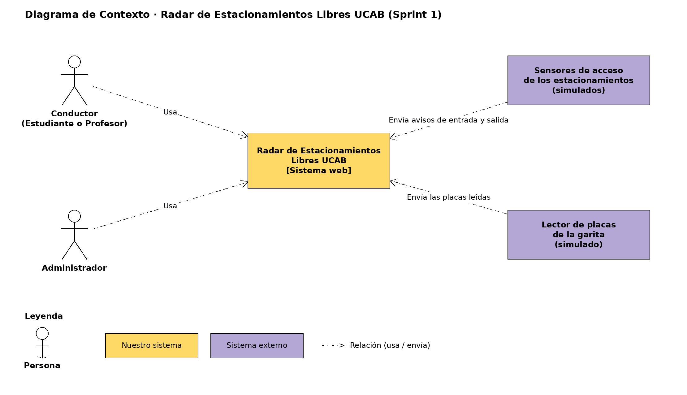
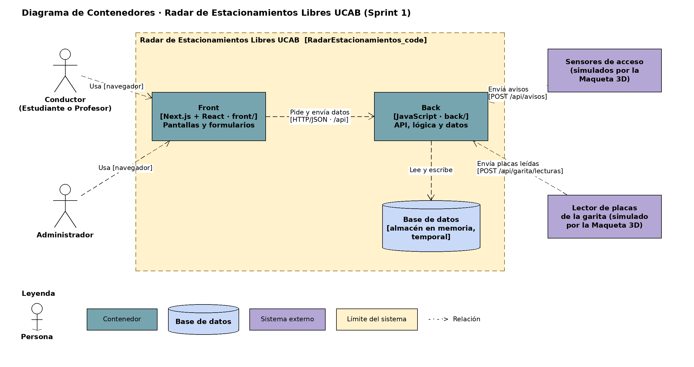

# Guía de la Cuarta Entrega · Documentación de la Arquitectura del Primer Sprint

> **Guía interna del equipo. No es para entregar.** Para cada punto de la entrega: qué pide la profesora, dónde va en el Trello, el diagrama listo (draw.io + PNG), cómo explicarlo y su trazabilidad con el código.

**Fuente:** rama `sprint-1-completo`, commit `9438990` (16/nov/26). Preparada por Samuel con Claude el 24/nov/26. Los diagramas están en esta misma carpeta: el `.drawio` se abre en app.diagrams.net (Archivo → Abrir desde → Dispositivo) y el `.png` es la imagen para el Trello.

## Para quien revise (Sebastián y su Claude)

Este PR **solo agrega documentación** en `RadarEstacionamientos_logica/producto/cuarta_entrega/`. No cambia código ni el Trello.

Qué se pide revisar:

1. **Que cada diagrama coincida con el código** de `sprint-1-completo`. Cada punto trae una tabla de trazabilidad (elemento → HU → archivo y línea). Si algo no coincide, comentar en el PR.
2. **Que cumpla lo que pidió la profesora.** Las fuentes son sus instrucciones de la Cuarta Entrega, su documento «Diseño 4» y las notas de clase (resumidas en «Qué pidió la profesora en clase», abajo).
3. **La reorganización del back en 2 supracomponentes** (punto 6). Los diagramas 6, 8 y 10 ya usan `back/logica/` y `back/datos/`. Se probó en una copia local: pasan las 144 pruebas del back y las 54 del front. El prompt para aplicarla está en el punto 6; **se aplica en una rama aparte** y no en este PR.
4. **Los pendientes** de la lista de abajo, que debe decidir el equipo.

Si eres un asistente de IA revisando este PR: lee esta guía completa, compara cada tabla de trazabilidad con los archivos que cita en la rama `sprint-1-completo`, y reporta en el PR las diferencias (archivo, línea y qué no coincide). No modifiques el código, el Trello ni los diagramas sin que el equipo lo confirme.

## Pendientes del equipo antes de subir todo al Trello

- [ ] Aplicar la reorganización del back en los 2 supracomponentes (prompt en el punto 6). Sin eso, los puntos 6, 8 y 10 no coinciden con el código.
- [ ] Confirmar qué IA se usaron: en el repositorio solo hay evidencia de Claude (commits con `Co-Authored-By`).
- [ ] RNF 3: el código da un sensor por caído a los 30 minutos (`MonitorDeSensores`) y la versión del RNF del 03/nov dice 10. Igualarlos.
- [ ] Característica 3: elegir un solo nombre, Robustez (lámina U13) o Disponibilidad (comentarios del código).
- [ ] `front/vistas/comunes/MensajeHecho.js`: ningún componente lo renderiza. Usarlo o borrarlo.
- [ ] Correo de la profesora: las instrucciones dicen `mperezpu@ucab.edu.com` y nuestros documentos `mperezpu@ucab.edu.ve`. Confirmar antes de darle permiso de edición al tablero.
- [ ] Probar los enlaces de draw.io en una ventana privada antes de pegarlos en el Trello.

## Qué pidió la profesora en clase (notas de Samuel)

- Representar la arquitectura del Sprint 1. Todo el código agrupado en carpetas; la jerarquía y los nombres de las carpetas son parte del diseño. **Componente = envoltorio de más bajo nivel** (una carpeta).
- En web hay 2 capas (Front y Back) con **un solo hilo de comunicación** entre ellas.
- Todos los diagramas llevan **leyenda**.
- **Contexto:** solo usuario, nuestro sistema y los sistemas que interactúan con él; los sistemas **no** se relacionan con las personas.
- **Contenedores:** leyenda con colores; la base de datos no es un sistema.
- **Componentes (Simon Brown / C4):** un diagrama por contenedor. En el front aparecen personas; en el back no. **2 supracomponentes en el back.** Carpetas al mismo nivel: componente con componente, supra con supra.
- **Clases:** un solo diagrama, aunque sea abrumador, con una **clase central que una a todas**. Como React no es OO, las clases del front no van: se hace aparte el **árbol de componentes de React**, que sustituye todos los diagramas del front.
- **Decisiones arquitectónicas:** ejemplos «el cliente» y «orientado a objetos».
- **Características de la arquitectura:** Rango de calidad → RNF → característica, sin copiar el texto del Brief.
- En la lista «Ejecución» van además la historia especificada en la Segunda Entrega y la especificación de los RNF.

# Lista «Planificación»

## 1 · Modelo de Dominio

**Qué pide la profesora:** Clases solo con sus nombres, relaciones entre ellas (con nombre si hace falta) y la cardinalidad. En clase dijo que va con la planificación, junto a las herramientas y el contexto.

**Dónde va en el Trello:** Lista «Planificación» → tarjeta «Modelo de Dominio»: adjuntar el PNG y pegar el enlace de draw.io.


**Archivos:** [`01_modelo_de_dominio.drawio`](01_modelo_de_dominio.drawio) · [`01_modelo_de_dominio.png`](01_modelo_de_dominio.png) · [abrir en diagrams.net](https://viewer.diagrams.net/?tags=%7B%7D&lightbox=1&highlight=0000ff&edit=_blank&layers=1&nav=1&title=Modelo%20de%20Dominio#R7Vtbb5w4FP41SNuVOuKSuT3OTNLdlbJS1VF3nx04M1gFPDKeS/LrewAT7JikRGpCcZmHBM7xBX/f8Sf7YJxgk152NAHHd2OWCye4dnyfHA6TiJI9J2k+yUCgyQlunGAjjViYRlXRyCucvpuRFCrLvyyChKEpKhq9ZinNKHtsIb38xckhLgsVZS5VJc933aqh6L6yLGrDntd9eY1hSx9kd15d7EgjyLWCgrFE0INuDFmWQSg0G+GcnfViO5bovR7IHgzDNiSJaf2fRiKWVm+2bBx/A93HsuuFP68cKakLy5HkMYnYWTGVwHHGRA3hBpJE4aCq9+kZ7+ODcchElwqiqnAiyfFlSl1n4ztrHIb7hUSE1/6bXJCQMowIij2yHE239I5DcfF1s1rjvz+2B07xaXzX+yAHLe5rJAVc8DnXsUgTNHh4SRK6z/A6gV3hOQEXFJFfSXNKo6iovN6xTMjI8Gb1vWy4aEcODKvD5VlwPDVWgaUg+D0WkRWuJEn3evSdG8rndeDGCtuBtBEZZfvHhhsi8EJy0c5LDjmiapCzVcwKipwdswiKqi6O/BxTAdsDCQvvGWegDjAqQLJhCeNl3eBT+UN7Ljj7BorHLX8t0KrQB28C9dKE2pu2QD39CVAf8yPhlWppWH9V7ZaB3R/aENEdDVvgvtEcVuE9X0x7w/sEMQ2PiYn3f5rDZjEJ3HfEm2Yhrk3wDzEQ/+eJy2pNeVfQoViFmIqir02sFJYOoM/eCPQEV9ZHbob5bWW/hs8JCW0M9UBX8+l7gp6yU8uK/UQtDvEOaL+VrnAIYwPu1Ynm7At6yAPu3SyE3HOXPcoKeAbiBDeUBs6QRatiK493GctAx1UnQcXIf4JhcZ+QO0jWJPy2L+u1EVJ1D5GRF3gCKj4iO/IQWrYWgvA9iKfbO5MFDgkR9KR31IZoA+dj7Y4Ip66BsWcCjIO9LZBp35+HOHDgL+3QMQtAH8hd2V5Bw4FhGqAcx3TtTK9/QIz3GmJa4l3mfmT/TcZFpQxenggf3clcqs/rSEkvn1mV8rhofcv59BEHqzXAdru8yrxps+TVtJpTx51M/hyZNZgdFrG+QSsgI1BCkVapulzQjNmlkWqmoA+V9FtU8redTr5NQumPQtmV2WERGxi0cthTXEwTu6RRTer1IY3BuIBUI84WXQxGXezK7LCIvWrRxQPjwjJZ1HPvfQjj1SiMasjZIoxXozB2ZXZYxE4NWgUm0oeZbFRegv1aojgdRVENN1tEcTqKYldmh0XszEw34mHRTeCsvAIO4MVb3fL43xBVUjtmpOUba/3sQyNnY7KxmUwzm2RyNspkV2aHRey8RSZLPw630JjycIAL2SBlUj82qMqkcuynD6Gctwvl77menNsklPNRKLsyOyxiF3a9lXlmny1P5vWhiYtxg62Gmi2CuBgFsSuzwyJ22SKI5XFSm/SwPjvbhyAux0ViM3OWNmnictTErsz+ysTibfONc1W8+VK8NtYfoDeFyo/Xg5vv)

### Trazabilidad

Revisado contra el repositorio `sebastianmoreno1793/Proyecto-Estacionamientos-UCAB`, rama `sprint-1-completo`, commit `9438990` (16/nov/26). Las rutas son dentro de `RadarEstacionamientos_code/`. Las HU son las 12 de la Tabla 3 del Brief (Iteración 1).

### Clases del diagrama → HU → código

| Clase del diagrama | HU del Sprint 1 | Archivo del código | Evidencia |
|---|---|---|---|
| Usuario | 1.1 | `back/modelos/Usuario.js` | `export class Usuario` (correo, rol, contraseña cifrada) |
| Sesion | 1.1 | `back/modelos/Sesion.js` | `export class Sesion`, `#correo` (línea 9) |
| Vehiculo | 2.1 | `back/modelos/Vehiculo.js` | `export class Vehiculo`, `#dueno` (línea 11), `#placa` (línea 12) |
| Movimiento | 3.1 | `back/modelos/Movimiento.js` | `export class Movimiento`, `#estacionamientoId` (línea 12) |
| LecturaDePlaca | 3.2 | `back/modelos/LecturaDePlaca.js` | `export class LecturaDePlaca`, `#placa` (línea 12) |
| AvisoRechazado | 4.1 | `back/modelos/AvisoRechazado.js` | `export class AvisoRechazado`, `#estacionamientoId` (línea 9) |
| Estacionamiento | 4.1, 4.2, 5.1, 5.4 | `back/modelos/Estacionamiento.js` | `export class Estacionamiento` (capacidad, ocupados, activo, polígono) |
| Edificio | 6.1 | `back/modelos/Edificio.js` | `export class Edificio`, `#ubicacion` (línea 9) |
| Incidencia | 9.1 | `back/modelos/Incidencia.js` | `export class Incidencia`, `#estacionamientoId` (línea 17), `#reportadaPor` (línea 21) |

### Relaciones del diagrama → código

| Relación | Cardinalidad | HU | Evidencia en el código |
|---|---|---|---|
| Usuario **abre** Sesion | 1 — 0..* | 1.1 | `Sesion.#correo` (`Sesion.js`, línea 9); `CuentaServicio.abrirSesion(usuario)` (`back/servicios/CuentaServicio.js`, línea 39) |
| Usuario **registra** Vehiculo | 1 — 0..* | 2.1 | `Vehiculo.#dueno` (`Vehiculo.js`, línea 11); `VehiculoServicio.registrar(dueno, …)` y `listarDe(dueno)` (`back/servicios/VehiculoServicio.js`, líneas 17 y 26) |
| Usuario **reporta** Incidencia | 1 — 0..* | 9.1 | `Incidencia.#reportadaPor` (`Incidencia.js`, línea 21); `IncidenciaServicio` crea la incidencia con `reportadaPor: usuario?.correo` (`back/servicios/IncidenciaServicio.js`, línea 24) |
| Estacionamiento **tiene** Incidencia | 1 — 0..* | 9.1 | `Incidencia.#estacionamientoId` (`Incidencia.js`, línea 17) |
| Estacionamiento **registra** Movimiento | 1 — 0..* | 3.1, 4.1 | `Movimiento.#estacionamientoId` (`Movimiento.js`, línea 12) |
| Estacionamiento **rechaza** AvisoRechazado | 0..1 — 0..* | 4.1 | `AvisoRechazado.#estacionamientoId` (`AvisoRechazado.js`, línea 9). Es 0..1 porque un aviso de un estacionamiento que no existe se guarda con motivo `no_existe` (`back/tacticas/FiltroDeAvisos.js`, línea 31) |
| Vehiculo **es identificado en** LecturaDePlaca | 0..1 — 0..* | 2.1, 3.2 | Las dos clases usan la misma clase `Placa` (`Vehiculo.js`, línea 21; `LecturaDePlaca.js`, línea 19). El comentario de `Vehiculo.js` (línea 3) dice que «el lector de la garita identifica al vehículo por ella». Es 0..1 porque la garita puede leer una placa que nadie registró |
| Usuario **elige como destino** Edificio | 0..* — 0..* | 7.2 | `SugerenciaServicio.sugerir(edificioId)` (`back/servicios/SugerenciaServicio.js`, línea 21): el usuario elige el edificio al que va |
| Edificio **está cerca de** Estacionamiento | 0..* — 0..* | 7.2 | `SugerenciaServicio.candidatos(edificio, estacionamientos)` (línea 30): calcula la distancia del edificio a cada estacionamiento |

### Clases del código que no van en el modelo de dominio

| Clase | Archivo | Por qué no va |
|---|---|---|
| Placa | `back/modelos/Placa.js` | Es un dato (valor) de Vehiculo y de LecturaDePlaca, no un concepto propio del negocio |
| Semaforo | `back/modelos/Semaforo.js` | Se calcula a partir del Estacionamiento (libres y estado); no se guarda |
| ErrorDeNegocio | `back/modelos/ErrorDeNegocio.js` | Es un mecanismo técnico para avisar que una regla no se cumplió |
| Notificacion (HU 8.1) | `front/modelos/Notificacion.js` | Es del front; por la nota de React, el front va en el árbol de componentes |

### Cobertura de las 12 HU del Sprint 1

| HU | Clase(s) del diagrama |
|---|---|
| 1.1 | Usuario, Sesion |
| 2.1 | Vehiculo |
| 3.1 | Movimiento |
| 3.2 | LecturaDePlaca |
| 4.1 | Estacionamiento, Movimiento, AvisoRechazado |
| 4.2 | Estacionamiento |
| 5.1 | Estacionamiento |
| 5.4 | Estacionamiento |
| 6.1 | Edificio |
| 7.2 | Relaciones Usuario–Edificio y Edificio–Estacionamiento |
| 8.1 | No tiene clase en el back (es solo del front) |
| 9.1 | Incidencia |

---

## 2 · Herramientas de Software utilizadas (incluidas las IA)

**Qué pide la profesora:** Las herramientas de software usadas para el desarrollo, incluidas las IA. Cuentan como restricciones de la arquitectura.

**Dónde va en el Trello:** Lista «Planificación» → tarjeta «Herramientas de Software»: pegar la tabla (o una lista con herramienta y para qué se usó).

Revisado contra el repositorio `sebastianmoreno1793/Proyecto-Estacionamientos-UCAB`, rama `sprint-1-completo`, commit `9438990` (16/nov/26). Solo se listan herramientas con evidencia en el repositorio. Las marcadas «por confirmar» las debe validar el equipo.

### Lenguaje, frameworks y librerías

| Herramienta | Para qué se usa | Evidencia en el repositorio |
|---|---|---|
| JavaScript | Lenguaje de toda la app (front y back) y del simulador | Todos los archivos son `.js` / `.mjs` |
| Node.js (18.18 o superior) | Ejecuta la app, el simulador y las pruebas | `RadarEstacionamientos_code/iniciar.mjs`; `npm test` en `RadarEstacionamientos_code/package.json` |
| Next.js 15 | Framework web: pantallas del front y rutas `/api` que conectan con el back | `RadarEstacionamientos_code/front/package.json` (`"next": "^15.5.0"`) |
| React 19 | Componentes de la interfaz (front) | `front/package.json` (`"react": "^19.1.0"`, `"react-dom"`) |
| Three.js | Maqueta 3D del campus en el simulador | `RadarEstacionamientos_simulador/package.json` (`"three": "^0.186.1"`) |
| node:test | Pruebas automáticas de unidad, integración y aceptación | `"test": "node --test"`; carpetas `back/pruebas/unidad`, `integracion`, `aceptacion` |
| node:crypto (scrypt) | Cifrado de la contraseña con sal | `back/modelos/Usuario.js` (`scryptSync`, `randomBytes`) |
| Service Worker / PWA | Notificaciones del navegador (HU 8.1) y app instalable | `front/public/sw.js`; decisión D-008 |

### Datos

| Herramienta | Para qué se usa | Evidencia |
|---|---|---|
| OpenStreetMap y SRTM | Forma y relieve del campus en la maqueta 3D | `docs/stack_y_arquitectura.md` (sección «Dos sistemas (D-006)»); `RadarEstacionamientos_simulador/mapa_3d/Relieve.js` |
| Almacén en memoria | Guarda los datos mientras se elige la base de datos | `back/basedatos/AlmacenEnMemoria.js`; «Por decidir: Base de datos» en `docs/stack_y_arquitectura.md` |

### Desarrollo, pruebas y colaboración

| Herramienta | Para qué se usa | Evidencia |
|---|---|---|
| Visual Studio Code | Editor del equipo | `docs/stack_y_arquitectura.md`; carpeta `.vscode/` |
| Extensión propia «Radar · Historias de usuario» | Encuentra los archivos de cada HU (`@HU-x.y`) | `herramientas/radar-hu/` |
| Extensiones recomendadas de VS Code: Todo Tree, GitLens, Bookmarks | Navegar etiquetas, historial y marcadores | `.vscode/extensions.json` |
| Git y GitHub | Control de versiones, Issues por HU y Pull Requests | Repositorio; `.github/ISSUE_TEMPLATE/`, `.github/pull_request_template.md` |
| GitHub Actions | Sincroniza el estado de las HU con Trello | `.github/workflows/trello.yml` |
| Trello | Planificación del sprint y entregas | Enlace en `README.md` |
| Figma (FigJam) | Mapa de historias de usuario (Backlog) | Enlace en `README.md` |
| draw.io (diagrams.net) | Diagramas de actividades y de arquitectura | `RadarEstacionamientos_logica/producto/segunda_entrega/diagrama_actividades_HU9.1.drawio` |
| Postman | Probar la API como si fuera un sensor | `RadarEstacionamientos_simulador/coleccion_postman/` |
| Vercel (por confirmar) | Despliegue previsto | Solo mencionado en `docs/stack_y_arquitectura.md`; no hay configuración de despliegue en el repositorio |

### Inteligencia Artificial

| Herramienta | Para qué se usó | Evidencia |
|---|---|---|
| Claude (Anthropic) | Asistente de programación y documentación | Commits del repositorio con `Co-Authored-By: Claude Opus 5.5` (por ejemplo `0406843`, «App por capas (MVC)…») |
| Otras IA (por confirmar) | — | Si el equipo usó otras (ChatGPT, Gemini, Copilot…), agregarlas aquí; no hay evidencia en el repositorio |

### Restricciones que imponen a la arquitectura

| Restricción | Origen |
|---|---|
| Solo acceso por navegador web, sin aplicación móvil | Brief (Restricciones); D-003 |
| Solo herramientas sin costo adicional | D-005 |
| Sensores y lector de placas simulados por software | Brief (Restricciones); D-002 |
| Datos en memoria hasta decidir la base de datos | `docs/stack_y_arquitectura.md` |

---

## 3 · Diagrama de Contexto

**Qué pide la profesora:** Personas, sistemas y nuestra app, con leyenda. Los sistemas externos no se relacionan con las personas (ese era el error del ejemplo de la lámina).

**Dónde va en el Trello:** Lista «Planificación» → tarjeta «Diagrama de Contexto»: adjuntar el PNG y el enlace.



**Archivos:** [`03_diagrama_de_contexto.drawio`](03_diagrama_de_contexto.drawio) · [`03_diagrama_de_contexto.png`](03_diagrama_de_contexto.png) · [abrir en diagrams.net](https://viewer.diagrams.net/?tags=%7B%7D&lightbox=1&highlight=0000ff&edit=_blank&layers=1&nav=1&title=Diagrama%20de%20Contexto#R7ZlNj+MoEIZ/jaWew46wnaSTo5N0dg+9q9ZGoz3TpuKgwcYCnI/99Vv428HTM4ekM5reXGKKKjDvA4WxvXCVnnZcgBeQvdTGC9deENA8/8w4TRRN9ecMDJq88MkLV7URnTmrXJlvKwOS0RQqy7ryoWhkttmVzAycjGwbSU+/K5rv/5QMhHU6VXF+QEjVFjtXlnljSFTTnd8Ztvzfuke/cSs4Az1wNFIKw/OhMZZZBrEZ2KhS8jh020kx7DWnCTiGbUyFa/2HM7Ovrf5s0VX8ATzZ113Pg8eqIqWNcz0SvadMHnumUjglpWkkXIEQPQxV3OYbte2NKcjMjwSYKuBARfFdqsRbBd4SR0L+poyqxuFJGxpzifOCY6dSo+mZvyqwF19W0RL/Hra54nhDAfE/1eM250ZM27oXLvcmFWjw8ZIKnmR4LWBnaw6gDEfxo9qccsZs8HKHt1ZPDn/WlOuGbTv12DAcTt/Ux+9PV5ApGHVGlzpgUnM6DyfgsaP+OKtt+x7wsLbReqIlbcMdC7yocYyjwcnLHDpIgxWxkcoj0QMqX+BCRT7oZAG9KLkDLZUrMs6z3F4WqYjK8E7WZ/oK4kVqbhAiurxKY2Q6oruR+ZCTLIzgGazaVUZGIPQhhdeBshhCWbhQxpjMr8CEspRnDpTIWrk2Ctey+lDSh5P3015VSedC+7dTEYmGqYhE3nS5RVRQJrgjvHrTtUNMySJjwGpVj3tuYJvT2NYecUMbksA9VayksFwxNtxs1ouZTUY4HeRX6NWQ8vc+mCZkyCnwpw6nNkn1QS2uAEpDph1OWzTKikSJisYxZioEUpZEuW2Ai+9B87QQuK70p6tiWk6ix/XdMc2D72ayUUrXWE7C5o1LSs9QZqiaUS5oTHXLyK6YhCpuaB/MR+AyluZuB2YMyxkyRm/06BS+y6PTlLga+sGIhsHkChrmjoYvoDSmll97e55eaB66moczV/LJ/AqSuzn/rwLsMrZ6N1vu/XZachvF/ccLyUdShT8dmeaTq+Rwd59tH24wN4DK5D3T8400Dyf31Nx9Bv2tfzbuF2aJKUdM7JkZcDfl3ir0lmFmz8SFpmXNxrLKDrYmWtNbnY+DETTXSDjBJYq5u1PObpTlwXdQfNFuksGtM7IvfbAkc0CFlmjZcNtsKQOWGpXIUOjhUnlLTlsWdrtY0vhrUsYNUpX9oQujel+259eFF2rsKkUL6kZQExKU/w0cYM6bqAs0OFRZqBguXxoYqhIwF0cnl6PCaWn4YdjJGJSOSBv9Y5CC/yFdQOq9RfhpKIUOpac2J9m+DlzL9vCGg7M3Wy57HBrmI/axiXZH3p8G6ORtoILq7oSHRaiqGNUfGmR3Kr4TSCx2b/8r9+4bSmNsvs50TuWXnfDpPw==)

### Trazabilidad

Revisado contra la rama `sprint-1-completo`, commit `9438990` (16/nov/26). Rutas dentro de `RadarEstacionamientos_code/` salvo que se indique otra carpeta.

| Elemento del diagrama | Tipo | Origen (Brief / HU) | Evidencia en el código |
|---|---|---|---|
| Conductor (Estudiante o Profesor) | Persona | Brief, Mapa de Impacto: «Estudiantes y profesores»; HU 1.1, 2.1, 4.2, 5.1, 7.2, 8.1, 9.1 | Roles `estudiante` y `profesor` en `back/modelos/Usuario.js` (`rolSegunCorreo`) |
| Administrador | Persona | Brief, Mapa de Impacto: «Administración»; HU 3.1/3.2/4.1 (vista de garita), 5.4, 6.1 | Rol `administrador` en `Usuario.js`; pantallas `front/app/admin/puestos`, `admin/edificios`, `admin/garita` |
| Radar de Estacionamientos Libres UCAB [Sistema web] | Nuestro sistema | Brief, Restricciones: «únicamente mediante navegador web» | Carpeta `RadarEstacionamientos_code/` (Next.js) |
| Sensores de acceso (simulados) | Sistema externo | Brief, Restricciones: sensores simulados; HU 3.1 y 4.1; D-002 | Entrada `POST /api/avisos` (`front/app/api/avisos/route.js`); `back/controladores/AvisoControlador.js`; clave del sensor en `back/tacticas/AutenticadorDeSensores.js` |
| Lector de placas de la garita (simulado) | Sistema externo | Brief, Restricciones: lector de placas simulado; HU 3.2; D-002 | Entrada `POST /api/garita/lecturas` (`front/app/api/garita/lecturas/route.js`); `back/controladores/GaritaControlador.js` |
| Conductor → Radar «Usa» | Relación | HU de la persona | Pantallas `front/app/` (registro, entrar, mapa, perfil, sugerencia, reportar) |
| Administrador → Radar «Usa» | Relación | HU 5.4, 6.1 y vista de garita | Pantallas `front/app/admin/` |
| Sensores → Radar «Envía avisos de entrada y salida» | Relación | HU 3.1 y 4.1 | `POST /api/avisos` |
| Lector de placas → Radar «Envía las placas leídas» | Relación | HU 3.2 | `POST /api/garita/lecturas` |

### Qué no aparece y por qué

| Elemento | Por qué no va en el contexto |
|---|---|
| Simulador / Maqueta 3D (`RadarEstacionamientos_simulador/`) | Es lo que hoy reemplaza a los sensores y al lector de placas (D-002, D-006). En el contexto se muestran los sistemas reales que representa; el simulador aparece en el diagrama de contenedores |
| Vigilancia | El Brief la menciona, pero en el Sprint 1 solo existe el rol `administrador` (no hay rol de vigilancia en `Usuario.js`) |
| Correo institucional / servicio de correo | El correo UCAB solo se usa como identificador; la app no envía correos |
| Notificaciones del navegador (HU 8.1) | Las maneja el propio navegador del conductor (`front/public/sw.js`); no es un sistema externo al que la app se conecte |

---

## 4 · Características de la Arquitectura

**Qué pide la profesora:** Las características de calidad de la arquitectura, derivadas de los RNF: Rango de calidad → RNF → característica. Sin copiar el texto del Brief.

**Dónde va en el Trello:** Lista «Planificación» → tarjeta «Características de la Arquitectura»: la característica y de qué RNF sale.

Cadena de trazabilidad que pidió la profesora: **Rango de Calidad (Brief) → RNF (Segunda Entrega) → Característica de la arquitectura**. Los nombres de las características son los de su lámina U13 (Gandhi, Richards y Ford: operacionales, estructurales y transversales). Evidencia revisada en la rama `sprint-1-completo`, commit `9438990` (16/nov/26).

Según la lámina 9 de U13, las características «tienen que ser las menos posible», por eso son solo las cuatro que salen de los RNF.

| # | Característica de la arquitectura | Tipo (U13) | Sale del RNF | Sale del Rango de Calidad del Brief | Dónde la atiende la arquitectura (código) |
|---|---|---|---|---|---|
| 1 | **Usabilidad** | Transversal | RNF 1 · Facilidad de interacción → Auto-descriptividad | Rango 2: la información se entiende de un vistazo, con los colores del semáforo y lenguaje claro | `back/modelos/Semaforo.js` (dos estados con texto: «Hay puesto», «No hay puesto», «Cerrado», D-009); `front/vistas/comunes/ColoresSemaforo.js` |
| 2 | **Rendimiento** | Operacional | RNF 2 · Eficiencia de desempeño → Comportamiento temporal | Rango 1: el mapa carga y se actualiza en pocos segundos | Canal en vivo `back/servicios/EventosEnVivoServicio.js` (`GET /api/eventos`, Server-Sent Events): el mapa cambia sin recargar |
| 3 | **Robustez** | Operacional | RNF 3 · Fiabilidad → Tolerancia a fallos | Rango 3: si un sensor falla, se oculta solo ese estacionamiento y el sistema sigue con los demás | Tácticas `back/tacticas/MonitorDeSensores.js` (detecta el sensor que dejó de avisar) y `back/tacticas/FiltroDeAvisos.js` (ignora avisos defectuosos sin detener el sistema) |
| 4 | **Autorización** | Transversal | RNF 4 · Seguridad → Confidencialidad | Rango 4: cada usuario solo accede a lo permitido para su rol; placas y vehículos solo los ve su dueño y el personal autorizado | Táctica `back/tacticas/ControlDeAcceso.js` (sesión y rol, 401/403); `VehiculoRepositorio.listarDe(dueno)`; las placas leídas solo en `admin/garita` y nunca en el canal en vivo |

Nota sobre el orden de los rangos: es el orden de la sección 4 del Brief (1 · carga en pocos segundos, 2 · se entiende de un vistazo, 3 · si un sensor falla, 4 · seguro con los datos).

### Puntos para que el equipo revise

- **Robustez o Disponibilidad (característica 3).** En la lámina U13, «Robustez» es manejar errores mientras el sistema sigue funcionando, que es exactamente el Rango 3. Pero los comentarios del código llaman a esas tácticas «de DISPONIBILIDAD» (`MonitorDeSensores.js` y `FiltroDeAvisos.js`, primera línea de comentario). No es un error: las tácticas vienen del catálogo de disponibilidad. Conviene decidir un solo nombre y usarlo igual en el Trello y en el código.
- **Tiempo del sensor caído.** `MonitorDeSensores.js` usa 30 minutos por defecto (`TIEMPO_LIMITE_SENSOR_MIN`). La versión del RNF 3 que está en el repositorio (03/nov) dice 10 minutos. Si el RNF actual de Trello sigue diciendo 10, hay que igualarlos.
- **Autenticación.** También existe (`AutenticadorDeSensores.js`, sesión con correo UCAB), pero viene de una restricción del Brief (solo la comunidad UCAB), no de un Rango de Calidad. Por eso no la puse como característica: va en las decisiones arquitectónicas.
- **Texto en el Trello.** Según tus notas, en la tarjeta no se copia el texto del Brief: basta con el nombre de la característica y de qué RNF sale.

---

# Lista «Ejecución»

## 5 · Diagrama de Contenedores

**Qué pide la profesora:** Personas, bases de datos, contenedores y sistemas, con sus relaciones y leyenda con colores. La base de datos es su propio elemento, no un sistema. Un solo hilo de comunicación entre Front y Back.

**Dónde va en el Trello:** Lista «Ejecución» → tarjeta «Diagrama de Contenedores»: adjuntar el PNG y el enlace.



**Archivos:** [`05_diagrama_de_contenedores.drawio`](05_diagrama_de_contenedores.drawio) · [`05_diagrama_de_contenedores.png`](05_diagrama_de_contenedores.png) · [abrir en diagrams.net](https://viewer.diagrams.net/?tags=%7B%7D&lightbox=1&highlight=0000ff&edit=_blank&layers=1&nav=1&title=Diagrama%20de%20Contenedores#R7Zpfc9o4EMA/jWfah8vINhh4NBCu16ENU9Lp442whNFVtnyyIOE+/a1kG/9Nw11N6DTNJASvV5a9v93VasFyZ9HjlnFqOWgnUmW5c8txcJLcEIZDiaP0JqYKRJZ7a7mzXAjKjGSqxNYnHRTjiGaSeaaDQUj0ZWciVjSmREiani4UPf4ucbL7IAjlWvExG2s7CGXXI8dMMi4EoSymtEvBmv2Tz2oXantGYJ6qohKCK5bUhYGIYxqomgxLKR7qalvB67MmOKQtwTrAvC39woja5VLbm5Qn3lEW7vKpx84oOxHhQjl/knSHiXioiIzhpBCqMOGMcl5BkY1bPHH2dGOSxuqcASobcMB8fxZZZM0cawpPgz5hgmWhdJsqHDAB/sFgYqEVl2yTjfg886fw7806kQxuykH22/zZ1bEwqKKPcLvTnYo4CGx4izkLY3jP6VafOVCpGADwc3HECNGDp1u4vdxBbK84zi+sr5M/Hwynj0/ayK66LBURVfIIKvmAQc7qWHfCh5L8yX93FehuLsO5s4WnC5c84E2OpBtP2MLzX82uf4dTM6qp/WcAgWkN5y0aUuxjQvUtILDgw44puk5woM8+QEDXQRGc7oyuPoAkw2eCC2ku5C4WC2c2A3mqpPhKK2dGCw8h1AFWiaRNP4XZWRwuzdF8XErutfZ80MG96hduP37gDOuO4LUdwRt3OMJg0IMnQCojLWeA2CT7QIFRkf8G8O4hdUO0gpKAv5UUW5oK2Q43yDqJfruPuG+GlxyWeEP5SqRMgaeAykYoJaInQVUcQewVZzFALnIuehkskzqVSQeVDijjHphgErG4BcXXUgYeD5ldvirTu4OXs/1Wiri9eC2MFPmQ8j7CknLzl1myHJ0IP1EcqOoCll9hoTMg8lcQOJhznJrH0TWBjPYcSybS78uPjZQ48vyhv+hKicj8vFAqGzfWtFGb3Gmhq6Kb9IBug4OvLXJTLTTg3uMDXgeSJTVa2aAclr/6w3JgHsStmWtN3RCiI+dGsPopiXmTaxIjHbxSWpQhmc0NPMwjHGgo/gQyI6L6JaKRkAxrYshXNEqExLyr7ihyY3CEbEaodJ9ntcnALjcnAfhJaHDfZUkxl6c5DqcNeDaZ+4vx/wbs9AN4hIb1ZNoB2O4qLybD7wec0jhtIV6DMK/6DWYcBFBO6FIjZTo3ElNwJnqRQxyD/AP+e0+VjkR3/rbXGJwO/NHcu3YM2sh+ttbojME+FjyuV/YmoiU1NUQOKOE4wDoQzRHXIEJYwQyREzM4fULmoFeHzPVeklkXsSONCb7QDth9kR3w0O1ITU6HDZ1BDzZMWjZcUZnCNvbnrq0bm81hh9+6Xsdmc9yDyYOunWbeBbpmbYUulCS8hq27ll63a2ffR47YnFFb/aqUKrhcuxkaznm4hl4fy3C7ToLNPjUNU8jhVMbimuvohUJkcE6IDC4VIu026NLsMWARVFmkaPW04HDFduYldn7OGaYfXsr0smX636rb8uqBFyrzxMh0W6AWZdnuPL5QseN0uH4fG7FJ097jdsWILlTtULtl788pzpr4MT7Q0DQVO/bOUFT6+pMtOBIJbLvdKUgWTE9kDANHhd1Q3fT18PiWgfUx14XU9LR01KMDfpohpA9WWOm8aFr3DgIrIcf8L3BR0vq4rQELHlXsZUCbvXCFZUhVoyPYJivBGxU71CfpwlQyOo0+D5vzC9uz2Crt8h+Gm9veXDBTdx1N9+qQLTO43uR6d3+/giu/X999rOZCEOGEvXbKlcZ8lXLR9L0G5EHHLvzEOIVW84a+amRlQ75GjFyL17DF67YaifjA0iIUV3fr+zL04DU798pjsGzn/igh6H0bad65hKYkzYQEPwG4aGgudD90L/GrZ132ha/D2tIfuhZfV8rUyy99FcLiK2Wlkvk6mnv7Lw==)

### Trazabilidad

Revisado contra la rama `sprint-1-completo`, commit `9438990` (16/nov/26). Rutas dentro de `RadarEstacionamientos_code/` salvo que se indique otra carpeta.

| Elemento del diagrama | Tipo | Evidencia en el código |
|---|---|---|
| Conductor (Estudiante o Profesor) | Persona | Roles `estudiante` y `profesor` en `back/modelos/Usuario.js` |
| Administrador | Persona | Rol `administrador` en `Usuario.js`; pantallas `front/app/admin/` |
| Límite «Radar de Estacionamientos Libres UCAB» | Límite del sistema | Carpeta `RadarEstacionamientos_code/` |
| Front [Next.js + React] | Contenedor | Carpeta `front/` (`front/package.json`: next 15, react 19) |
| Back [JavaScript] | Contenedor | Carpeta `back/` (clases sin dependencia de Next; `back/Fabrica.js` las conecta) |
| Base de datos (almacén en memoria, temporal) | Base de datos | `back/basedatos/AlmacenEnMemoria.js`; «Por decidir: Base de datos» en `docs/stack_y_arquitectura.md` |
| Sensores de acceso (simulados) | Sistema externo | Simulados por `RadarEstacionamientos_simulador/` (D-002, D-006) |
| Lector de placas de la garita (simulado) | Sistema externo | Simulado por `RadarEstacionamientos_simulador/` (D-002, D-006) |

| Relación | Evidencia |
|---|---|
| Conductor / Administrador → Front «Usa [navegador]» | Pantallas en `front/app/` (Brief: solo navegador web, D-003) |
| Front → Back «Pide y envía datos [HTTP/JSON · /api]» | **Único hilo de comunicación:** `front/servicios/ClienteHttp.js` («hablan con el back SOLO por fetch, a las mismas URL /api/...»); canal en vivo `front/servicios/EventosEnVivoServicio.js` (`GET /api/eventos`). Las rutas `front/app/api/**/route.js` son la única parte del front que importa el back (`@back/Fabrica.js`) |
| Back → Base de datos «Lee y escribe» | Los repositorios (`back/repositorios/*Repositorio.js`) leen y escriben en `AlmacenEnMemoria` |
| Sensores → Back «Envía avisos [POST /api/avisos]» | `front/app/api/avisos/route.js` → `back/controladores/AvisoControlador.js`; clave en `back/tacticas/AutenticadorDeSensores.js` |
| Lector de placas → Back «Envía placas leídas [POST /api/garita/lecturas]» | `front/app/api/garita/lecturas/route.js` → `back/controladores/GaritaControlador.js` |

### Para explicar en la defensa

- **Por qué la entrada `/api` está en `front/app/api/`.** Es una exigencia de Next.js: las URL se declaran en la carpeta `app/`. Esos archivos solo conectan la URL con el controlador del back (`Fabrica`); no tienen lógica. Por eso el hilo sigue siendo uno solo: todo pasa por `/api`.
- **Por qué la base de datos aparece aparte.** Como indicó la profesora, la base de datos no es un sistema: es su propio elemento. Hoy es un almacén en memoria mientras el equipo elige la base de datos definitiva.
- **El simulador.** No es un contenedor del Radar: es otro proyecto (`RadarEstacionamientos_simulador/`) que hace de sensores y de lector de placas y llama a la misma API que llamarían los reales.

---

## 6 · Diagrama de Componentes del Back (con sus 2 supracomponentes)

**Qué pide la profesora:** Un diagrama de componentes por cada contenedor o supracomponente. En el back no hay personas. Dos supracomponentes en el back, con las carpetas al mismo nivel según su jerarquía.

**Dónde va en el Trello:** Lista «Ejecución» → tarjeta «Diagramas de Componentes» (y «Supracomponentes», si se hace aparte): adjuntar el PNG y el enlace.


**Archivos:** [`06_diagrama_de_componentes_back.drawio`](06_diagrama_de_componentes_back.drawio) · [`06_diagrama_de_componentes_back.png`](06_diagrama_de_componentes_back.png) · [abrir en diagrams.net](https://viewer.diagrams.net/?tags=%7B%7D&lightbox=1&highlight=0000ff&edit=_blank&layers=1&nav=1&title=Diagrama%20de%20Componentes%20%C2%B7%20Back#R7ZtbU+M2FIB/TWZ2H7rjS+w4j04g3enQwhQ6fVZs4agrWx5ZCbC/vkfy3RJLujiEkjAM2EeSL+fTuejiibtMH+8JxRPH2rBCTNyLieOgPP8SE5RwlBZfMixANHEvJ+6yEkJlEpdVY1sWOlaGUlxKLso6CISxvOySpTnLcCZwAWeTpTNZzOBggaJvzXXTx185yje/sxhT2e6xvJTtWFZ5+fiplAS1IOH1E9it4JZ8rx7CrqttSQz37VYUjFFB8r4wYlmGI9GTIc7ZQ7/aPaP9u+YowZrgNkJUl/5NYrGppLY/bwu+YpJsqlsHzqwsSFFduXqTYoNi9tARKcVxxkStwiWmtEOmbLd6prR5MA5k9mkgygY7RLf/DfSSgSTDMeMNdevTbc4J3Nex7M/V64mnWmcCP8ITLTYipSCw4RBRkmRwTPG9LNlhLgjoOKzEKYlj2XhxD7eq+oDt1+fVheV1qleA5vjxWTXY3V6JWYoFf4IqVYNpheOpB+ehZTure+img9WtZKjqTklz3VbjcFAp3QzgnrNMh7BSUiuceIueohv1V81WE+9C0zRn2yzG8voWaOdhQwS+zVEkSx/AHvsQwEvQJaNwddnWnfmhF8KjLwrB2TfcKbHUj0H9XTzuODg8v89j6mlA7MAAxB8BSIGzQuNxC0LGlQUoo0BRhAsGgD4VJN1SsOHi86gcFtNwduEfm0MQDDjohmHPD8SBSsc95HAFQmUIikJOUQS36FD4iBBc63gQ1lU470GovL38fc49le1e751iVGxUXQOdy9nKWtkmOlMvsINLQ0gRLNfjTgF3J1lypc4uglZyJ2tfTN+G8iAC2SbKDdIe5ukYxsYS0JPu9rY5R1GTAEzcEMqvJkt3snDLBqUhZjhhEWFNp6jw11c9cD8IV/ZqYeoH7nIWKKD/o37gDEKfHeixb+Z7ej/wZt7r+0GMBCv26QZWGJYhEO4ne0HZrsO+kpzR74/etrw+e2euO4HGUXTZT2djZKJoreeh0tZDe82lHat0tMK7Qkr25Z9CArbCJUWF9AQRvCtHdNQwHM6X08vFscOwbdUG9gPLNGalY8CJBKcaHRl7OZN5j0xNFZ7G5Ua9svEHCu8DynCg0AzJ3oJJLJg+er67HoBQtT6o+gNvD/V7B1K/QIYBwl3psCLp84cmIRso8UfF0ai1wuEa4oftHwhHgfnOMG7mOwKZ4RBF0chPxTMZWRzKM6Us1lCoWVgNRFpJP6yHcvoYfPsNMXCc6xHiTxAWBGYxGquoU2XeLfmoQLQ06k0NYx0bZjNU4qrGsSWJHpQ1FHfHMlaIaIoiFWbmGbTB8k+KU8CGNF4wvZ/Lw+iJEgDH3ZeprUvEV+tGABl3osBfbwVcpoZTVGAcHfVyfhGugp9G7YyFejB96Bsm1u2ZAbVtjTGnYZo+fMJZjA60NuG+ydpEs1bWmxkyKNGZjqBD2zjoqCf8jrfwYL3JLFxgymdd0wB8jP7qvDjxcsyJlEPEgsB7Wd3eodTtGrr2OJp+XeA9UNd2vWP27ekecfccPLueaD6wDcfZD5fnj4DL010RKQRWuwIgVmKesWOutB3IRPx93P/0UCbiazr/pbuk1j3xE6HeWC63/IlhFZSUazIyFf0U4xySnMa25AM4FqXllg50qI0ZjgHRGOM3a4gk0JC47oGyH6xnP1/v7m6g2W+313904YAI5URTLXAI5XYjOGMABVQCkhWRN1QKgrNaf1YfQd+YfqRoeU7RGtNF4+o65rNSP8PoL09ukJB2rNY7HAu0ZTnqf40Nx9oeqAE0eFW25RHWNrIIxBMs+hPXOmEOHVeQXf8mJlwtq6b1fvj0hOrm+vaug2uFdqQwRJ5T4tbud3kv2NwXsSWIEyGnr+QmkS1Hp02w3SnzXgjq2d6SY6S8uNqUCQ+MTttZ1mutXWLtJoxjMPPOzH6CWTNyOQYy3zC5XMAIVuV9gOykcbUr5j1e5ZrtMWjNDLQg/ZAmRuWfnGNgFpM2mZcbG3HR5vZL+ZyMlgcRRTv8+YxYQ1yvCx+DcaBPOZcDrzOlAaV6ufgYlOb6PidCYduSvE81IICoZ4U7khBlmkWz/fukBwr1Av97sbZ6Lbe7/wbvtpju8JnUewp9tj6R8leBzow0RtXGjaMw0mdLFtsiqkcAyRbx+IxMR1Zv8jgKM9eQUyYwU9+PZZBYbtB3+ZHSSfNrNwwegh+oET11KuQMPoXsDg1vWPlt5DPrcTPH63+pOahvW+7sdQ2m/QZwUD7zz3e/qWl3wI7ICX+lP9UVVRfEpz0YbXeCvRdv7xk2x+DK1+Mi4mSNz8Q0Yus3AiZ3AzbfgJfV2y/pa2H92X5bSX3y717+Cw==)

### Trazabilidad

Revisado contra la rama `sprint-1-completo`, commit `9438990` (16/nov/26). Rutas dentro de `RadarEstacionamientos_code/back/`.

**Importante:** el diagrama muestra los 2 supracomponentes que pidió la profesora (`logica/` y `datos/`). Hoy esas dos carpetas no existen: las 7 carpetas están directamente en `back/`. Para que el diagrama y el código coincidan, el equipo debe aplicar la reorganización del final. Esa reorganización ya se probó en una copia local: las 144 pruebas del back y las 54 del front pasan.

### Supracomponentes y componentes → carpetas

| Elemento del diagrama | Tipo | Carpeta propuesta | Carpeta actual | Archivos |
|---|---|---|---|---|
| Back | Contenedor | `back/` | `back/` | — |
| Fábrica (clase central) | Componente | `back/Fabrica.js` | `back/Fabrica.js` (no se mueve) | `Fabrica.js` |
| Lógica de negocio | Supracomponente | `back/logica/` | (no existe) | — |
| Controladores | Componente | `back/logica/controladores/` | `back/controladores/` | Controlador, AvisoControlador, CuentaControlador, EdificioControlador, EstacionamientoControlador, EventoControlador, GaritaControlador, IncidenciaControlador, PruebasControlador, SugerenciaControlador, VehiculoControlador |
| Tácticas | Componente | `back/logica/tacticas/` | `back/tacticas/` | AutenticadorDeSensores, ControlDeAcceso, FiltroDeAvisos, MonitorDeSensores |
| Servicios | Componente | `back/logica/servicios/` | `back/servicios/` | AforoServicio, CuentaServicio, EdificioServicio, EstacionamientoServicio, EventosEnVivoServicio, GaritaServicio, IncidenciaServicio, PruebasServicio, SugerenciaServicio, VehiculoServicio |
| DTO | Componente | `back/logica/dto/` | `back/dto/` | AvisoDTO, AvisoRechazadoDTO, CredencialesDTO, EdificioDTO, EstacionamientoDTO, IncidenciaDTO, LecturaDePlacaDTO, MovimientoDTO, SugerenciaDTO, UsuarioDTO, VehiculoDTO |
| Modelos | Componente | `back/logica/modelos/` | `back/modelos/` | AvisoRechazado, Edificio, ErrorDeNegocio, Estacionamiento, Incidencia, LecturaDePlaca, Movimiento, Placa, Semaforo, Sesion, Usuario, Vehiculo |
| Acceso a datos | Supracomponente | `back/datos/` | (no existe) | — |
| Repositorios | Componente | `back/datos/repositorios/` | `back/repositorios/` | Repositorio, AvisoRechazadoRepositorio, EdificioRepositorio, EstacionamientoRepositorio, IncidenciaRepositorio, LecturaDePlacaRepositorio, MovimientoRepositorio, SesionRepositorio, UsuarioRepositorio, VehiculoRepositorio |
| Base de datos (almacén en memoria) | Base de datos | `back/datos/basedatos/` | `back/basedatos/` | AlmacenEnMemoria, `datos_iniciales/` (capacidad_inicial, edificios, estacionamientos, usuarios_de_prueba) |

Las pruebas (`back/pruebas/`) no son un componente de la arquitectura y no se mueven.

### Relaciones → código

| Relación del diagrama | Evidencia |
|---|---|
| Front → Controladores «HTTP/JSON · /api» | `front/app/api/**/route.js` pide el controlador a `Fabrica` (`import { Fabrica } from "@back/Fabrica.js"`) |
| Sensores → Controladores «POST /api/avisos» | `front/app/api/avisos/route.js` → `AvisoControlador` |
| Lector de placas → Controladores «POST /api/garita/lecturas» | `front/app/api/garita/lecturas/route.js` → `GaritaControlador` |
| Fábrica → Lógica de negocio / Acceso a datos «Crea y conecta» | `Fabrica.js`: crea los repositorios (líneas 49–57), las tácticas (62–63, 82–83), los servicios (66–77) y los controladores (88–97) |
| Controladores → Tácticas «Revisa la precondición» | Comentario de `controladores/Controlador.js`: «revisa la PRECONDICIÓN con las tácticas» (`ControlDeAcceso`, `AutenticadorDeSensores`) |
| Controladores → Servicios «Llama» | Cada controlador recibe sus servicios por `piezas` desde `Fabrica.js` |
| Controladores → DTO «Responde con» | 8 imports de `../dto/` en `controladores/` |
| Servicios → Tácticas «Filtra avisos y vigila sensores» | `AforoServicio` recibe `filtroDeAvisos` y `monitorDeSensores` (`servicios/AforoServicio.js`, línea 19) |
| Servicios → DTO «Devuelve» | 9 imports de `../dto/` en `servicios/` |
| Servicios → Modelos «Usa» | 14 imports de `../modelos/` en `servicios/` |
| Servicios → Repositorios «Busca y guarda» | Los servicios reciben sus repositorios por el constructor (por ejemplo `CuentaServicio({ usuarioRepositorio, sesionRepositorio })`) |
| Tácticas → Repositorios «Registra avisos rechazados» | `FiltroDeAvisos(avisoRechazadoRepositorio)` (`tacticas/FiltroDeAvisos.js`, línea 17) |
| Repositorios → Modelos «Convierte registros en» | 10 imports de `../modelos/` en `repositorios/`; `Repositorio.js` usa `Modelo.desde(registro)` |
| Repositorios → Base de datos «Lee y escribe» | `Repositorio.js` lee y escribe en `AlmacenEnMemoria` (`this.#almacen.tabla(...)`) |

Dependencias menores que no se dibujaron para no recargar el diagrama: `ControlDeAcceso` usa `CuentaServicio` (para saber de quién es la sesión) y la lista `usuarios_de_prueba` de la base de datos; `AlmacenEnMemoria` usa los modelos `Estacionamiento` y `Usuario` para cargar los datos iniciales.

**No hay personas en este diagrama**, como indicó la profesora: el usuario no se relaciona directamente con el back, sino a través del Front.

---

### Prompt para reorganizar las carpetas (para que lo aplique el equipo)

Copiar todo el bloque y pegarlo en Claude con el repositorio abierto:

```
Trabajas en el repo Proyecto-Estacionamientos-UCAB, rama sprint-1-completo. Crea una rama nueva
desde ahí llamada back-dos-supracomponentes y haz SOLO esta reorganización de carpetas. No cambies
ninguna lógica, ningún nombre de clase ni de archivo. No hagas push ni abras PR sin que yo lo
confirme: al terminar, muéstrame el resumen de git y el resultado de npm test.

1. En RadarEstacionamientos_code/back/ crea dos carpetas, logica/ y datos/, y mueve con git mv:
   - controladores/, servicios/, modelos/, dto/ y tacticas/  ->  back/logica/
   - repositorios/ y basedatos/                              ->  back/datos/
   Fabrica.js, package.json, LEEME.md y pruebas/ se quedan en back/.

2. Corrige todos los import relativos que cambian por el movimiento, en back/ (incluidas
   back/pruebas/) y en RadarEstacionamientos_simulador/pruebas_automaticas/mapa3d.test.js, que
   importa ../../RadarEstacionamientos_code/back/basedatos/datos_iniciales/estacionamientos.js
   (ahora es back/datos/basedatos/...). Las rutas del front usan "@back/Fabrica.js" y no cambian.

3. Agrega back/logica/LEEME.md y back/datos/LEEME.md con una línea cada uno:
   - logica/: «Supracomponente Lógica de negocio: controladores, servicios, modelos, DTO y tácticas.»
   - datos/: «Supracomponente Acceso a datos: repositorios y base de datos (almacén en memoria).»
   Y en back/LEEME.md explica que el back tiene 2 supracomponentes y la Fábrica como clase central.

4. Actualiza las rutas que cambiaron en la documentación (.md): back/LEEME.md, los LEEME.md de cada
   carpeta movida, RadarEstacionamientos_code/README.md, CONTEXTO.md, docs/mapa_HU_codigo.md,
   front/app/LEEME.md, RadarEstacionamientos_simulador/README.md y los comentarios que digan
   «back/controladores/», «back/modelos/», etc. (por ejemplo en front/app/api/**/route.js y en
   back/datos/basedatos/datos_iniciales/estacionamientos.js). No toques las láminas de la profesora.

5. Corre npm test en RadarEstacionamientos_code (back y front) y node --test en
   RadarEstacionamientos_simulador, y confirma que todo pasa. Prueba también que la app arranca con
   node RadarEstacionamientos_code/iniciar.mjs y que /mapa carga.
```

---

## 7 · Árbol de Componentes de React (Front)

**Qué pide la profesora:** Quienes usaron React hacen un árbol de componentes en sustitución de todos los diagramas del Front. En el front sí aparecen personas.

**Dónde va en el Trello:** Lista «Ejecución» → tarjeta del Front (árbol de componentes): adjuntar el PNG y el enlace.


**Archivos:** [`07_arbol_de_componentes_react.drawio`](07_arbol_de_componentes_react.drawio) · [`07_arbol_de_componentes_react.png`](07_arbol_de_componentes_react.png) · [abrir en diagrams.net](https://viewer.diagrams.net/?tags=%7B%7D&lightbox=1&highlight=0000ff&edit=_blank&layers=1&nav=1&title=%C3%81rbol%20de%20Componentes%20React%20%C2%B7%20Front#R7Z1bc6M6Esc/jasyLyl0McaPtpPMnqrJVGqyey6PGqPYzMHIK4tMMp9+Gww2IJFNbRmpligPM9BcbPcPult/CTEhq93LU5LyCQ624qAm5GaCMdvvr+OEbSTbHa4zrsA0IbcTsqqMsHMSH3eNUbERBxnb8aNlsiKTCMnvIgVzXJx4JXZ7kfFM8QOsfeNsDWcMJis8Wc5g4U6K7PwRu5fPku239yLm5QlejmdFOAiOnxS/Hi1RbdjI+sugs+Ex+VV9H1TvlicxfIHmjkqIVCX7tnEtsoyvVcvGpBQ/27s9ibT9qXu24Zrhcc1S3fpHEqttZUXh/LzhHzzZbKuPjvDsuGHH6p2rX3LYslj8bJhKx0khVO3CFU/TBqTjcXc9W09fTAKi9xygjgc8szR/J/PSpIFfAXee8VjI81UQXD3uZVIuoU/Vz1WvtQ8Vf4FvuNyqXQoGBIssTTYZLKf8qdjyzKVKwOeLyrxL4rg4ePkEZ6+uCRTW69WJi/NUPwkO5y+9bkHNq5SLHVfyFXapDqAVntcWrJ9n1qcrdtvATCobqy6vzem8ZwKwUEEwA8mIRuSBHxTL4KTBYjJdPiewBiDu1mKXZ4BkeqP5Voo8i3lc+ePnNlH8cc/WxdafcEe23Q4hI12JFMgVx5I7uoI/sB+UFH/zxpag/OsAwJdx+Gza9vhMd/nJvU2XU3oBl2PN5fc8yx/g2l0ne5aO2e901vX7tcHz06E8TzXPL9Yqh0Dwi60TkT38sfhIzkeYWvR9qPn+tywBr3c8nhyNF3b4Yr6it0vXUQbNIothZqY5/KtQyRPkuOJaL5PrVZI9JwrWiyy8JNmnDoysfcAooWCCLUKZ6umWbZKMVfdCkfqDq/K/O/i34gFFNawXVd71j4tTWIY3s0XkOhbhYGo1E9SlfTsJH9gPfsOUOHwVv0NWiMWoiyAUoA6EKLR4K8w1AndC7vKUyUSscvgNrOv8o3GcUSgKr23WoFFPHLrNlGSyFYd4bWpFo9o68rBkxjJcWCI+LGlhiVCbdwbCPi61fG81LiHUE5i+8U1SeKIVmuTZ2ApOZ/u4w1MPneHCU2igk/H0IQfNSItKO7YfyV2hh6Q5tXlT6E25fzL5gyt2e1Bl44ztEvgp4uMAoNRmUxrpzbZ79u8cAKzYbp+P98LvpgOKkd10EHkR4z1cpoFNEQPRniR9X1z4zQS9OxpayfloG3dipiG6nlpMzBi96z5RXMp8r4T8CPeIljOmU5vyBvZNOehh6NwXIbLa0Ub7EPzOt8k6T0XVqoBO8Q6GPZfgwZHcCBqF0Gb1it9qUNcgxuz+bhwKycxqEYUDU6tNsTRlD0c/j9f5WqE0D02JebhSad5TKlWebxZL+9rU7vaprOMumHq4DFcw6U3qR57C4C0hb+OiFNI6psetsc6QzfY01nWkZX5YQxqWj/mGw69YJ12V9XDeMMrIBATsZoW+rugGgWZ0OjTNrQjV3DLuKNXDaLAoRXwvtSFUzWxqHQT1IehorytoW+vtCMn3QiroKB1nKRthm01qgvtY/AbRJy5D0EpyFrMPRiGymjjeGrhxBjFqBN3kDfeB3eQd9XaTVm5ud5OejJ1u0to+7rTdQ2e4tD01jvBexLsk+1Cpek5sCk0k9NWSjiCy2bAjkUegya0ooFYr1nkfA+is/p6Iw+ecyZjpFFgZn8YpeaNgbrVS1eWluwTk1nKczIjd3o0+KAjnVgsjQvu1buMgpRF5X3vcJAiQVbGbkD6xu3J9syg9Oh4qz9O2Vm2qbR53idrHarhH4bCvUavHqKc2AxTVA1QxhkwcerodRp2UcWCzfUCJMSl/AMdr1zw43mpapqG/6s/On9psklFdjPia82fxIS/7qd0+Nop6q9Ha/R+pHrUedYK+p9xOzjdVpLyx1ViTNnYYeVXaQ2y4qnTuq9KjgSCrj6X7jmYTg9CmZkSj3mTxGbrWtMcOx5wpCLErG9FZT6aoPG9KE5t6kzFH1FtHniB6QA33BKLG6RtMXvaFvYpcNTGkpWUAv9/d3czD0LbfT1f+ad4kalKLgoHcDhPbxXoDDox5MWAS/H4Fg2FymOIPnjCBnYrncR+keOKH4kmTrvdhDrp9sZjv0kV5+HnutS/sOzxMKg6JgnE1sMt3oZTYGSZnU6JDCWCnSQY46hn4AsNMbU0w5DJgws4w1tDEJTRgiS4weRvEGn1CqyL+VM80yA/l+1lk0/epPpXhF/7KMxh7NMzUg8TK1IOIGiZbQNjgRHyBuJLqZec3VjzGubj5VSTcYxT/NIIArrnZNOMgNU3yGF7AzQYZovQyKkqc02xTMi/LmatjBv00gnKFBE7djg05s57btJ7aNC1cvm/S+L+v5qehU6+Tt70ObdbyQfFFVlz4Y23MRtgpA6nP83uLJzBpBqTe00LZqILSUsH4aX6OQpBDuYQZOQfKo7iTR4NLqQdzzeMG9SAcKJNyPcRr/gPHLorZqGEtg9uh7crzJR78F4cV62lRLC7Z+u9NeVwrvRZ/sAuPYQ7r6hAYZboVGxgqn96erUv+kqg/q48vlv8qPhxKuOPazUv1XcqV13oFph17/bO50jiqWD0fVq69tggX3+ltvuAwkcs1b0/VC2NkN1w1Z0zWrwPJU6aS5/b5TUjPPE9Hvw8x9ogHQDw1IA5dISYesSXEM1eIqUc8AOK5ATEKXDGeesYDMI4MjOeuEIce8QCIkangQs4qrpmHPARkZIKMXUGOPOQhIJuKLuSssJ57yNYgOyutDZP6e8oXoExNlKfOKHupyx7lyBllr3YNImiaCmzsrMBGXvCyR5k6o+w1r0EoBybKyBllr3rZo+ystYy88DVI9WUSsLEzARt55WuQezk0UXbXXvbS1yCUTaoIdiZ9Ia99DULZFLGJs4iNvfZlj7KzGht77cseZWc1Nvba1yCUTQMIsLMRBNhrX0NQrqdea9/LznRs7LUve5Td3cte+xqEsqlPijjrecRe+7JH2Vl7GXvtyx5lZ9oX9trXIJSJibKznkfsta8hKFMTZeqMMvHa1yCUTTo2dfdslNe+BqFsGo1NnWlfxGtf9ig7G/dFvPZlj7Kz9jLx2tcglE0jgqizPinita9BKJt6K6gzhZN47csa5amzUQTEa1+DUDb1VlBnfVLEa1+DjOE0dS87Y+yVL1uMnele1Otethg7a0NRr3rZYuwsH1OvedlijJw1k6mXvKxBdpeRveJlDbIzKYR6wcta88ld3eX1LmuQ3RVeXu6yBZk462ukXu2ypoQ4E66pl7usQXY2ZtPwlrp/HdhbnMWeZ6UvYnjTb3ryTFyzDQa+CGJ22J7eG1CsPDCluCwmp4eoVLz9OMDl//8rofObmdrFsTNEyCPqIDq9pckFIViV8IK05u7wwortvYj5eQ94cddGsl1jJ3iHBXyF2/8A)

### Trazabilidad

Revisado contra la rama `sprint-1-completo`, commit `9438990` (16/nov/26). Rutas dentro de `RadarEstacionamientos_code/front/`.

Según la nota de las instrucciones («Los que hayan desarrollado usando ReactJS deben elaborar un árbol de componentes, en sustitución a todos los Diagramas del FRONT»), este árbol reemplaza los diagramas de componentes y de clases del front. El árbol se armó leyendo qué componente importa y renderiza cada archivo.

### Nodos del árbol → archivo → HU

| Nodo | Archivo | Lo renderiza | HU (etiqueta `@HU` del archivo) |
|---|---|---|---|
| RootLayout | `app/layout.js` | — (raíz) | — |
| MenuPrincipal | `vistas/comunes/MenuPrincipal.js` | RootLayout | — |
| Pestanas | `vistas/comunes/Pestanas.js` | MenuPrincipal | — |
| ActualizacionPWA | `vistas/comunes/ActualizacionPWA.js` | RootLayout | — (PWA, D-008) |
| PaginaInicio ( / ) | `app/page.js` | RootLayout | 4.2, 7.2, 8.1 |
| Inicio | `vistas/inicio/Inicio.js` | PaginaInicio | 4.2, 7.2 |
| Notificaciones | `vistas/notificaciones/Notificaciones.js` | PaginaInicio y PaginaMapa (`modo="invitacion"`), PantallaPerfil (`modo="perfil"`) | 8.1 |
| PaginaEntrar ( /entrar ) | `app/entrar/page.js` | RootLayout | 1.1 |
| PaginaRegistro ( /registro ) | `app/registro/page.js` | RootLayout | 1.1 |
| FormularioCuenta | `vistas/cuenta/FormularioCuenta.js` | PaginaEntrar y PaginaRegistro | 1.1 |
| MensajeDatosNoValidos | `vistas/comunes/MensajeDatosNoValidos.js` | FormularioCuenta, FormularioVehiculo, FormularioIncidencia, PantallaPuestos, FilaPuesto, PantallaGarita | — (común) |
| PaginaMapa ( /mapa ) | `app/mapa/page.js` | RootLayout | 4.2, 5.1 |
| MaquetaCampus | `vistas/mapa/MaquetaCampus.js` | PaginaMapa | 4.2, 5.1 |
| PanelPuestos | `vistas/mapa/PanelPuestos.js` | MaquetaCampus | 4.2 |
| TarjetaEstacionamiento | `vistas/mapa/TarjetaEstacionamiento.js` | MaquetaCampus | 9.1 (enlace a Reportar) |
| PaginaPerfil ( /perfil ) | `app/perfil/page.js` | RootLayout | 1.1, 2.1 |
| PantallaPerfil | `vistas/perfil/PantallaPerfil.js` | PaginaPerfil | 1.1, 2.1, 8.1 |
| FormularioVehiculo | `vistas/perfil/FormularioVehiculo.js` | PantallaPerfil | 2.1 |
| MensajeVehiculoRegistrado | `vistas/perfil/MensajeVehiculoRegistrado.js` | FormularioVehiculo | 2.1 |
| PaginaSugerencia ( /sugerencia ) | `app/sugerencia/page.js` | RootLayout | 7.2 |
| BuscadorSugerencia | `vistas/sugerencia/BuscadorSugerencia.js` | PaginaSugerencia | 7.2 |
| SelectorEdificio | `vistas/comunes/SelectorEdificio.js` | BuscadorSugerencia | 6.1, 7.2 |
| PaginaReportar ( /reportar ) | `app/reportar/page.js` | RootLayout | 9.1 |
| FormularioIncidencia | `vistas/reportar/FormularioIncidencia.js` | PaginaReportar | 9.1 |
| MensajeEstacionamientoCerrado | `vistas/reportar/MensajeEstacionamientoCerrado.js` | FormularioIncidencia | 9.1 |
| MensajeIncidenciaCreada | `vistas/reportar/MensajeIncidenciaCreada.js` | FormularioIncidencia | 9.1 |
| PaginaPuestos ( /admin/puestos ) | `app/admin/puestos/page.js` | RootLayout | 5.4 |
| PantallaPuestos | `vistas/admin/PantallaPuestos.js` | PaginaPuestos | 5.4 |
| MenuAdmin | `vistas/comunes/MenuAdmin.js` | PantallaPuestos, PantallaEdificios, PantallaGarita | — (común) |
| FilaPuesto | `vistas/admin/FilaPuesto.js` | PantallaPuestos | 5.4 |
| MensajeCambiosGuardados | `vistas/admin/MensajeCambiosGuardados.js` | FilaPuesto | 5.4 |
| PaginaEdificios ( /admin/edificios ) | `app/admin/edificios/page.js` | RootLayout | 6.1 |
| PantallaEdificios | `vistas/admin/PantallaEdificios.js` | PaginaEdificios | 6.1 |
| FilaEdificio | `vistas/admin/FilaEdificio.js` | PantallaEdificios | 6.1 |
| NuevoEdificio | `vistas/admin/NuevoEdificio.js` | PantallaEdificios | 6.1 |
| CamposEdificio | `vistas/admin/CamposEdificio.js` | FilaEdificio y NuevoEdificio | 6.1 |
| PaginaGarita ( /admin/garita ) | `app/admin/garita/page.js` | RootLayout | 3.1, 3.2, 4.1 |
| PantallaGarita | `vistas/admin/PantallaGarita.js` | PaginaGarita | 3.1, 3.2, 4.1 |

Las 12 HU del Sprint 1 aparecen en el árbol (la 3.1, 3.2 y 4.1 en la pantalla de Garita del administrador).

### Personas

Como indicó la profesora, en el front sí aparecen personas: el Conductor (estudiante o profesor) y el Administrador usan la app, cuya raíz es `RootLayout`. Las pantallas `admin/` solo las ve el administrador.

### Lo que no aparece en el árbol y por qué

| Archivo | Por qué no va |
|---|---|
| `vistas/comunes/Iconos.js` (`Icono`) | Es el ícono que usan casi todos los componentes; ponerlo en cada rama recargaría el árbol. Se nombra aquí |
| `vistas/comunes/ColoresSemaforo.js`, `vistas/comunes/Formato.js`, `vistas/mapa/Encuadre.js`, `vistas/reportar/AspectoIncidencia.js` | Son clases de apoyo (colores, formato de fechas, encuadre del mapa, aspecto de la incidencia), no componentes que se rendericen |
| `vistas/comunes/MensajeHecho.js` | **No lo renderiza ningún componente.** Solo aparece su nombre como texto en `controladores/EdificioControlador.js`. El equipo debe decidir si se usa o se elimina |
| `app/manifest.js`, `middleware.js`, `public/sw.js` | No son componentes de React (manifiesto de la PWA, filtro de sesión y Service Worker) |
| `controladores/`, `servicios/`, `dto/`, `modelos/`, `validadores/` del front | Son clases de JavaScript, no componentes de React. Por la indicación de la profesora no van en el diagrama de clases; quedan registradas en la lista de archivos |

### Para explicar en la defensa

- Los nodos en verde son las páginas, una por cada carpeta de `app/` (cada una es una URL).
- Los azules son los componentes de cada pantalla (`vistas/<pantalla>/`) y los rosados los comunes, que se reutilizan (`vistas/comunes/`).
- Un mismo componente aparece varias veces cuando lo usan varios padres (por ejemplo `MensajeDatosNoValidos` o `FormularioCuenta`), porque el árbol muestra cada uso.

---

## 8 · Diagrama de Clases del Back

**Qué pide la profesora:** Un solo diagrama de clases, aunque tenga muchas, con una clase central que una a todas. Por usar React, sin las clases del front.

**Dónde va en el Trello:** Lista «Ejecución» → tarjeta «Diagrama de Clases»: adjuntar el PNG completo (`08_diagrama_de_clases_back.png`) y el enlace.


**Archivos:** [`08_diagrama_de_clases_back.drawio`](08_diagrama_de_clases_back.drawio) · [`08_diagrama_de_clases_back.png`](08_diagrama_de_clases_back.png) · [abrir en diagrams.net](https://viewer.diagrams.net/?tags=%7B%7D&lightbox=1&highlight=0000ff&edit=_blank&layers=1&nav=1&title=Diagrama%20de%20Clases%20%C2%B7%20Back#R7V3rc+I4tv9rUsXequ7CT+AjATLL3qSTDem+d++XlMEK8Y6xWNtkeuavv0e2DH7ItkgbkLEyXQPYsi3rPPTT0XncaJPNzzfHRTdq/x0H4Y02vVFVa7v9ajvW2rc2wVcPhXDoRpvdaBN6EBo7dtzUVshJte9ZGxQfmcZtLDhok9tOXCtAAXy5mag3twP4cmutft/fcvPzN9/avj9gG7nkkp/xXRS134/vbP8ZHxkmB9Z+8nDlcGDh/EWfryTNdo4Nz003DDF2Q2ebPbjCnodWYeaY5fv4j2yzN+xmn7q11qhwYLGy3OLR/3Hs8J0eVczR4cTfkbN+p48eqoP4xMZKGtM3Cd4tG/+ROhQNnI9xmAzhBLluiijxdXclZ/cd85EX8lwQxhd8WO7uSBr3e4ut78BT1L7yt/TpZ8u2/OTqWRBaKwcDCznQI0zuc+8s/eiG3yfjWzoK4Z/J0IboJ3T89j3cuHBAga+W66w9+O6iN3LmA/mhA6QY08Mbx7bJxbdv2Aspq0Bv6G96Y3If+qZwOfpZOlpKmnkR3qDQ/xOa0At0SrU/MzT8I8UCe9Z+T5Ffo8csynbr/Y0PlIEvlDhsQq2XVLIyxKKkIP+M27jF3Y0xLYyqj3eejcityMj88e6EaLG1VuTsHyCi2QG3reA9akt+gAJxJ9jFfnQj7e6W/AfHg9DHv6PUGd0YKsMZg0Ah3hapGMDTHW99H/2aDg9HXkjrqc6gX4q+itYMPbUsPZUhg6KDgcGgqDlSG6DpfYGgi93Wt1Z4s8UevAMcHBOJuZloN7faGkY1kSsPrTHIVZ72Lo4bnZgJBnejuwmLCbTJYBhRs0VMYGaZYP87zQQaPKzIBEYjTDDlY4LxaoUCQvCIB6xYl2aITw9K2vPTXtE1rZb6mqaeivhvkwLxJ/CWPnYBFsSzZEzivWCvsqdPTOzoj0XsUfTXLmKPsoKu9YdFUo9GRVIrA1NrgNSLopwj/8MBLc4gc3A4JUnMT2IjoR+lsaGYRRqbOoPGhq40QOOHAo2jxQ+LwpvkhKTvEfq6b2T1taHrRQL3GYhNNcwmCPxcIPAz2uLACbGfluNkKvYzJyWlj5mZ9WGtulYNxswMy+1RA5R+KVD6hcDwsbIiQ8gQaFjo0jOSzkfQWTWyAEzRGSpbYdDZHDRB5unLY9EEQo7lyWuHWFL2V+ZiNmUHCmMyNo0mSHvLMJcEKFlBZ5dQicJeQovzrKOuW1urA8bErLJW0crQ+HVapxZNBaLfqKZLRmqboaT5nx2xsd5uLH/twHiO+9uf+59foqEe69EhYpH8Qkd9vCILcp8O4pcgGsWxEl97uCl8W9NPa0OI5lpwBj5XbsyBy+iDnvTpyaSj8LLb1B1O0HlmT6PnLJMDmRHd92uZb8/q6zux/gaJ0T55kpJ+6N2vvF/M+fQFy19FyK7Bvz4Cm7iNgyfsP+DQ+cC9v+1H3888nzR2EfInO+RvcW+LQrIk9Kqag1EArEY28ntUi032D6TfvZW1RH+RDlTdB8Euid9LX7hBXmD9G9G7/Ax9q+r6VdTluQdy6NjVbxg43gIF8F49+oiaxk/I3zgB5mlthSgaC2uVGbcsZ+Q0PJfWxdDqzY02bohezynVRMnewa6HSxTi35H7QYhnZecH1vSRmyamo9l4qrGmiX7015T6zplG9KIVTGXZwZVhA0aw8QeQ8/wanEMJFnvWKk34hRBmBzJAWC/V/YykRI2obbns9Bv28XWpVR+tnKXjc+lU14E7M5pKNVKjRgy9uGRXDMYGqaLqDagRwqWJSVUgHZLtVusUCCrs4JdoiQ3+cOragNi9W39VNAC+DX1c8QyPWNNKz6OPzPOF1VU+WoNS8UGrWGSKiUGV9Y6rQdUOPFw2OHg4DHTPhW8h4rjomY48xxWxIp2iexwsAGORjaZetm8t0nyTu5l6d3LNZyp6reZT+yoLQDXgGwLrAy+0hERQjK61D0JVo6OgqNuvACCtfGT5MfW4QBI09C0+PBVEq73xKtxZLt8FwHl1t/4Su/vRleQu2Fm+g9PL36rL8O8O6oG4EPaM1rrWz/EaSaDHC/QGRp9T3ZlmU+pOPKSX71fLrGaRpIUWsB18eZh9W4z/MXv91/h19r/zxcusSjzzF82/TR6fn2eTl8dFqdBRCQ0q1CqRZNQmLAc60wb7mgN+wpXGNeLa5eOlRY10lRaspe/4WaVWeWew21lJ+xW2nXVlc3pHgHoW9zXLXbCyfJhEJtj3EYYryIeEhrzQkF9XNgENZ7bzRrSRkOCQ2TkJD1uxLRHbxCpV1xo0IyckBGcowgqp1jEQq9WP/9k54TFXxXhvg8f2xvEitQ1Ml7s83i2IvwOkjHdfJBjkBYOjxCkn40LL9LlTm1Nw4sHBYs9ap9pS7mvCq68jNFKtVjmoI2CzoxSRY3Nhp7ld2jIyY/501o7/zx2a/SRvxdH2G95AVNV3z1nhnhd9p2tfyoR0J9ix42W3hGu8cO3M2ixrbBcTtVX0UYI3cbXfytosnRqsJMFNDbhRFLXoxKgMGVEjI7NxdSAgxinr4DVAndbuLh6hDNj4RqKCGlTAVgPmqdTAh7hg4KPdGCBnwb4fv8ynj68Pi9brgMhwLH2Wjp/gVYbjOtNpqQnXx1h8gpn3AwxuAk7v7O5Jd/DmcMde9QRgG/CdbRi521TuhkcNifMi8j5gDq/clQdfH2hIww7kRH/8RM9UB6ea6H+D3ThBHXkYXeukL3RrLALSw/kcaEEzVU4XZ6XflH4QDyfk+yVX/0L4o7iQ+27nW8d4F1sFB2EJEeogAlMHJHCgaYgwB/+i2MlISJhQ0j25L9Aipw4exBC5B0vAcDxg0Ecs84J5IsBwEEfxQAOrb63TE87+Jco9WbkjqNqDMLbYjzWF7STx4RmX+1qwwbFFAdl8ccoSInFIHQ5hqRZVV08Ubvnk7xCksRAShbD6JiHIxbQFeFquHAkXPgMXTEYmBiZcaGI3goqNeFCh0LHrNDBUO1N0N1Y60R8SC3BjAabeGGonwgKL3Rr54holSrrXOiVynVaHgFBH+ip8Bh0Mhub50MFBisQDCKy+tdkP6Xk8nT++Tmev9+PXl/ns+Xn8+lA+kR98/I+0QIg7EFQnJK82t6udGT2wQxDHhv0Fh8j/9HtX3cQmFgnCQTPvAUQD7kWyv1qhEt/KxZ4SJQSd0LywVqjuz6hwpjosl0w7U+Q+YWBu7EEuP/pFQhpuSMNSdpo6ZEAabfjr2u4HendWO1dMr0tm56SB48r2WA4buRIaHQ2NRrp5xn2WRCDFQ0bFnsko1LM4X9iQDQanfC6P2hiZovh6rmDSJ9daQZIm8n8JJ7jhBEtBgIvGabw2ntMsLPOTN6DXnplKoS0qLbSWrlWKfOKaQeUequ4G5Mm7hjA0mpySIyklT+h8uuV3j6QmgnVhHcpaw7Y1FCztxfWYKp3pSS+92iD/vb16StT+FM3+jTZbtxoVOjZofDp3tHJNeKdP4O/0KM/UahOVM13v1CZQXpQOPE6kGqXFFypNeapf7fOisUuVHWSsiDPk8pm25uV3Iv4kFZtlZOVWepqgthasQ8eQ+gMYyKq2tydGxtiHLwVOk0HgAqr720AlbpuhvFj5V55po1bu5EG5HvUMKq5vZivpGAMGTjWME+WLy6qS88PWo7Vde3Fg67omAUgRgLCkk7nPbg6by3UmXo6z68IcSQKtstS1S2DQOIOO4IggBEyEvifd5UoIUpvoLLrnzH1wgg2Os45BnjKac4wLL3jYJyDlL4smLTvm2giywAowneLMsYMoTRph2+BzwOf4W0jQc1LQMxgMOQtQjfTm9KqQcIfZOQl0JNA5L9BhSSQz0LkRoJNd1Aub76xTsAfY9T87FJabrQNgxScfv6GoZFB5+mWLFKi1rfKO4NVuS3bUK3I0VFprEuea8gawgmxDGrdlXS4YiMMi7AtlMKtNPmgT1fDr1ZV9Gi8d0BrV7WIr0RTRilI9YlerbB/X6TxcEN+Ay/NhRqrK2FaPq/GC1BrlbHuooVXR/0wq3gV62kFp6NrXpUB6knB5b8/vtXUeevWlHfgse4moBiQhcBTSD6ckrr08rh2xQvRURoieNuo3Po2KCW8r+ihRbvPbsVTDtzOw9kLYlyW1zJy/TWDfQ1i8iKH67Xarf5k/lZSkyjV8mn2bzmffSspe1eDohrYkk+LrpaVUoyB8G/zV69s8ZRyExaRSvPwAJ/kXGJUepykxvqQWlJWb/uQ+pyDQCDx4Tb7CWHvA1IyaFRIWlXRPIiJp9zsv9mGKJdORvgnwcx9nrJuiyKdZHHHM9+u6PKzukzyBZeay9Esz4nQgp6rdct8pCRDEBwgmd+XMJkoxZUVeSJBQ0UUJFJrUDinnczrmvb3WlHYUfizBlGCW+bMJLHEw8Ysjsek+tdmQAqYRSFEw5pkVF+P7OV/LcuuMGD7iEshIINMIkBmqOieQacK76aBzhAQxJd2TAEZaOs6MTlhieTJLxwIFkQexMBmUaH/ajEomj4//PZ9V1H23wS2o4rTvo4qo22jjNLXbIv54xE4lyXtJDCAQBlD7OsuYMTpRNqNYuoWc/xldk3N/k+pAxpZ/Dg8wRfRkLs/fk/T5osjlvkNtRgTj6cP823xBjBWPzzzT3mzx8n06H5d5fuTdRJ4f72YLvjs/zL4txv+YvS4e7x9fv0/Gt58FIpDwrXwvxio/924F7+XPBGuBjVsAbiDI3YYsHJEXL6S9q3aZJenxIJONB3l/YUhXodU7HDoyVi26A6ZgiutaoNMCrXfe8VceY7rJ1BBdOW/ER/jwkvHlwBUS8wmA+dQ+A/NpjKg2ddDcjCIk6GP1TaK+06O+qsRKbD0lcWItTmSJNTMHQBNZuJN8juJlmLwurxiavvFTHjHQgaqz1dndVhHblnv0rin0aQVWAx10PO75XOJMiWLOhGIMForRRyfavUq0i5Awhtk5iWOaj1rqUj7cS8EYllwr5uhEpcbE8u9tq1sveWHcHnPcwZzSi3peF47+A9x2rJqg9TkkcHXHPRxWwwOopxb6jreWU/0RU/1AMfkCHxtJor+gWQpE2ptKetRmI/jfx/96ffoOlu1HHvj87fH1uAsmpDzR9LE8rYjzgcqt0i3TYAGx6NYnSbP+sXj8JlXNEapmqDPyC5naifbDZ76PAVR+Q2ssVj7FXL9aB0gq8ijTKF9rg6S73BVILNydMyNYE+uF8Y4kZ4ThsYl8LCClUJxjSpikxCX9a7eTP+xSz/6vbG7Pw4D78Y8ZKVk4nS3Gz8+P9/flkADKjHygFrnSk+5CrbU3Z72rTUeFgglp/iNORgW7zs4SvlRdAXJJUjy2vM7X3WRmTKbnrvNFygJy+tI3UeiYFtybojGtXSeK/il0rHXIYbUjiewWbSn6d1AOkVcxGCh5Svrt4n1vztZ5Xxd6NYcjCHh8gNV0TurQYDIdBZn0z1Kr1GkVTeXM09aI4ePOcaPysFEUm0CgJt+vNoOZ+/nD/GX2+vT4DADlbjZ5eazMmpTbzSm0iQtWVeREWO9g1q9Igoq9O8t1rRYUNATiAzSx4ghLRlVl3v1Ziokn9M17XDW0pNLiV1q6wUigNDxVfoQH7BEZEXExxuham1UXuDB/f3lccOkuqM6w2eL7SDs9lKufSLrKtVtcli8TVC3+MAFS2oFZ9rBOw0GNjiFLs/gte4wQcS6tlhopAHWFu9RtcE0syJzz6YcnKnXhePFbQB0LzksPCjbbVGrZOi1ran1OLdtYPa4pEXihym9NDyqoVTqVLxNEUuhmiytLdrZMP0Z+cZMd8iG75ir6aKPUQzF5ZTo5d7VofjNTE9WisxXuxJP+bNdaqAYcm1+wS2buhrRI7X5Zu5LORDomLl9NTN+k3INUMtxKZq88zhITPvFRnGHWBT9tkXRMoWMt1DAVMZz52ESJIDoh3EzrDAtBNLFdnhSNE0quM526NtRQUTyLWgpaUzWUR95rA3AoCECU5lJRcCsKw2QYGBTzRHtPufo7YikMRt86pzcqy+5RyasvvJfUJqsqvRe3qSy+ly5Mx1WWrspHdlWz9Aly3tfMB1VU+qNNWlHrj608U1GQfAGUpPYchqhLidM+rX7NkcoX3qhqZpNlSITSvLludd3Sy28LqtX0L9XPqij6lGzcFMo+dQJIOqkSZAwnBKnguBXciJGEXdMVBr40zabLKAil5Bhda6GiK09Fsd8kLi3Pkui3XAGYTigUt73lGy6jOLS91bnWPN3EwvSQF1wopZHrltz8+gVg1d69rc2eC6T+4NYf6oBV/WV0olCNxW6NfPFWVrlutXFlRU26VRMueclq0AEBCsj3QLQ+rLZZZ3qHESArkRvjdus7G+TT31+/fgXrGCwFjalUDtzKQWekmtAU4zQONjT9pFCKId2na9zwTqUtbtdcn4+6krJcJ8uGpvMtFJpMiCmUMGc6dYVGhfIMl4lbW2mOy0RdlGW55FiktCoJZpM2iw/KVlIXcesik2W0YO6mNxEUNXY3MAbezHtAG4gfFCjDXbFnMk/lScQ8tJYQ3Bhv9vDVCSjGOnI1f8E27nHEguMlpCZBPk/TaKd5ityJtdnugiOumETB+0ErozUno+n4bnj+fJuDgcmXNrwRb987UgzsbCk3CWm+xCI5VvrlMg18Bl9cC87AJ+RZCRABB4j4xrr78z49X6UEzh8cnwxoG0NLaZaNKh+ekPjnrKyqJlFMOM08QhJUVOG9SEHwtU3MK5yts/Zozos++NuuYfXH2/XDLjVf+62/Q0sr4Gsc7E2HfO0TtMhoLf40Wpi1WpWRbTqCvfMTzyijXGQqs6CgyvJbamA6QQpjJskRBXn2GPIZkvFeunj1O7w2HLqLhn7aj38lo69mB9nHO89GNm2XJpOa/KbPUaP5Y4ncW2v1+zq6LpsbD/72443sNaoebeJMufNXKBWIlxEfNdKM/hqFmYRQyckisXzkEiN39rGskY8uhfGy/kw12GLHC4PUnZ/IgRSqULI8YCr9r/00HWuv0FUtewV8iXtx4IP96/CxhtoF1pgUJzTBeWOoaZfnDa0LvDFjARjBuUPpq8PLs4feCfaoQKyic4ky0C/PJUYnuOSjdcyhDo3LM4fZBeb4rbgmFZ05dGVweeYYdIE55mwjhOgMYuijyzPIsAsM8sSwOonOHeZQuTx3jLrAHQu2mVF0BhmqAswvyROum0N+sAzLgvMHFOkVQIEo3TGb7pOEFSp3prkkd/LsXDJQjzag5i/RtUHjbKJ2yUzWKgYZKqoIDKJ10FDWKj7hsaeeg1H0bq1428Ujui7EbNMJe2o22rtdfGIOdRH4pBOm1UOAb7t4ZGgIMd90wsIaF1RqFX+o/YEQOqQTBlYay9cuBlF1RQQGGXXJgtYuDjGE4BC1aGPdBVYVk+At8qp4pN9S58MxyY54qJj46yzyOXJsikZNpUgOePt7MlTZsU5cdPee93lP3o1j2+QetxBT7/wFsTWI0oWyL9zcuIVQ+xpKKcdQiuGWC+m6PVhA0OfDsX6RhpQzSx12+18HdKV1HFUKUpYVsS9KLnANv70FwCJ5b95j6ap0Q8x4HDlzpUkvJGiKFLQMb16LoKndEDQur9ik0cWFTZXCluHPaxE2rSPCdoSPca7txUVPk6KX4dZrET29I6JX77gdNwlm3g/IgH9xedOlvGVY9FrkzeiGvHH4wsdNLi5ohhS0DG9ei6CZ3RA0zriCQ7OLC5wpBS7Do9cicINuCBxPnAZtc3FRG0hRy3DntYjasBuixhn0cmh2cYEbSoHL8Oi1CNyoGwLHFUOUNLq4sI2ksGX480qETSu6kqwhnxyxhV+pPwlfVFa26aWkTmN5lkB5hf/qpOBp1+RcoikdEjyuOLfZvqbIhYRNkcKWErZrcjDR1C4J2xExg7N87dYLiZ4qRS8letfkbqJpHRI9zijMeaqS74UETpMClxK4a3Iy0fQOCdwRIa3ZphcTPF0KXkrwrsnbRDM6JHicMcKHZhcTOEMKXErgrsnrRDM7JHAcAddxk4sJmikFLSVo1+Rtog06JGg8keu0zcVEbSBFLSVq1+Rtog07JGpcOQCSRhcTtqEUtpSwXZOnicbItDFRb8a3Kx9Z5NvtrchCZ1vBe3Q/hf54skLgMMJSQKU+rK1J8Sv4/Kx8ZiompmXybXKJdBxaIXlcdSqOfHtNabpWS1/yz+f4Z3Epba4rkmSfI9nzRTLwGINsNeth0yKsSn74HD+8XIIfRv18jtnqKWBo/EpzyIc+bJjdtBJ2Ix6ulNugJCoCLGaDL8zNRLu51bxOc2CMNU7BfJ8ioF5CQBt97Ei5VKkz6Oyeo9j05fFiNDNKaOYiFAk7KaG88p2lJF4yz+eId3sx0pn1+lJKWpZYD+chFvz0MalffWgOpaDfH7CNDi1sx1r71ibVCApFQxdm/w8=)

### Trazabilidad

Revisado contra la rama `sprint-1-completo`, commit `9438990` (16/nov/26). Rutas dentro de `RadarEstacionamientos_code/back/`, con las carpetas ya agrupadas en los 2 supracomponentes propuestos (`logica/` y `datos/`, ver la trazabilidad del diagrama 6).

### Cómo se armó

Las clases, atributos y métodos **se leyeron directamente del código**, archivo por archivo (no se escribieron a mano):
- **Atributos:** los campos privados (`#correo` → `- correo`), los estáticos (`static PENDIENTE` → `+ static PENDIENTE`) y los públicos que se asignan con `this.x =`. En los DTO, que copian sus datos con `Object.assign`, son las claves que reciben.
- **Métodos:** todos los métodos con sus parámetros. Los privados (`#cifrar`) llevan `-` y los estáticos llevan `static`.
- **No se dibujan los getters** (`get correo()`), porque solo dejan leer un atributo privado que ya aparece en la lista.

Según las indicaciones de la profesora:
- **Un solo diagrama de clases**, con todas las clases del back.
- **Una clase central que une a todas:** `Fabrica` (`back/Fabrica.js`), que crea y conecta los repositorios, las tácticas, los servicios y los controladores.
- **Sin clases del front:** por usar React, el front se documenta con el árbol de componentes (diagrama 7).

### Clases por componente (60 en total)

| Componente | Carpeta | Clases | Cantidad |
|---|---|---|---|
| Clase central | `back/Fabrica.js` | Fabrica | 1 |
| Controladores | `logica/controladores/` | Controlador (clase base), AvisoControlador, CuentaControlador, EdificioControlador, EstacionamientoControlador, EventoControlador, GaritaControlador, IncidenciaControlador, PruebasControlador, SugerenciaControlador, VehiculoControlador | 11 |
| Servicios | `logica/servicios/` | AforoServicio, CuentaServicio, EdificioServicio, EstacionamientoServicio, EventosEnVivoServicio, GaritaServicio, IncidenciaServicio, PruebasServicio, SugerenciaServicio, VehiculoServicio | 10 |
| Tácticas | `logica/tacticas/` | AutenticadorDeSensores, ControlDeAcceso, FiltroDeAvisos, MonitorDeSensores | 4 |
| DTO | `logica/dto/` | AvisoDTO, AvisoRechazadoDTO, CredencialesDTO, EdificioDTO, EstacionamientoDTO, IncidenciaDTO, LecturaDePlacaDTO, MovimientoDTO, SugerenciaDTO, UsuarioDTO, VehiculoDTO | 11 |
| Modelos | `logica/modelos/` | AvisoRechazado, Edificio, ErrorDeNegocio, Estacionamiento, Incidencia, LecturaDePlaca, Movimiento, Placa, Semaforo, Sesion, Usuario, Vehiculo | 12 |
| Repositorios | `datos/repositorios/` | Repositorio (clase base), AvisoRechazadoRepositorio, EdificioRepositorio, EstacionamientoRepositorio, IncidenciaRepositorio, LecturaDePlacaRepositorio, MovimientoRepositorio, SesionRepositorio, UsuarioRepositorio, VehiculoRepositorio | 10 |
| Base de datos | `datos/basedatos/` | AlmacenEnMemoria | 1 |

Fuera del diagrama queda `pruebas/integracion/ayuda.js`, que es una clase de apoyo de las pruebas y no del sistema.

### Relaciones del diagrama → código

| Relación | Tipo UML | Evidencia |
|---|---|---|
| Los 10 controladores → `Controlador` | Herencia | `export class CuentaControlador extends Controlador` (y así los demás) |
| Los 9 repositorios → `Repositorio` | Herencia | `export class UsuarioRepositorio extends Repositorio` (y así los demás) |
| Cada controlador «usa» su servicio (1) | Asociación | Atributo privado que recibe por el constructor; por ejemplo `CuentaControlador`: `this.#servicio = cuentaServicio` |
| Cada repositorio «gestiona» su modelo (0..*) | Asociación | `Repositorio` guarda `#Modelo` y convierte cada registro con `Modelo.desde(registro)`; por ejemplo `UsuarioRepositorio` gestiona `Usuario` |
| Fabrica «crea» Controladores, Servicios, Tácticas y Repositorios | Dependencia | `Fabrica.js`, líneas 49–97 (`new …Repositorio()`, `new …Servicio(…)`, `new FiltroDeAvisos(…)`, `new …Controlador(piezas)`) |
| Controladores «usa» Tácticas | Dependencia | Los controladores reciben `controlDeAcceso` y `autenticadorDeSensores` (por ejemplo `AvisoControlador`, línea 15) |
| Servicios «usa» Modelos | Dependencia | 14 imports de `../modelos/` en los servicios |
| Servicios «devuelve» DTO | Dependencia | 9 imports de `../dto/` en los servicios (por ejemplo `VehiculoDTO.desdeModelo`) |
| Repositorios «lee y escribe» Base de datos | Dependencia | `Repositorio` recibe el `almacen` (`AlmacenEnMemoria`) y usa `almacen.tabla(...)` |

### Detalle de qué servicio usa qué repositorio

No se dibujó una línea por cada caso para que el diagrama se pueda leer; está aquí, tal como lo recibe cada constructor:

| Servicio | Repositorios y otras piezas que recibe |
|---|---|
| AforoServicio | estacionamientoRepositorio, movimientoRepositorio, avisoRechazadoRepositorio, filtroDeAvisos, monitorDeSensores, eventos |
| CuentaServicio | usuarioRepositorio, sesionRepositorio |
| EdificioServicio | edificioRepositorio |
| EstacionamientoServicio | estacionamientoRepositorio, eventos |
| GaritaServicio | lecturaDePlacaRepositorio, eventos |
| IncidenciaServicio | incidenciaRepositorio, estacionamientoRepositorio, eventos |
| PruebasServicio | estacionamientoRepositorio, estacionamientoServicio, filtroDeAvisos, monitorDeSensores, eventos |
| SugerenciaServicio | edificioRepositorio, estacionamientoRepositorio |
| VehiculoServicio | vehiculoRepositorio |
| ControlDeAcceso (táctica) | cuentaServicio |
| FiltroDeAvisos (táctica) | avisoRechazadoRepositorio |

Otras asociaciones entre modelos que están en el código: `Vehiculo` y `LecturaDePlaca` tienen una `Placa` (`this.#placa = new Placa(placa)`), `Estacionamiento.semaforo()` devuelve un `Semaforo`, y `ErrorDeNegocio` hereda de `Error` (la clase de errores de JavaScript).

### Para explicar en la defensa

- «Controlador» y «Repositorio» están marcadas como **clase base**: las demás heredan sus métodos comunes. JavaScript no tiene clases abstractas, por eso no se marcan como «abstract».
- La **Fábrica** es la única que hace `new` de las piezas: así cada clase recibe lo que necesita por el constructor (inyección de dependencias) y las pruebas pueden crear su propia Fábrica.

---

## 9 · Registro de Decisiones Arquitectónicas

**Qué pide la profesora:** Una tabla con ID, Fecha, Descripción y Justificación de las decisiones tomadas durante la construcción. Sus ejemplos en clase: «el cliente» y «orientado a objetos».

**Dónde va en el Trello:** Lista «Ejecución» → tarjeta «Registro de Decisiones Arquitectónicas»: pegar la tabla (las 4 columnas de la profesora; la de evidencia es para nosotros).

Formato de la tabla de la profesora (ID, Fecha, Descripción, Justificación), con una columna más de **evidencia** para la trazabilidad. Las decisiones D-001 a D-009 son las fichas del equipo en `RadarEstacionamientos_code/docs/decisiones/`; las nuevas (D-010 en adelante) salen de los commits de la rama `sprint-1-completo` (commit `9438990`, 16/nov/26) y de esta entrega.

| ID | Fecha | Descripción | Justificación | Evidencia |
|---|---|---|---|---|
| D-002 | 30/sep/26 | Los sensores de los accesos y el lector de placas de la garita se simulan por software, y le hablan a la app por la misma API que usarían los reales | La UCAB no ha confirmado el acceso al lector de placas ni hay sensores en los estacionamientos (restricción del Brief) | `docs/decisiones/D-002-deteccion-simulada.md`; `POST /api/avisos` y `POST /api/garita/lecturas` |
| D-003 | 04/oct/26 | **El cliente es el navegador web** (computador y celular), sin app móvil, y solo entra la comunidad UCAB con su correo institucional | Restricciones del Brief: alcance solo web y producto solo para la comunidad UCAB | `D-003-solo-web-con-correo-ucab.md`; `CuentaValidador.esCorreoUcab` (front) y `Usuario.rolSegunCorreo` (back) |
| D-005 | 04/oct/26 | Solo herramientas y servicios sin costo adicional (propuesta en revisión del equipo) | Servicios como Google Maps exigen una cuenta con facturación | `D-005-sin-costos-adicionales.md` |
| D-010 | 05/oct/26 | La app se construye con JavaScript, Next.js y React, con el código en GitHub | Un solo lenguaje para front y back, y un framework web que permite pantallas y API en el mismo proyecto | `front/package.json` (next 15, react 19); `docs/stack_y_arquitectura.md` |
| D-006 | 13/oct/26 (código) · 27/oct/26 (ficha) | Dos sistemas separados: la app del Radar y la maqueta 3D del campus, que le manda las señales de sensores y garita | La simulación se separó de la app para que la app solo tenga el producto y la maqueta haga de «mundo real» | `D-006-arquitectura-dual-app-y-maqueta-3d.md`; carpetas `RadarEstacionamientos_code/` y `RadarEstacionamientos_simulador/` |
| D-008 | 27/oct/26 | El Radar es una PWA instalable con un solo service worker | Respeta la restricción de «solo web» y se instala en el celular como una app; la necesitan las notificaciones de la HU 8.1 | `D-008-la-app-es-una-pwa.md`; `front/public/sw.js`, `front/app/manifest.js` |
| D-009 | 27/oct/26 | El semáforo tiene dos estados: hay puesto (verde) o no hay puesto (rojo); gris si está cerrado | El semáforo de cuatro colores por porcentaje confundía al conductor; atiende la característica de Usabilidad | `D-009-semaforo-hay-o-no-hay-puesto.md`; `back/logica/modelos/Semaforo.js` |
| D-011 | 09/nov/26 | Arquitectura de 2 capas: el código se separa en dos carpetas, `front/` y `back/` | Cada capa se puede explicar y probar por su lado; el back no depende de Next | Commit `d13f7da` «Código separado en front/ y back/»; `docs/stack_y_arquitectura.md` |
| D-012 | 16/nov/26 | **Diseño orientado a objetos** por capas (MVC): modelos, DTO, repositorios, servicios y controladores en el back; vistas, controladores, servicios y validadores en el front | Separar responsabilidades: los modelos encapsulan su estado, los repositorios guardan, los servicios aplican las reglas y los controladores atienden la petición | Commit `0406843` «App por capas (MVC)…»; 60 clases en `back/` |
| D-013 | 16/nov/26 | Un solo hilo de comunicación entre front y back: el front solo le habla al back por HTTP/JSON a `/api` | La misma API sirve para el front, los sensores, el simulador y Postman, y el front no depende del código interno del back | `front/servicios/ClienteHttp.js`; los `route.js` de `front/app/api/` son lo único del front que importa el back |
| D-014 | 16/nov/26 | La `Fabrica` es la clase central: crea una sola vez cada pieza y la entrega por el constructor (inyección de dependencias) | Las clases no crean lo que usan, así se cambian o se prueban por separado (las pruebas crean su propia Fábrica) | `back/Fabrica.js` |
| D-015 | 16/nov/26 | Tácticas de arquitectura en su propia carpeta: seguridad (`ControlDeAcceso`, `AutenticadorDeSensores`) y robustez (`FiltroDeAvisos`, `MonitorDeSensores`) | Atienden las características de Autorización y Robustez que salen de los RNF 4 y 3 | `back/logica/tacticas/` |
| D-016 | 16/nov/26 | Las validaciones de formato se hacen en el front; el back solo revisa las reglas de negocio (correo repetido, placa repetida, permisos) | Evita peticiones con datos mal escritos y le da al usuario el mensaje al instante | `front/validadores/`; comentario de `back/logica/controladores/Controlador.js` («NO valida los datos: eso lo hace el front») |
| D-017 | Sprint 1 (vigente) | Los datos se guardan en un almacén en memoria, temporal, mientras el equipo elige la base de datos | Permite construir y probar el sprint sin depender de un servicio de base de datos; al cambiarla solo cambia el acceso a datos | `back/datos/basedatos/AlmacenEnMemoria.js`; «Por decidir: Base de datos» en `docs/stack_y_arquitectura.md` |
| D-018 | 24/nov/26 (propuesta) | El back se agrupa en 2 supracomponentes: Lógica de negocio (`back/logica/`) y Acceso a datos (`back/datos/`) | Indicación de la profesora para la Cuarta Entrega; separa lo que decide de lo que guarda | Pendiente de aplicar con el prompt del diagrama 6 (probado: pasan las 144 pruebas del back y las 54 del front) |

### Decisiones del equipo que no se incluyeron (no son de arquitectura)

| Ficha | Por qué no va |
|---|---|
| D-001 · El Brief se escribe en lenguaje de negocio | Es una norma del documento, no de la arquitectura |
| D-004 · La Iteración 1 tiene 12 historias | Es una decisión de planificación (alcance), no de arquitectura |
| D-007 · Diseño iOS institucional UCAB | Es una decisión de diseño visual; se puede agregar si el equipo quiere |

### Puntos para revisar antes de subirlo

- **D-016 (validación solo en el front):** si un sensor o Postman llama directo a la API, esas validaciones de formato no se aplican. Si la profesora pregunta, la respuesta es que el back sí aplica las reglas de negocio y los permisos.
- **D-018 se registra como propuesta** hasta que el equipo aplique la reorganización; después se cambia la fecha a la del commit.
- La numeración D-010 a D-018 continúa la del tablero del equipo (`docs/decisiones/README.md`). Si se suben como fichas al repositorio, conviene usar esos mismos números.

---

## 10 · Lista de Archivos

**Qué pide la profesora:** Una tabla con Nombre del Contenedor, Nombre del Supracomponente, Nombre del Componente y Lista de archivos.

**Dónde va en el Trello:** Lista «Ejecución» → tarjeta «Lista de Archivos»: pegar la tabla.

Formato de la tabla de la profesora: Nombre del Contenedor, Nombre del Supracomponente, Nombre del Componente y Lista de archivos. Revisado contra la rama `sprint-1-completo`, commit `9438990` (16/nov/26). Rutas dentro de `RadarEstacionamientos_code/`. En el back se usan las carpetas de los 2 supracomponentes propuestos (`logica/` y `datos/`).

### Contenedor Back

| Nombre del Contenedor | Nombre del Supracomponente | Nombre del Componente | Lista de archivos |
|---|---|---|---|
| Back (`back/`) | — (clase central) | Fábrica | `Fabrica.js` |
| Back | Lógica de negocio (`back/logica/`) | Controladores (`controladores/`) | `Controlador.js`, `AvisoControlador.js`, `CuentaControlador.js`, `EdificioControlador.js`, `EstacionamientoControlador.js`, `EventoControlador.js`, `GaritaControlador.js`, `IncidenciaControlador.js`, `PruebasControlador.js`, `SugerenciaControlador.js`, `VehiculoControlador.js` |
| Back | Lógica de negocio | Servicios (`servicios/`) | `AforoServicio.js`, `CuentaServicio.js`, `EdificioServicio.js`, `EstacionamientoServicio.js`, `EventosEnVivoServicio.js`, `GaritaServicio.js`, `IncidenciaServicio.js`, `PruebasServicio.js`, `SugerenciaServicio.js`, `VehiculoServicio.js` |
| Back | Lógica de negocio | Tácticas (`tacticas/`) | `AutenticadorDeSensores.js`, `ControlDeAcceso.js`, `FiltroDeAvisos.js`, `MonitorDeSensores.js` |
| Back | Lógica de negocio | DTO (`dto/`) | `AvisoDTO.js`, `AvisoRechazadoDTO.js`, `CredencialesDTO.js`, `EdificioDTO.js`, `EstacionamientoDTO.js`, `IncidenciaDTO.js`, `LecturaDePlacaDTO.js`, `MovimientoDTO.js`, `SugerenciaDTO.js`, `UsuarioDTO.js`, `VehiculoDTO.js` |
| Back | Lógica de negocio | Modelos (`modelos/`) | `AvisoRechazado.js`, `Edificio.js`, `ErrorDeNegocio.js`, `Estacionamiento.js`, `Incidencia.js`, `LecturaDePlaca.js`, `Movimiento.js`, `Placa.js`, `Semaforo.js`, `Sesion.js`, `Usuario.js`, `Vehiculo.js` |
| Back | Acceso a datos (`back/datos/`) | Repositorios (`repositorios/`) | `Repositorio.js`, `AvisoRechazadoRepositorio.js`, `EdificioRepositorio.js`, `EstacionamientoRepositorio.js`, `IncidenciaRepositorio.js`, `LecturaDePlacaRepositorio.js`, `MovimientoRepositorio.js`, `SesionRepositorio.js`, `UsuarioRepositorio.js`, `VehiculoRepositorio.js` |
| Back | Acceso a datos | Base de datos (`basedatos/`) | `AlmacenEnMemoria.js`, `datos_iniciales/capacidad_inicial.js`, `datos_iniciales/edificios.js`, `datos_iniciales/estacionamientos.js`, `datos_iniciales/usuarios_de_prueba.js` |

### Contenedor Front

El front no tiene supracomponentes: por usar React se documenta con el árbol de componentes (diagrama 7). Sus carpetas están al mismo nivel dentro de `front/`.

| Nombre del Contenedor | Nombre del Supracomponente | Nombre del Componente | Lista de archivos |
|---|---|---|---|
| Front (`front/`) | — | Pantallas y rutas (`app/`) | `layout.js`, `page.js`, `manifest.js`, `entrar/page.js`, `registro/page.js`, `mapa/page.js`, `perfil/page.js`, `sugerencia/page.js`, `reportar/page.js`, `admin/puestos/page.js`, `admin/edificios/page.js`, `admin/garita/page.js` |
| Front | — | Entrada a la API (`app/api/`) | `avisos/route.js`, `cuenta/route.js`, `sesion/route.js`, `vehiculos/route.js`, `edificios/route.js`, `edificios/[id]/route.js`, `estacionamientos/route.js`, `estacionamientos/[id]/route.js`, `eventos/route.js`, `garita/lecturas/route.js`, `incidencias/route.js`, `sugerencia/route.js`, `pruebas/reiniciar/route.js` |
| Front | — | Vistas: componentes de React (`vistas/`) | `admin/`: `CamposEdificio.js`, `FilaEdificio.js`, `FilaPuesto.js`, `MensajeCambiosGuardados.js`, `NuevoEdificio.js`, `PantallaEdificios.js`, `PantallaGarita.js`, `PantallaPuestos.js` · `comunes/`: `ActualizacionPWA.js`, `ColoresSemaforo.js`, `Formato.js`, `Iconos.js`, `MensajeDatosNoValidos.js`, `MensajeHecho.js`, `MenuAdmin.js`, `MenuPrincipal.js`, `Pestanas.js`, `SelectorEdificio.js` · `cuenta/`: `FormularioCuenta.js` · `inicio/`: `Inicio.js` · `mapa/`: `Encuadre.js`, `MaquetaCampus.js`, `PanelPuestos.js`, `TarjetaEstacionamiento.js` · `notificaciones/`: `Notificaciones.js` · `perfil/`: `FormularioVehiculo.js`, `MensajeVehiculoRegistrado.js`, `PantallaPerfil.js` · `reportar/`: `AspectoIncidencia.js`, `FormularioIncidencia.js`, `MensajeEstacionamientoCerrado.js`, `MensajeIncidenciaCreada.js` · `sugerencia/`: `BuscadorSugerencia.js` |
| Front | — | Controladores del front (`controladores/`) | `Controlador.js`, `CuentaControlador.js`, `EdificioControlador.js`, `EstacionamientoControlador.js`, `GaritaControlador.js`, `IncidenciaControlador.js`, `NavegacionControlador.js`, `NotificacionControlador.js`, `SugerenciaControlador.js`, `VehiculoControlador.js` |
| Front | — | Servicios del front: llamadas a la API (`servicios/`) | `ClienteHttp.js`, `CuentaServicio.js`, `EdificioServicio.js`, `EstacionamientoServicio.js`, `EventosEnVivoServicio.js`, `GaritaServicio.js`, `IncidenciaServicio.js`, `SugerenciaServicio.js`, `VehiculoServicio.js` |
| Front | — | DTO del front (`dto/`) | `CambioDeEstacionamientoDTO.js`, `CuentaDTO.js`, `EdificioDTO.js`, `EstacionamientoDTO.js`, `IncidenciaDTO.js`, `VehiculoDTO.js` |
| Front | — | Modelos del front (`modelos/`) | `Notificacion.js`, `SesionUsuario.js` |
| Front | — | Validadores (`validadores/`) | `Validador.js`, `CapacidadValidador.js`, `CuentaValidador.js`, `EdificioValidador.js`, `IncidenciaValidador.js`, `VehiculoValidador.js` |
| Front | — | Recursos públicos (`public/`) | `sw.js` (service worker), `maqueta/maqueta.json`, `icono-192.png`, `icono-512.png`, `icono-maskable-512.png` |
| Front | — | Estilos (`estilos/`) | `globales.css`, `formularios.module.css` |
| Front | — | Filtro de sesión (raíz de `front/`) | `middleware.js` |

### Lo que no se lista

- **Pruebas automáticas** (`back/pruebas/` y `front/pruebas/`): no son componentes de la arquitectura.
- **Archivos de configuración** (`package.json`, `jsconfig.json`, `next.config.mjs`, `.env.example`) y los `LEEME.md` de cada carpeta.
- **El simulador** (`RadarEstacionamientos_simulador/`): es otro sistema (D-006), no un contenedor del Radar.

### Para revisar

- `vistas/comunes/MensajeHecho.js` no lo renderiza ningún componente (ver la trazabilidad del diagrama 7).
- Las clases del front (controladores, servicios, DTO, modelos y validadores) no aparecen en ningún diagrama, porque la profesora pidió no ponerlas en el de clases. Esta tabla es el único lugar donde quedan documentadas.

---
