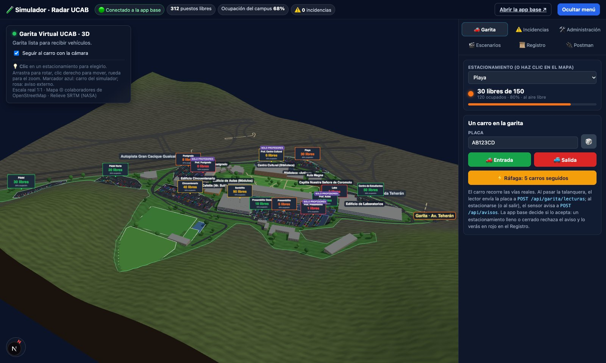
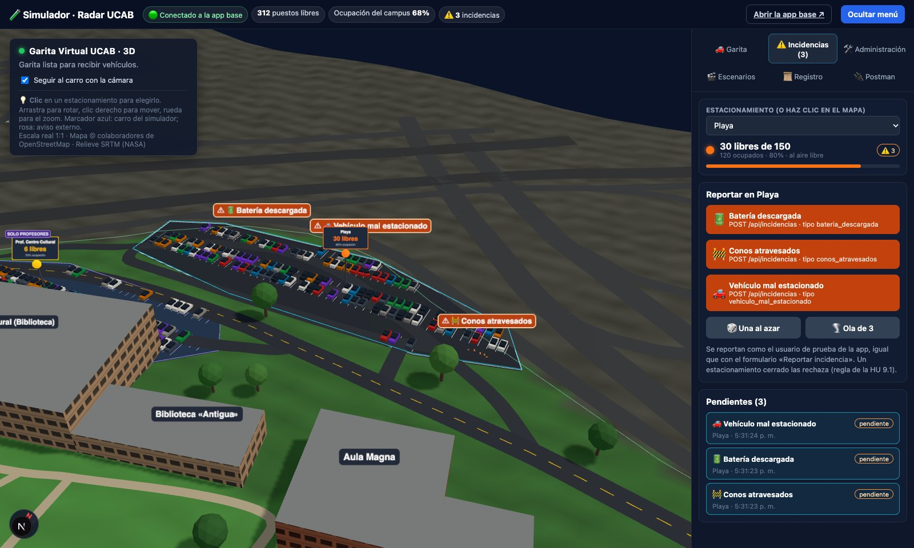
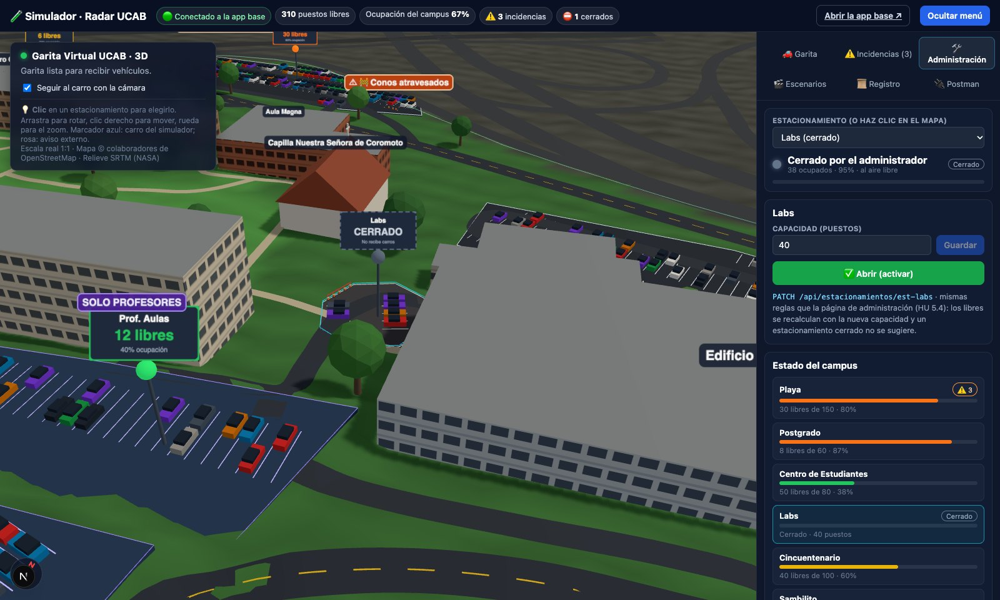
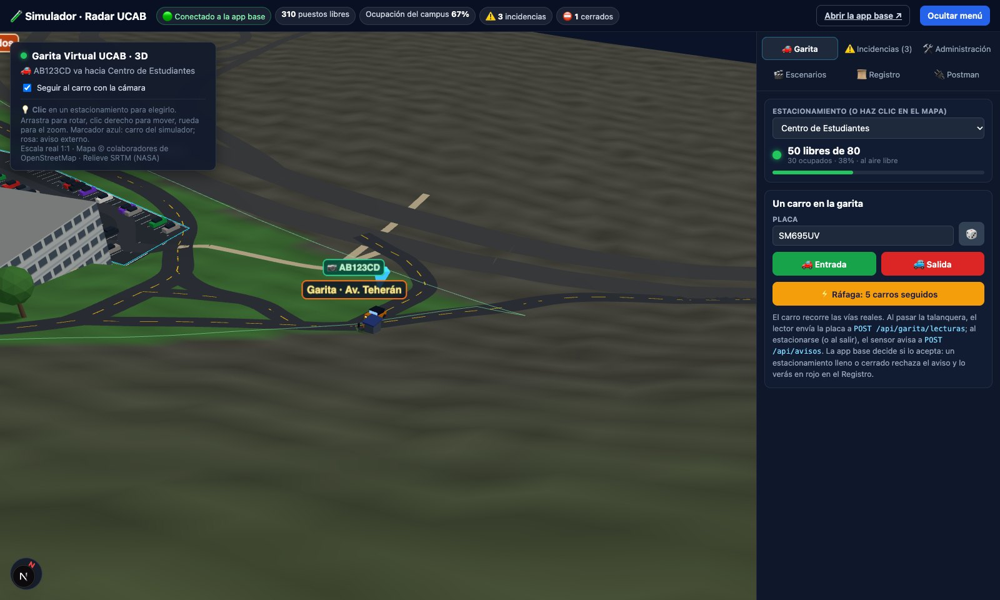
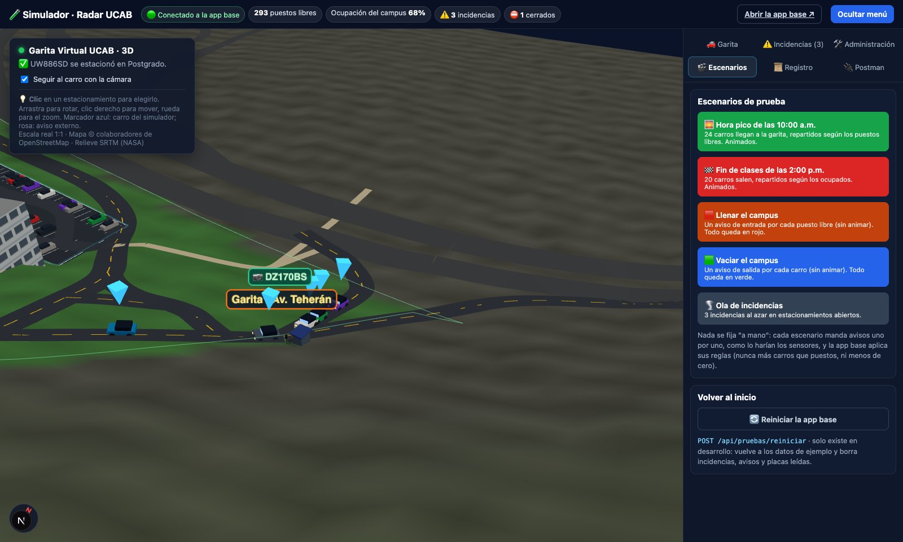
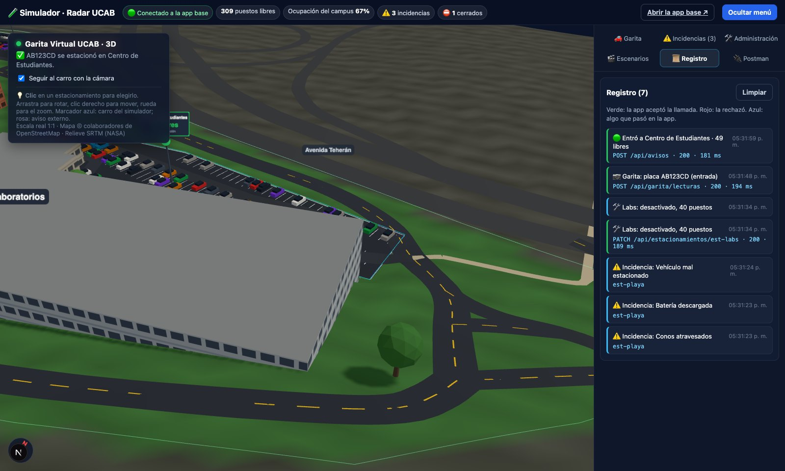
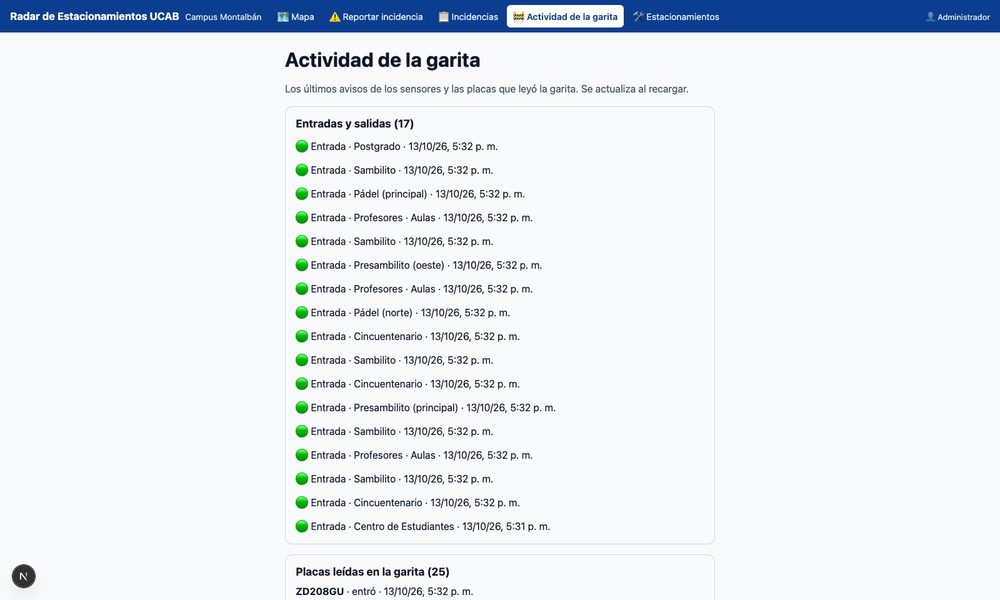
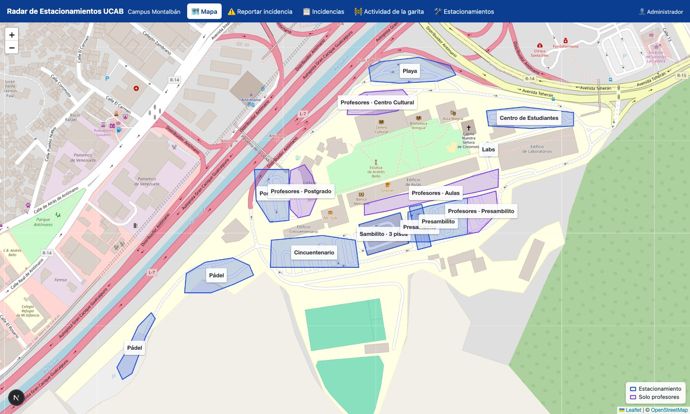

# Simulador del Radar de Estacionamientos UCAB

Un **mundo virtual en 3D** del Campus Montalbán, con dimensiones reales (1 unidad = 1 metro).
Le hace a la app base lo mismo que le pasaría en la realidad:

- carros que entran y salen;
- placas que lee la garita;
- incidencias que reportan los conductores;
- cambios que hace el administrador.

Después muestra cómo reacciona la app.

**No es parte de la app.** Es una extensión aparte que solo usa la API pública de la app base,
igual que lo haría Postman, un sensor o una persona. La app no sabe que el simulador existe.

```
 Postman ──────────┐
                   ├── HTTP (API pública) ──►  APP BASE  ── canal en vivo ──► Simulador 3D
 Simulador 3D ─────┘   avisos, placas,          (Radar)     GET /api/eventos   (lo dibuja)
                       incidencias, admin
```

## Cómo abrirlo

1. La app base, en una terminal:

   ```bash
   cd RadarEstacionamientos_code
   npm install
   npm run dev          # http://localhost:3000
   ```

2. El simulador, en otra terminal:

   ```bash
   cd RadarEstacionamientos_simulador
   npm install
   npm run dev          # http://localhost:3001
   ```

3. **Entra a la app** en el mismo navegador: http://localhost:3000/entrar con
   `admin.prueba@ucab.edu.ve` / `123456789` (administrador, solo existe en desarrollo). Las
   incidencias, la administración y el reinicio van con esa sesión (HU 1.1); sin ella, la app
   responde 401 o 403 y el Registro lo muestra en rojo. La garita y los sensores no la necesitan:
   usan la clave de sensores.

Si la app base corre en otra dirección o con otra clave de sensores, copia `.env.example` como
`.env.local` y cámbialas.

## El menú

| Pestaña | Qué hace | Llamada a la app base |
|---|---|---|
| 🚗 **Garita** | Manda un carro (o una ráfaga de 5) a entrar o salir del estacionamiento elegido. El carro recorre las vías reales. Al pasar la talanquera se lee la placa, y al estacionarse el sensor avisa | `POST /api/garita/lecturas` y `POST /api/avisos` |
| ⚠️ **Incidencias** | Un botón por tipo (batería descargada, conos atravesados, vehículo mal estacionado), una al azar o una ola de 3. Muestra las pendientes | `POST /api/incidencias` |
| 🛠️ **Administración** | Cambia la capacidad y abre o cierra un estacionamiento. Muestra el estado de todo el campus con su semáforo | `PATCH /api/estacionamientos/:id` |
| 🎬 **Escenarios** | Hora pico de las 10:00 a.m., fin de clases de las 2:00 p.m., llenar o vaciar el campus, ola de incidencias y reiniciar | Avisos uno por uno; `POST /api/pruebas/reiniciar` (solo desarrollo) |
| 📜 **Registro** | Cada llamada con su código HTTP (verde aceptada, rojo rechazada) y lo que pasó en la app | — |
| 🔌 **Postman** | Las mismas llamadas listas para copiar | — |

- **Elegir un estacionamiento:** haz clic sobre él en el mapa.
- **Marcadores:** azul es un carro del simulador; rosa, un aviso que llegó de afuera (Postman, otro simulador).
- **Lo que pasa en la app también se ve:** si alguien reporta una incidencia desde el formulario de la app o el administrador cierra un estacionamiento, el simulador lo muestra al instante.

## La maqueta para la app (`/maqueta`)

http://localhost:3001/maqueta fotografía la escena con estilo de maqueta física (grama, árboles,
techos de teja y concreto, puestos pintados), en cámara casi cenital, y con **Exportar** guarda
`exportes/maqueta-campus.jpg` y `exportes/maqueta-campus.json` (dónde cae cada estacionamiento y
edificio en la imagen). Se copian a la app: `public/maqueta/campus.jpg` y `data/maqueta.json`.
Necesita la app base corriendo (le pide los estacionamientos). Ver D-007 › Maqueta.

## Postman

Importa `postman/Radar_UCAB_app_base.postman_collection.json`. Trae los avisos de sensores, el
lector de placas, las incidencias, la administración, las consultas y el reinicio. Las variables
son `urlBase`, `claveSensor` y `estacionamiento`. Lo que mandes desde Postman llega a la app
base como si fuera real, y el simulador lo dibuja.

Las incidencias, la administración y el reinicio piden sesión: entra a la app en el navegador,
copia el valor de la cookie `radar_sesion` (herramientas del navegador › Aplicación › Cookies) y
agrégala en Postman como encabezado `Cookie: radar_sesion=<valor>`.

## Cómo se ve

**El simulador conectado a la app base** (barra de arriba: puestos libres, ocupación,
incidencias y estacionamientos cerrados).



**Incidencias** reportadas en la Playa: cada una se dibuja donde ocurre, con su letrero.



**Estacionamiento cerrado** por el administrador: cartel «CERRADO», losa gris y conos en la entrada.



**Lector de placas:** el carro espera la talanquera y la placa leída aparece sobre la garita.



**Hora pico:** varios carros a la vez en la garita.



**Registro**, como en Postman: cada llamada con su código HTTP.



**La app base reacciona**: en «Actividad de la garita» quedan los avisos y las placas que
generó el simulador, y el menú tiene sus funciones reales.





## De dónde salen los datos del mapa

| Qué | Dónde | Fuente |
|---|---|---|
| 14 estacionamientos y su ocupación | La app base (`GET /api/estacionamientos`) | Su `data/estacionamientos.js` |
| Contorno, edificios, vías, canchas, garita | `data/campus.js` | OpenStreetMap (relación 3644537) |
| Relieve | `data/campus.js` (`RELIEVE`) | SRTM 30 m (NASA) |

- **Medidas reales del campus:** ~930 m de este a oeste × 610 m de norte a sur (~20 ha).
- **Relieve:** va de ~920 m s. n. m. (Playa, junto a la autopista) a ~975 m (canchas del sur).
- **Garita:** está en la esquina noreste, sobre la Av. Teherán.

**Qué es estimado** (por confirmar en la visita al campus):

- **Pisos de los edificios** que OSM no trae (`fuentePisos: "estimado"`). El Edificio de Aulas
  dice 12 pisos en OSM, pero se dibujan 5.
- **Árboles:** son decorativos.
- **Rectorado y Centro de Estudiantes:** no están en OSM y todavía no se dibujan.

## Código

- `app/page.js`: estado, canal en vivo y acciones del menú, todo contra la API de la app base.
- `app/api/base/[...ruta]/route.js`: puente hacia la app base. Agrega la clave de sensores en el
  servidor, para que nunca llegue al navegador.
- `components/Mapa3D.js`: la escena (Three.js). `components/PanelDeControl.js`: el menú.
- `lib/mapa3d/`: conversión GPS → metros, relieve, polígonos, puestos y rutas por las vías reales.
- `lib/escenarios.js`: qué avisos manda cada escenario. `lib/cliente_base.js`: las llamadas.
- `tests/`: distancias, orientación, rutas y escenarios (`npm test`).

Mapa © colaboradores de OpenStreetMap (ODbL). Relieve: SRTM, NASA.
